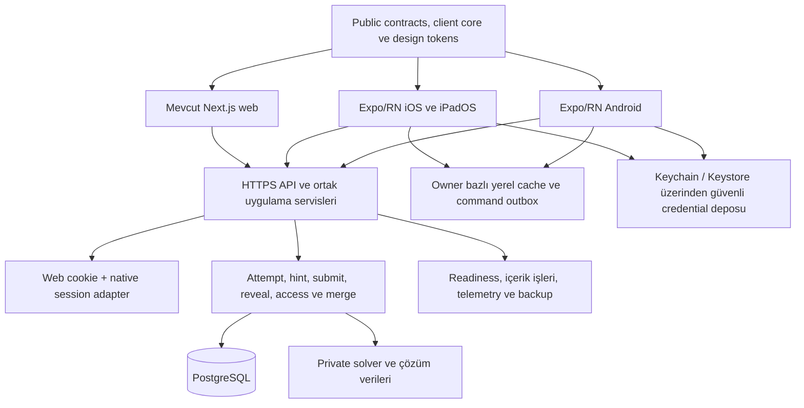

# ScoreLogic — Uçtan Uca Mobil Uygulamaya Dönüşüm Planı

> Tarih: 12 Kasım 2026 · Son uygulama güncellemesi: 14 Kasım 2026
>
> Durum: Faz 1 UX prototipi, Faz 2 native PoC kaynakları ve Faz 3 API/kimlik altyapısı ve Faz 4 native veri/navigation temeli, Faz 5 çekirdek oyun paritesi ve Faz 6 bütün oyuncu ekranları ve Faz 7 native entegrasyon/sertleştirme kaynak ve yerel test teslimi uygulandı. İmzalı build/gerçek cihaz, insan denemesi ve canlı rollout kabul kapıları açık.
>
> Hedef: Mevcut oyuncu özelliklerinin tamamını koruyan, iOS/iPadOS ve Android için mobil öncelikli uygulama.
>
> İlk analiz yalnız bu dokümanı üretti. Kullanıcının sonraki yetkilendirmesiyle karar kaydı, public tasarım tokenları, ayrı tıklanabilir UX prototipi ve testleri eklendi. Güncel uygulama/kanıt kayıtları Bölüm 21–22'de.

## 1. Önerilen yaklaşım ve başarı tanımı

**Mevcut Next.js web uygulaması ve Railway backend korunarak, Expo + React Native ile ayrı bir mobil istemci geliştirilmesi önerilir.** Oyun kuralları ve canonical kayıtlar aynı sunucuda kalır; telefon/tablet arayüzü native bileşenler ve mobil etkileşimlerle yeniden tasarlanır.

Başarı, sitenin bir uygulama penceresinde açılmasıyla değil şu sonuçlarla ölçülür:

- Guest kullanıcı login olmadan daily ve açık campaign seviyelerini oynayabilir.
- Mevcut hesap, ilerleme, campaign erişimi, hint, Check, Reveal, Analyze Board, replay, süre, streak, stats ve paylaşım davranışları iki platformda korunur.
- Klavye, dokunma, güvenli alan, sistem geri hareketi, uygulamayı kapatma/açma ve bağlantı değişimleri oyun akışını bozmaz.
- Veri ve kimlik izolasyonu, tek hint/tek işlem, sunucu doğrulaması ve geçmişin korunması web ile aynı kurallara dayanır.
- İmzalı gerçek iOS/Android build'leri cihazlarda doğrulanır; mağazalara hazır gizlilik, hesap silme, signing, dağıtım ve destek süreçleri tamamlanır.
- Mevcut web kullanıcıları ve web yayını geçiş sırasında çalışmaya devam eder.

Bu belge tamamlanmış native ürün iddiası değildir. Kullanıcı önerilen tercihlerle ilerlemeyi ve Faz 1–5 uygulamasını yetkilendirdi. Seçimler [karar kaydında](mobile/karar-kaydi.md); teknik PoC ve dış erişim doğrulaması gerektiren kapılar ayrıca izlenir.

### Okuma sırası

- Kapsam ve kaynak analizi: Bölüm 2–4.
- Mimari, API, kimlik ve senkronizasyon: Bölüm 5–8.
- Mobil arayüz ve cihaz entegrasyonları: Bölüm 9–10.
- Aşamalı uygulama, test ve yayın: Bölüm 11–15.
- Risk, süre, açık kararlar ve tamamlanma ölçütleri: Bölüm 16–19.
- Resmi dış kaynaklar: Bölüm 20.
- İlk faz uygulaması ve doğrulama: Bölüm 21 ve [Faz 1 teslim raporu](mobile/faz-1-uygulama-raporu.md).
- Native PoC/API/kimlik teslimi: Bölüm 22 ve [Faz 2–3 raporu](mobile/faz-2-3-uygulama-raporu-2026-11-13.md).

## 2. Platform kapsamı ve varsayımlar

### 2.1 İlk sürümün platform hedefi

| Platform/cihaz | Planlanan destek | Doğrulama biçimi |
|---|---|---|
| iPhone / iOS | Ana hedef | Desteklenen en eski OS + güncel OS; küçük ve büyük ekran; fiziksel cihaz |
| iPad / iPadOS | Ana hedef | Portrait/landscape, split view ve değişen pencere boyutu |
| Android telefon | Ana hedef | Alt/orta donanım ve güncel cihaz; farklı üreticiler; gesture ve üç düğmeli gezinme |
| Android tablet | Ana hedef | Uyarlanabilir iki panel; büyük font ve harici klavye |
| Android katlanabilir | Ana hedefin cihaz sınıfı | Açılma/kapanma, yeniden boyutlanma ve menteşe alanı |
| Mobil web | Korunacak mevcut ürün | Uygulama kurulu olmayanlar ve mevcut web kullanıcıları |
| HarmonyOS / OpenHarmony | Ayrı fizibilite ve yayın kararı | Native modül, build, mağaza ve cihaz testleri ayrı iş paketi |
| watchOS, Wear OS, TV, otomobil, masaüstü uygulaması | İlk sürüm kapsamı dışında | Kullanıcı ayrıca isterse ayrı ürün/arayüz planı |

“Tüm mobil platformlar”, bütün işletim sistemleri ve geçmişteki bütün telefon modelleri için otomatik garanti olarak kullanılmamalıdır. Bu planın ana kapsamı iOS/iPadOS + Android'dir. En düşük desteklenen OS sürümleri, seçilen Expo/RN sürümü ve native modüller doğrulandıktan sonra yazılı uyumluluk listesine bağlanır. OpenHarmony'nin ayrı React Native platformları arasında bulunması, Expo modüllerinin otomatik çalışacağı anlamına gelmez. [React Native diğer platformlar](https://reactnative.dev/docs/next/out-of-tree-platforms).

### 2.2 Ürün ve uygulama varsayımları

- Mevcut web ve backend kapatılmayacak; veritabanı telefonlara taşınmayacak.
- İngilizce ürün metinleri mevcut kapsamın temelidir. Metinler yerelleştirmeye uygun ayrılır; Türkçe veya başka dil eklemek ayrıca onaylanır.
- Mevcut açık renkli futbol/editoryal kimlik korunacak; mobil hiyerarşi, bileşenler ve etkileşimler yeniden tasarlanacak.
- Dark mode, push, ödeme, reklam, leaderboard, multiplayer ve tam offline solver mevcut özellik değildir; ilk parity sürümüne kendiliğinden eklenmez.
- Çevrimdışı dayanıklılık gerekir; bütün sunucu özelliklerinin internetsiz çalışması ayrı bir ürün kararıdır.
- Şirket/mağaza hesapları, bütçe, ekip ve teslim tarihi henüz doğrulanmadı. Bölüm 17'deki tahminler bu belirsizliklerle okunmalıdır.

## 3. Mevcut uygulamanın ayrıntılı analizi

### 3.1 İncelenen kaynaklar ve kanıt düzeyi

Bu çalışma kaynak kod ve mevcut proje dokümanlarının salt okunur incelemesine dayanır. Yeni build, test, canlı veri yazımı veya deployment yapılmadı. Native uygulama henüz bulunmadığı için gerçek cihazda native performans/uyumluluk doğrulaması yapılmış sayılmaz.

Başlıca kaynaklar:

| Kaynak | Analizdeki rolü |
|---|---|
| [package.json](../package.json), [next.config.ts](../next.config.ts), [app/layout.tsx](../app/layout.tsx) | Next.js 16.3, React 19.2.8, TypeScript, standalone server, request-time render |
| [Ürün kuralları](product-rules.md) | Güncel çözüm, campaign, hint, attempt, süre, merge ve istatistik semantiği |
| [API sözleşmeleri](phase-0/api-contracts.md), [lib/api/client.ts](../lib/api/client.ts) | Mevcut endpoint'ler, DTO ve web transport |
| [lib/contracts](../lib/contracts), [lib/puzzles/campaignConfig.ts](../lib/puzzles/campaignConfig.ts) | Public/private model ayrımı ve pack politikaları |
| [DailyPuzzleExperience](../components/puzzle/DailyPuzzleExperience.tsx), [usePuzzle](../hooks/usePuzzle.ts), [puzzleStore](../store/puzzleStore.ts) | Oyun orkestrasyonu, timer, taslak, assist ve mutation yaşam döngüsü |
| [Auth config](../lib/auth/config.ts), [anonymous](../lib/auth/anonymous.ts), [anonymousMerge](../lib/auth/anonymousMerge.ts) | Cookie/Auth.js, credentials ve canonical guest merge |
| [Attempt sorguları](../lib/db/queries/attempts.ts), [submit receipt](../lib/db/queries/submissions.ts) | Sahiplik, kilitler, terminal durum ve idempotency |
| [globals.css](../app/globals.css), [Design system](design-system.md), [components](../components) | Mevcut görsel kimlik, responsive ve DOM bağımlılıkları |
| [Deployment](deployment.md), [railway.toml](../railway.toml), [health](../app/api/health/route.ts) | Migration/content release, minimum env ve readiness |
| [Playwright config](../playwright.config.ts), [CI](../.github/workflows/ci.yml), [testler](../tests) | Mevcut doğrulama altyapısı ve native test boşluğu |

Son uygulama kaydında 315 unit, 7 PostgreSQL integration ve 60 browser testi geçtiği belirtiliyor. Bu, 12 Kasım düzeltmelerinin tarihsel doğrulama kaydıdır; bu plan çalışmasında yeniden test yapılmadı ve bu sayılar native cihaz testi değildir. [Son uygulama kaydı](feedback-uygulama-plani-2026-11-09.md#20-hint-modalinin-otomatik-açılması-daily-gün-devri-ve-120-dakika-sınırı--12-kasım-2026).

### 3.2 Korunacak güçlü temel

- Daily ve campaign için aynı solve-any doğrulama modeli var.
- Public puzzle DTO, private çözüm kümesinden ayrılıyor.
- Attempt sahipliği, kullanıcı/attempt kilitleri, canonical completion ve aggregate rebuild var.
- Submit idempotency receipt'i; hint requestId ve beklenen hint sayısı kontrolü mevcut.
- Guest ilerlemesi hesaba transaction içinde taşınıyor; geçmiş doğrudan aggregate toplamasıyla birleştirilmiyor.
- Campaign'in beş paketi, otuzar seviye ve erişim politikaları veri/servis katmanında tanımlı.
- Editorial review, içerik QA, immutable revision, daily buffer ve readiness mevcut.
- Son düzeltmelerde hint modalinin başarıda kapanması, daily saatinin puzzle'a bağlanması ve 120 dakika sınırının kaldırılması uygulanmış.

Bu son maddeler açık bug listesine yeniden yazılmamalı; native sürümde korunacak regresyon kriterleridir.

### 3.3 Mobil dönüşüm için somut açıklar

| ID | Kaynakta doğrulanan durum | Mobil uygulama etkisi | Planlanan iş |
|---|---|---|---|
| A01 | Next standalone; request kullanan layout ve Route Handler'lar | Sunucu çalışma zamanı native bundle içine alınamaz | Backend korunur; mobil istemci ayrı oluşturulur |
| A02 | API client göreli /api yolları kullanıyor; JSON doğrudan tipe çevriliyor | Native'de API adresi, kimlik, timeout ve response doğrulaması eksik | Platformdan bağımsız, sürümlenmiş transport |
| A03 | Credentials + Auth.js JWT/cookie; native session lifecycle endpoint'i yok | Mobil login, refresh, revoke ve guest kimliği tasarlanmalı | Ayrı native session adapter |
| A04 | localStorage tabanlı owner draft ve UI state | Async native hydration, process kill ve migration ele alınmamış | Native persistence ve hydration gate |
| A05 | Hint kimliği ref belleğinde; submit anahtarı eylem sırasında üretiliyor | Uygulama ölünce belirsiz işlemin güvenli retry bilgisi kaybolabilir | Kalıcı command outbox ve aynı payload/key |
| A06 | Progress conflict ve yerel draft tercihi timestamp kullanıyor | Saat kayması/çok cihaz, veri üstünlüğünü yanlış belirleyebilir | Server revision/baseRevision ve açık reconcile |
| A07 | window/pagehide/document visibility ve browser focus kullanılıyor | Native lifecycle ve background timer varsayımları geçersiz | AppState, online/focus ve timer adaptörleri |
| A08 | Rate limiter cookie veya proxy IP üzerinden kimlik seçiyor | Native oturumlar yanlış ortak/IP kovasına düşebilir | Doğrulanmış native principal + IP koruması |
| A09 | İki satırlı üst gezinme ve yoğun puzzle başlığı | Küçük ekranda oyundan önce fazla dikey alan kullanılıyor | Alt sekmeler ve kompakt oyun kabuğu |
| A10 | AnalyzeBoard'da 650px minimum tablo; küçük metrik yazıları | Mobilde yoğun yatay kaydırma ve okunabilirlik sorunu | Telefon için metrik kartları; tablet tablo |
| A11 | PuzzleHeader'da Checks değeri visibleErrors | Kontrol sayısı ile hata sayısı karışıyor | Errors etiketi veya gerçek submission sayısı kararı |
| A12 | DOM number input, textarea, Next Link, Framer Motion, navigator.share | Bileşenler native'e doğrudan taşınamaz | Native UI ve platform adaptörleri |
| A13 | NumPad bileşeni var, ekrandan kullanılmıyor | Mevcut keypad varmış gibi plan yapılamaz | Klavye seçimi UX prototipinde yapılır |
| A14 | CSS'te font aile isimleri var; font yükleme/asset'i görülmedi | Cihazlarda aynı fontun bulunduğu varsayılamaz | Yerel font/izin/fallback ve boyut testi |
| A15 | Hesap silme, refresh/revoke ve password recovery endpoint'i yok | Mağaza ve hesap yaşam döngüsü işleri eksik | Zorunlu deletion + session; recovery ayrı karar |
| A16 | Playwright üç browser projesi tanımlıyor; CI yalnız Chromium kuruyor | Üç projenin CI güvencesi mevcut sayılmaz | WebKit kurulumu ve native CI kapıları |

A09–A14 kaynak kod bulgularıdır; bu çalışma sırasında fiziksel telefonda gözlenmiş hata olarak sunulmaz. Örnek konumlar: AnalyzeBoard satır 253; PuzzleHeader satır 160–162; API client satır 133–150; progress route satır 38–52; CI satır 147–151.

## 4. Tam özellik paritesi matrisi

Aşağıdaki maddelerin tamamı ilk genel mobil yayının kapsamındadır. Dikey PoC bunların küçük bir bölümünü doğrular; PoC'nin bitmesi tam ürünün bitmesi değildir.

| ID | Mevcut özellik | Mobil karşılığı ve korunacak davranış | Kabul kanıtı |
|---|---|---|---|
| P01 | Guest giriş ve devam | Hesap duvarı olmadan güvenli mobil guest session | İlk kurulumdan daily ve her pack'in level 1'ine erişim |
| P02 | Home ve rehber | Kompakt ana ekran; bugünkü oyun, devam ve yeniden açılabilir rehber | Rehber kapanır/açılır; mevcut açıklama ve örnekler erişilebilir |
| P03 | Daily | Sunucunun business date'ine ait içerik | Türkiye dışı cihaz timezone'unda da aynı doğru daily |
| P04 | Campaign | Beginner/Easy/Medium/Hard/Expert; 5×30 seviye; Previous/Next ve pack sınırı geçişleri | Her pack'in ilk seviyesi açık; sıralı unlock ve komşu açık seviyeye geçiş korunur |
| P05 | Başlangıç desteği | Given skorlar, pack/level prefill ve feedback politikaları | Beginner 1–3/4–15/16–30; diğer pack'ler için fixture doğrulaması |
| P06 | Final Table | Değişmez kaynak tablo ve bütün gerekli metrikler | Skor girerken tablo değişmez; erişilebilir okuma |
| P07 | Skor/not girişi | 12 skor hücresi, 6 maç, 0–19, boş değer ve maç notları | 0/9/10/19, silme, readonly skor ve not kalıcılığı |
| P08 | Autosave/devam | Yerel kayıt + canonical progress sync | Restart/OS kill sonrası kalıcı yazımı tamamlanmış revision geri yüklenir |
| P09 | Hint | Bir skor açma veya bir çelişkili dolu hücreyi düzeltme | Bir eylem bir hücre/sayaç; retry aynı işlem; başarıda sheet kapanır |
| P10 | Check | Geçerli çözümlerden herhangi birini kabul; pack'e uygun feedback | Alternatif doğru çözüm kabul; hata bilgisinde seviye politikasının aşılmaması |
| P11 | Reveal | Yardımlı cevap gösterme; normal solve/unlock üretmeme | Terminal reveal ayrı; sonraki seviye kendiliğinden açılmaz |
| P12 | Analyze Board | Beginner 1–3 guided, 4–15 assisted; diğerlerinde kapalı | Snapshot, SAT/UNSAT/UNKNOWN; giriş değişince analiz eskir |
| P13 | Reset/replay | Yeni attempt; first/best/history ve unlock korunur | Belirsiz retry ikinci replay yaratmaz; unique solve artmaz |
| P14 | Süre ve gün devri | Sunucu duvar saati, puzzle'a bağlı timer, 120 dk üstü kullanım | >120 dk Check/Reveal; ertesi gün yeni timer; eski taslak korunur |
| P15 | Stats/streak | Mevcut solved, attempt, perfect, assisted, difficulty ve süre metrikleri | Web ve mobil aynı hesap için aynı canonical değerler |
| P16 | Son attempt'ler | Mevcut son altı kaydın karşılığı | Doğru durum, pack/daily kimliği ve süre |
| P17 | Hesap/kayıt/çıkış | Mevcut e-posta/şifre ve guest → yeni/mevcut hesap merge | A → logout → guest → B sırasında veri sızıntısı yok |
| P18 | Paylaşım/davet | Kimlik, süre, hint, spoiler'sız grid ve exact puzzle HTTPS link | Native share; cancel yan etkisiz; kilitli link kuralları korunur |
| P19 | Hata/yardım/loading | Mevcut açıklamalar ve erişilebilir loading/empty/error/retry | Veri yokken sahte sıfır stats veya sahte başarı yok |
| P20 | Sunucu operasyonları | İçerik üretimi, QA, editorial, migration, daily buffer, backup | Backend'de korunur; mobil consumer uygulamasına admin ekranı eklenmez |

İlk sürüm için ayrıca gereken mobil teslim işleri: uygulama kabuğu, cihaz güvenli depolaması, deep links, session yenileme/iptal, hesap/guest verisi silme, destek/gizlilik ekranları, signing ve mağaza dağıtımıdır. Bunlar mevcut oyun kapsamının yerine geçmez.

## 5. Mimari seçenekleri ve önerilen karar

### 5.1 Seçenek karşılaştırması

| Yaklaşım | Yeniden kullanım | Mobil UX | Ana maliyet/risk | Değerlendirme |
|---|---|---|---|---|
| Expo + React Native + mevcut backend | TypeScript kontratları, public config, formatlayıcılar, test/domain kararları | Native ekran, klavye, navigation ve erişilebilirlik kontrolü | UI yeniden yapılır; native auth/storage gerekir | Önerilen |
| Capacitor + paketlenebilir ayrı web istemcisi | DOM/CSS paylaşımı daha yüksek | İyi optimize edilirse mümkün; WebView davranışları sürer | SSR ayrıştırma, keyboard/safe-area/cookie/origin yönetimi | Zaman/bütçe önceliği değişirse alternatif |
| Railway sitesini remote WebView'de açmak | En yüksek kısa vadeli web reuse | Ağ ve web kabuğuna bağımlı | Native kalite ve minimum functionality riski | Ana yayın mimarisi olarak önerilmez |
| Swift + Kotlin | Backend/kontratlar | Tam platform kontrolü | İki UI kod tabanı ve daha yüksek ekip yükü | Mevcut React yatırımı için öncelikli değil |
| Flutter | Backend/kontratlar | Native benzeri ayrı UI | Dart ve ayrı client/domain uyarlaması | Geçerli ama burada daha düşük yeniden kullanım |

Bu bir kaynak kod ve ürün hedefi değerlendirmesidir; seçeneklerin performansı bu projede henüz benchmark edilmedi. React Native'in resmi rehberi yeni projelerde framework yaklaşımını öneriyor. [React Native başlangıç rehberi](https://reactnative.dev/docs/environment-setup).

### 5.2 Next.js ve Capacitor sınırı

Mevcut RootLayout request-time render yapıyor; API ve Prisma sunucu çalışma zamanı istiyor. Standalone çıktı bir mobil statik asset klasörü değildir. Web'i doğrudan statik export'a çevirmek; cookie, request kullanan handler ve server davranışlarını taşımaz. Backend'i ayrı sunucuda bırakıp ayrı paketlenebilir frontend oluşturmak ise mümkündür. [Next.js statik export sınırları](https://nextjs.org/docs/app/guides/static-exports#unsupported-features).

Capacitor'ın external server URL seçeneği resmi config'te live reload için tanımlıdır ve production için önerilmez. Bu nedenle bir Railway URL'sini server.url alanına yazmak ana teslim planı olamaz. Bu, Capacitor uygulamalarının yasak olduğu anlamına gelmez. [Capacitor config](https://capacitorjs.com/docs/config).

Apple 4.2, uygulamanın yeniden paketlenmiş web sitesinin ötesinde uygun arayüz ve değer sunmasını ister. Native framework seçmek tek başına mağaza onayını garanti etmez. [App Review Guidelines](https://developer.apple.com/app-store/review/guidelines/).

### 5.3 Önerilen katmanlar

### 5.4 Paketleme ve kod paylaşımı

İlk adımda çalışan web'i kökten taşımak gerekmez. Önerilen başlangıç düzeni:

    ScoreLogic/
      app/, components/, lib/, prisma/, scripts/   mevcut web/backend
      apps/mobile/                                yeni native istemci
      packages/contracts/                         public DTO ve validation
      packages/client-core/                       transport, hata ve command modeli
      packages/game-state/                        platformdan ayrılmış state/view-model
      packages/design-tokens/                     renk, tipografi ve spacing tanımları

Sonradan apps/web düzenine geçilirse Railway root path, migration yolu, standalone file tracing, env yükleme ve CI ayrı bir kontrollü refactor olarak doğrulanır. Mobil geliştirmeyi açmak için web deployment'ını aynı anda taşımak zorunlu değildir.

| Paylaşılabilir | Adaptörle ayrılacak | Sunucuda kalacak |
|---|---|---|
| Public DTO, public config, süre/share formatları | API transport ve credential erişimi | Prisma ve DB bağlantısı |
| Campaign durum/view-model kuralları | Persistence ve async hydration | Generator, editorial ve QA pipeline |
| Hata kodları ve public response şemaları | Timer, lifecycle ve network durumu | Private solver/solution/allSolutions verileri |
| Platformdan bağımsız reducer/state testleri | Share, clipboard ve link yönlendirmesi | Canonical hint/check/reveal/merge kararları |
| Tasarım tokenları ve metin anahtarları | DOM/Next bileşenlerinin native karşılıkları | Secret'lar, signing ve privileged admin işlemleri |

Bütün lib klasörü mobil pakete import edilmez. TypeScript'in saf olması, her modülün client'a taşınabileceği anlamına gelmez. Public puzzle okumalarında çözüm bulunmaz; mevcut açık Reveal yanıtının cevap içermesi yetkilendirilmiş ürün davranışıdır ve ayrı değerlendirilir.

Monorepo'da React/native modül sürüm çoğalması, Metro resolution, peer dependency ve TypeScript alias'ları kontrol edilir. Web'in React sürümü, Expo'nun beklediği sürümle zorla eşitlenmez; destek matrisi PoC'de sabitlenir. [Expo monorepo rehberi](https://docs.expo.dev/guides/monorepos/).

### 5.5 Başlangıç teknoloji adayları

- Expo + React Native; navigation için Expo Router/native stack.
- State/view-model için mevcut Zustand yaklaşımının platformdan ayrılmış hali.
- Server cache için TanStack Query; native focus/network adaptörüyle.
- Credential için Expo SecureStore; public cache/draft/outbox için transaction destekli Expo SQLite.
- UI için native bileşenler + ortak design tokens. Tailwind sınıflarını birebir dönüştürme hedefi yok.
- Native component testleri için React Native Testing Library; cihaz E2E için Maestro veya Detox'tan PoC'de seçilecek tek ana araç.
- Hata izleme için mevcut sunucu Sentry düzenine bağlı native SDK; release/build/OS etiketleri ve privacy filtreleri.
- Build için yerel Xcode/Gradle veya EAS Build; EAS ücretli bulut kullanımı mimarinin zorunlu şartı değil.

13 Kasım uygulamasında Expo 58.0.25, RN 0.88.1, React 19.3.0 ve Node 22 seçildi; native lockfile sabitlendi. iOS/iPadOS kaynak alt sınırı 16.4, Android API 24; compile/target 37/36, Expo build gereksinimi Xcode 26.4+. Kesin araç matrisi ve kaynak/cihaz kanıtı ayrımı [Faz 2–3 raporunda](mobile/faz-2-3-uygulama-raporu-2026-11-13.md). [Resmi SDK matrisi](https://docs.expo.dev/versions/v58.0.0/). PoC, yalnız Expo Go'da değil uygulamanın kendi development build'lerinde doğrulanır. [Development builds](https://docs.expo.dev/develop/development-builds/introduction/).

## 6. API ve kimlik doğrulama dönüşümü

### 6.1 Sürümleme ve uygulama servisleri

Önerilen hedef, native için kararlı bir /api/v1 sözleşmesidir. Mevcut web route'ları geçişte korunur ve aynı uygulama servislerine bağlanır; oyun iş kuralları iki kez yazılmaz.

Yapılacaklar:

1. Route içindeki auth/HTTP işlemleriyle domain/transaction servislerini ayırmak.
2. Public response şemalarını client ile paylaşmak; runtime validation eklemek.
3. Client build/API version bilgisini hata ve uyumluluk akışına bağlamak.
4. Additive DTO değişiklikleriyle başlamak; eski mobile client destek penceresi tanımlamak.
5. Puzzle cache kimliğinde physical id kullanmak; contentKey/contentRevision bilgisini açık public sözleşmeye eklemeyi değerlendirmek.
6. Retired, silinmiş veya artık kilitli link için kontrollü hata/güncel sürüm yönlendirmesi tasarlamak.
7. Saat/gün bilgisi için serverNow, businessDate, timeZone ve nextDailyAt gibi alanları sürümlü config/daily yanıtında tanımlamak.
8. Mevcut hata kodlarını koruyup mobile bağlantı, session, version, conflict ve maintenance durumlarını açıklaştırmak.

Revision yalnız yeni native endpoint'ine eklenmez. Web ve native progress, hint, submit,
reveal ve reset/replay dahil bütün canonical writer'lar aynı transaction/kilit altında
aynı monotonic revision'ı ilerletir. Web client da baseRevision/reconcile modeline
uyarlanır veya legacy writer'lar için açık, güvenli uyumluluk politikası uygulanır.
Native CAS kontrolü varken eski web autosave'inin onu kontrolsüz ezmesine izin verilmez.

Yeni endpoint isimleri tasarım önerisidir; bugün varmış gibi kabul edilmemelidir.

| Alan | Mevcut temel | Planlanan native sözleşme |
|---|---|---|
| Guest | Cookie oluşturma | Güvenli guest session oluşturma/yenileme |
| Auth | Register + Auth.js Credentials | Native login/register/refresh/logout/revoke |
| Hesap | Mevcut user/stats/progress | Hesap ve guest verisi silme; işlem durumunun doğrulanması |
| Puzzle | Daily/id/campaign GET | Sürüm, zaman ve revision davranışı belirli public okumalar |
| Attempt | STANDARD/REPLAY start | Retry-safe start/reset/replay ve aktif attempt reconcile |
| Progress | PUT snapshot | baseRevision ile compare-and-set ve conflict response |
| Submit | Idempotency-Key receipt | Kalıcı client command kimliği + eski yanıt/terminal state çözümleme |
| Hint | requestId + expectedHintCount | Aynı eylem kimliğiyle process-kill sonrası retry |
| Reveal | Terminal answer işlemi | Kayıp yanıt sonrası ikinci işlem yerine state/receipt reconcile |
| Stats | User stats + cursor progress | Owner-scoped cache ve web ile aynı canonical değerler |

### 6.2 Native session tasarımı

Web'in HttpOnly cookie, Auth.js ve CSRF davranışı korunur. Native için login/refresh/revoke yaşam döngüsünün henüz bulunmadığı esas alınır; Auth.js bağımlılığının bir Bearer token decode edebilmesi, hazır bir mobile session sözleşmesi değildir.

Önerilen model:

- Guest ve authenticated kullanıcı için doğrulanmış principal üreten session adapter.
- Kısa ömürlü imzalı access token; döndürülen ve sunucuda hash'i tutulan opaque refresh token.
- Rotation, token reuse tespiti, cihaz/session iptali ve logout sonrası geçersizleşme.
- Principal çözümlemesinde session status/version veya eşdeğer sunucu revocation kontrolü.
  Yalnız refresh token'ı silmek, eldeki imzalı access token'ı anında geçersiz kılmaz.
  Logout/hesap silme kabul testi eski access token'la owner API erişimini de denetler.
- Eşzamanlı 401 yanıtlarında tek refresh isteği; diğer işlemler onun sonucunu bekler.
- Refresh yanıtının kaybı için güvenli retry protokolü; yanlışlıkla her cihazdan logout üretmeyen tasarım.
- Account token ve guest credential yalnız güvenli credential deposunda; URL, log veya oyun taslağında bulunmaz.
- Süre, issuer/audience ve anahtar rotasyonu Faz 0 tehdit modeliyle kesinleştirilir; bu belge key/secret üretmez.

Mobilde API çağrısı için açık HTTPS base URL, auth header, timeout/cancellation ve sınırlı backoff gerekir. Hint/submit/reveal gibi mutasyonlar sıradan GET retry politikasıyla yeniden başlatılmaz.

Native fetch, browser CORS kısıtına tabi değildir. Native'i çalıştırmak adına herkese açık wildcard CORS veya kapatılmış web CSRF kontrolleri önerilmez. Expo web veya WebView alternatifi seçilirse origin ve credential modeli ayrıca tasarlanır.

### 6.3 Guest → account ve cihazlar arası süreklilik

- Mevcut merge servisi ve identity lock sırası korunur.
- Native guest'in sahipliği güvenli credential ile kanıtlanır; body'deki user id kimlik doğrulaması değildir.
- Başarılı merge tamamlanmadan guest verisi/credential silinmez.
- Login/merge öncesinde bir kimlik geçiş bariyeri kurulur: pending/unknown guest komutları
  reconcile edilir; yerel taslaklar gönderilir veya kalıcı transfer kaydıyla korunur.
  Sunucu yalnız kendisine ulaşmış veriyi birleştirebildiği için unsynced notlar ayrıca
  korunur. Merge sonrası owner değişimi sunucu receipt'iyle doğrulanır; kayıp merge
  yanıtı ve client kill durumunda kaynak guest silinmiş olsa bile işlem kurtarılabilir.
- Hesap A'nın cache/outbox/draft'ı hesap B'ye veya yeni guest'e gönderilmez.
- Web ve native aynı hesapla login olduğunda aynı server history ve campaign erişimini görür.
- Tarayıcı guest cookie'si native uygulamaya otomatik taşınmaz. Hesapsız web → native anonim aktarım bugün mevcut değildir; ayrı bir özellik olarak onaylanmadıkça vaat edilmez.
- Reinstall sonrası anonim ilerlemenin kurtarılması garanti edilmez; hesapla kaydetme seçeneği açık anlatılır.

### 6.4 Mağaza için hesap/veri silme

Hesap oluşturma sunan uygulamalar için uygulama içinden silme başlatma akışı gerekir. Apple rehberi otomatik guest hesaplarını da kapsar. Google ayrıca uygulama dışından erişilebilir bir web silme talep adresi ister. [Apple deletion rehberi](https://developer.apple.com/help/app-review/guideline-reference/5-1-1-account-deletion/), [Google deletion gereksinimi](https://support.google.com/googleplay/android-developer/answer/13327111?hl=en).

İş paketi:

- Hesap ve guest için anlaşılır silme/confirmation ekranı.
- Gerekli yeniden doğrulama ve oturum iptali.
- User, attempt, completion, submission, merge receipt ve kişisel not ilişkileri için deletion/anonymization politikası.
- Yedeklerdeki veri yaşam döngüsü, retention ve geri yükleme sonrası silinmiş hesabın canlanmasını önleme.
- Tamamlanma/bekleme durumunun kullanıcıya gösterilmesi; yalnız logout veya local cache temizliğinin silme olarak sunulmaması.
- Support, privacy ve web deletion URL'lerinin gerçek çalışan sayfalara bağlanması.
- Silme sonrasında credential/outbox/draft temizliği; kullanıcı yeniden oynamayı açıkça
  istemeden startup'ın hemen yeni bir guest hesabı oluşturmasının önlenmesi.

Password reset ve e-posta doğrulaması mevcut özellik değildir. Üretim hesap dayanıklılığı açısından önerilen ayrı kararlardır; seçilirse mail sağlayıcısı, rate limit, token ve recovery testleri kapsamlandırılır. Social login eklenirse mağaza auth politikaları ayrıca değerlendirilir.

## 7. Yerel veri, offline ve işlem güvenliği

### 7.1 Depolama sınıfları

| Veri | Hedef depo | Kural |
|---|---|---|
| Access/refresh/guest credential | SecureStore/Keychain/Keystore | Oyun DB'sine veya genel loglara yazılmaz |
| Public puzzle/cache | SQLite | Physical id, revision ve schema version ile |
| Skor/not taslağı | Owner-scoped SQLite | Yazım bekliyor/kaydedildi durumu; atomik yazım ve migration |
| Bekleyen command/receipt | Owner + attempt bazlı SQLite outbox | Göndermeden önce command UUID ve değişmez payload saklanır |
| Seçili hücre, sheet açık mı, animasyon | Geçici UI state | İşlem receipt'i veya canonical progress yerine kullanılmaz |
| Basit UI tercihleri | Native key/value adapter | Credential ve kritik outbox verisinden ayrı |

SecureStore'un reinstall/backup davranışı iOS ve Android'de aynı değildir; tek kurtarma kaynağı olarak kullanılmaz. SQLite veya AsyncStorage'ın varsayılan olarak şifreli olduğu kabul edilmez. Notların gizlilik modeline göre SQLCipher/at-rest encryption gereksinimi ayrıca kararlaştırılır. [SecureStore](https://docs.expo.dev/versions/latest/sdk/securestore/), [React Native güvenlik](https://reactnative.dev/docs/security), [Expo SQLite](https://docs.expo.dev/versions/latest/sdk/sqlite/).

Kayıpsız geri yükleme ölçütü, yerel disk transaction'ı tamamlanmış son revision içindir.
OS, input event'i ile async disk yazımı arasındaki anda uygulamayı öldürürse henüz
kaydedilmemiş son karakter mutlak garanti edilemez. Kayıt bekleyen durum görünür olmalı;
bu pencere ölçülüp küçültülmelidir. Network'e command göndermek için command'ın yerel
kalıcı kaydı tamamlanmış olmalıdır.

### 7.2 İlk sürüm offline sözleşmesi

| Durum | Kullanıcıya sunulacak davranış |
|---|---|
| Uygulama offline açıldı; cache var | Son bilinen public içerik ve o owner'ın taslağı açılır |
| Cache olmayan puzzle offline istendi | Anlaşılır offline ekranı; uydurma puzzle/ilerleme yok |
| Skor/not düzenleme | Yerelde sürer; senkron beklediği görünür |
| Hint/Check/Reveal offline başlatılmak istendi | Sunucu gerektiği açıkça gösterilir; sahte sonuç/hint tüketimi yok |
| İstek gönderildi, yanıt kayboldu | İşlem unknown durumuna alınır; aynı command/receipt ile çözülür |
| Bağlantı döndü | Önce session/daily/attempt yenilenir; sonra güvenli reconcile yapılır |
| Hesap değişti | Eski owner'ın işlemleri karantinada kalır; yeni kimlikle gönderilmez |
| Backend bakımda | Yerel düzenleme korunur; resmi sonuç için yeniden bağlantı beklenir |

Tam offline hint, solver veya resmi completion/streak üretimi bu kapsamda değildir. Mobil uygulama kabuğu ve veri dayanıklılığı offline çalışır; sunucuya bağlı özellikler bağlantı geldiğinde kullanılabilir hale gelir.

### 7.3 Kalıcı command protokolü

1. Kullanıcının bir eylemi için tek command UUID oluştur.
2. Owner, attempt, işlem tipi, payload hash, baseRevision ve payload'ı göndermeden önce kalıcı yaz.
3. Pending durumundayken ikinci aynı eylemi başlatma.
4. Yanıt geldiyse receipt/canonical state ile ack kaydet.
5. Timeout veya process kill sonrası yeni UUID üretme; önce mevcut işlemi reconcile et.
6. Retry aynı kimlik ve aynı payload ile yapılır. Daha yeni kullanıcı girdisi ayrı taslak revision'ıdır.
7. Terminal attempt'e ait gecikmiş yanıt yeni attempt'i/board'u ezemez.
8. Autosave snapshot'ları birleştirilebilir; hint/submit/reveal gibi kullanıcı eylemleri otomatik yeni işlemlere dönüştürülemez.

Önerilen işlem durumları: idle → pending → acknowledged; belirsizlikte pending → unknown → reconciling → acknowledged/rejected. Native outbox, sadece bir React ref veya bellek içi retry listesi olamaz.

### 7.4 Çok cihaz ve conflict çözümü

Cihaz timestamp'i tek üstünlük ölçütü olmamalıdır. Server revision/baseRevision ile:

- Given, hint, reveal, timer ve terminal durumlar server-authoritative kalır.
- Aynı hücreyi yalnız bir taraf değiştirdiyse o değişiklik korunabilir.
- Her iki taraf farklı değiştirdiyse kullanıcıya anlaşılır seçim sunulur; taslak atılmaz.
- Çakışan notlar otomatik birleştirilip 180 karakter sınırını aşmaz; her iki sürüm kurtarılabilir kalır.
- Campaign unlock ve istatistikler istemcide tahmin edilerek canonical yapılmaz.
- Saatin ±24 saat kaydırılması senkronizasyon üstünlüğü veya resmi solve süresi üretmez.
- Eski native istemciler için revision eklemesi geriye uyumlu veya yeni API sürümünde açılır.
- Bu politika eski web writer'larını da kapsar; aynı veri için platforma göre ayrı
  revision gerçeği tutulmaz.

## 8. Timer, daily ve native yaşam döngüsü

Resmi süre bugün sunucudaki attempt başlangıcı ile duvar saati arasından hesaplanır. Native background'a geçince resmi süreyi durdurmak bu semantiği değiştirir. İlk parity sürümünde bu kural korunur; aktif oyun süresi modeline geçmek ayrı ürün kararıdır.

| Olay | Yapılacak iş | Korunacak kural |
|---|---|---|
| Cold start | Credential ve owner DB hydration; config/daily/attempt okumaları | Başka owner'ın cache'i gösterilmez |
| Background | Son yerel düzenlemeyi kalıcılaştır; UI timer aboneliğini yönet | Network save'in tamamlanacağı varsayılmaz |
| Foreground | Session, bağlantı, server time, daily ve aktif attempt yenile | Background'da timer'ın sürekli tick etmesine güvenilmez |
| OS process kill | Restart'ta draft ve outbox geri yükle | Kayıp response yeni hint/submit yaratmaz |
| Business date değişti | Yeni daily identity ve kendi state'ini yükle | Önceki günün timer/notes/modal'ı yeni güne taşınmaz |
| Aynı puzzle refetch oldu | Server state ile reconcile | Hint sonucu tekrar sheet açmaz; geçerli düzenleme kaybolmaz |
| >120 dakika | Süre gösterimi ve action payload'ları devam eder | Check/Reveal/progress geçerliliğini korur |
| Saat/timezone değişti | Server ile yeniden hizala | Daily Europe/Istanbul business date'ine göre seçilir |
| Share/auth browser dönüşü | Gerekli query'leri yenile; navigation intent'i koru | Otomatik yeni attempt veya hint yok |

TanStack Query'nin web window focus/reconnect varsayımları native adaptör ister. AppState ve online/focus manager bağlantısı test edilmelidir. [React Native AppState](https://reactnative.dev/docs/appstate), [TanStack Query React Native rehberi](https://tanstack.com/query/latest/docs/framework/react/react-native).

## 9. Mobil arayüzü yeniden tasarlama planı

### 9.1 Görsel sistem ve temel ölçüler

- Mevcut saha yeşili, sıcak açık yüzeyler ve editoryal spor kimliği korunur.
- Ağır hero alanları ve çok katmanlı kutular yerine oyun görevi, sayısal okunabilirlik ve aksiyon hiyerarşisi öne çıkar.
- Renk/spacing/radius/typography/state token'ları platformdan bağımsız tanımlanır.
- İlk sürüm mevcut açık temayı tamamlar. Dark mode ayrı onaydır; erişilebilir yüksek kontrast ve sistem font büyütmesi ilk sürüm kriteridir.
- iOS'ta 44pt, Android'de 48dp etkileşim alanı proje hedefi olarak alınır. Simge küçük olabilir; hit area küçültülmez.
- Fontlar sistem fontuyla güvenilir fallback veya lisansı doğrulanmış yerel bundle üzerinden yüklenir.
- Given/hint/reveal/error/locked durumları renk yanında ikon, metin ve accessibility value ile ayrılır.
- Motion kısa, iptal edilebilir ve Reduce Motion'a uyumludur.
- Timer ekran okuyucuya her saniye zorla duyurulmaz.

Apple'ın erişilebilirlik ve layout rehberleri; sistem metin ölçeği, yeterli kontrol alanı ve safe-area uyumunu destekler. Buradaki ölçüler ScoreLogic'in tasarım hedefidir. [Apple accessibility](https://developer.apple.com/design/human-interface-guidelines/accessibility), [Apple layout](https://developer.apple.com/design/human-interface-guidelines/layout).

### 9.2 Navigation ve uygulama kabuğu

- Dört ana tab: Home, Campaign, Daily, Stats.
- Account/Settings ve Help, görünür bir profil/yardım erişimiyle native stack içinde açılır.
- Oyun ekranı kompakt üst başlık, puzzle kimliği, gerekli durum ve geri/pack erişimi içerir.
  Mevcut Previous/Next ve pack sınırından komşu açık seviyeye geçiş kaybolmaz.
- Alt tab bar, home indicator ve Android sistem navigation alanını dikkate alır.
- Android geri hareketi önce açık klavye/sheet'i, sonra ekranı yönetir; iOS gesture aynı navigation intent'ini korur.
- Tab değiştirme veya arka plana geçme, board reset veya yeni attempt anlamına gelmez.
- Landscape/tablet/split view düzeni gerçek pencere boyutuna göre değişir; yalnız cihaz ismi veya genişlik breakpoint'i kullanılmaz.
- Safe area, keyboard inset ve sistem bar görünümü tek AppShell katmanından yönetilir.

Android adaptive rehberi telefon, tablet, foldable ve yeniden boyutlanan pencereleri birlikte ele alır; uygulamayı yalnız portrait telefon varsayımıyla sınırlamak uygun değildir. [Android adaptive layout](https://developer.android.com/develop/adaptive-apps/guides/support-different-display-sizes).

### 9.3 Ekran bazında hedef tasarım

| Ekran | Tasarım işi | Doğrulanacak sonuç |
|---|---|---|
| Home | İlk görünümde bugünkü puzzle/Devam et, campaign devam ve rehber | Uzun marketing sayfasını kaydırmadan oyuna giriş |
| Campaign ana | Beş pack kartı, ilerleme ve açık devam aksiyonu | 150 level'ı tek uzun sayfada aramama |
| Pack detayı | Otuz level, intro/development/finale grupları ve erişilebilir durum | Grid büyürken hit area küçülmez; durum renk olmadan anlaşılır |
| Daily/oyun | Kompakt HUD, tabloya hızlı erişim, fixture ve action bar | Ana görev ekranın ilk görünümünde anlaşılır |
| Analyze | Telefon kart/accordion; tablet tablo | 650px minimum tablo telefona aynen taşınmaz |
| Stats | Dört temel metrik, ikincil değerler ve mevcut son altı kayıt | Bütün mevcut metrikler erişilebilir; sahte sıfır yok |
| Login/Register | Form ilk görünümde; guest devam, autofill ve alan hataları | Login sonrası önceki puzzle/link niyetine dönüş |
| Account/Settings | Oturum, hesap/guest silme, privacy, support, app/build bilgisi | Zorunlu mağaza ve destek işlemleri uygulama içinde bulunur |
| Help/Guide | Mevcut açıklama/örnekleri kısa bölümlere ayırma | İlk öğretici akış tekrar açılabilir; bilgi kaybolmaz |
| Sonuç/paylaşım | Native sonuç yüzeyi, doğru süre/hint ve paylaşım | Tek completion; cancel yan etkisiz |

### 9.4 Oyun ekranı prototipi

Telefon için iki prototip karşılaştırılmalı:

- A: Kompakt/pinlenebilir Final Table üstte, fixture'lar altta ve erişilebilir alt action bar.
- B: Fixture odaklı ekran; Final Table'a tek dokunuşla açılan panel/çekmece.

Yeterli kullanılabilir en/boy alanında tablo ve fixture iki panelde birlikte görünür.
Karar cihaz etiketi yerine font ölçeği, klavye/inset ve menteşe alanıyla verilir;
dar landscape veya split view tek panel düzenine dönebilir. Seçim Faz 1 kullanılabilirlik
denemesinden sonra yapılır; mevcut web düzeni otomatik son tasarım kabul edilmez.

Karar ölçütleri:

- Bir skoru yazarken gerekli tablo verisine kaç dokunuşla erişiliyor?
- Klavye açıkken seçili hücre, takım/rakip ve sonraki işlem görülebiliyor mu?
- Büyük fontta tablo metrikleri kesiliyor mu?
- Oyuncu Hint, Reveal ve Check farkını ilk kullanımda anlıyor mu?
- Final Table bütün metrikleriyle erişilebilir ve değişmez kalıyor mu?

### 9.5 Skor girişi ve not etkileşimi

- Native numeric TextInput veya özel score keypad prototiplerinden biri ana yöntem seçilir.
- Aynı anda iki klavye açılmaz; custom keypad seçilirse VoiceOver/TalkBack ve harici klavye alternatifi doğrulanır.
- 0 ile boş değer ayrılır; 10–19 iki basamaklı giriş desteklenir. İlk 1 yazıldığında otomatik sonraki hücreye atlama yapılmaz.
- Sil, önceki/sonraki düzenlenebilir hücre ve klavyeyi kapat eylemleri görünürdür.
- Given/hint/reveal hücreleri düzenlenemez; odak sırası bunları yanlışlıkla değiştirilebilir göstermez.
- Maç notu simge/özet üzerinden açılan düzenleyicide tutulabilir; 180 karakter sınırı, çok satır ve imleç görünürlüğü korunur.
- Input range kontrolü puzzle doğruluğu hakkında canlı ipucu üretmez. Constraint/solve geri bildirimi yalnız mevcut Check/Hint/Analyze politikalarıyla verilir.
- Klavye açılması, scroll veya orientation değişimi seçim ve taslağı kaybettirmez.

### 9.6 Yardım ve geri bildirim

- Hint: açık onay → tek pending → başarıda kapanış → board'da tek mesaj ve ilgili hücreyi gösterme/duyurma.
- Background/resume/refetch, başarılı hint sheet'ini yeniden açamaz.
- Reveal, etkisini ve normal solve/unlock sağlamayacağını belirten native confirmation ile sunulur.
- Reset/replay, kaydedilmemiş taslak ve geçmiş etkisini açıklayan onayla erişilebilir menüye alınır.
- Check sonucu görünen alanda sunulur; yalnız pack politikasının izin verdiği hücre/maç vurgulanır.
- Mevcut Checks/hata sayısı semantiği düzeltilir; kontrol sayısı isteniyorsa gerçek submission count kullanılır.
- Loading, offline, syncing, unknown command, expired session, content unavailable ve retry görünümleri ayrı tasarlanır.
- Sheet/dialog açılış odağı, kapanışta odak dönüşü, Android back dismiss ve ekran okuyucu başlığı ortak bileşende çözülür.
- Modal açıkken arka plan ekran okuyucu odağından çıkarılır ve odak modal kapsamında
  kalır. Sonuç/hint değişimi bir kez duyurulur; timer ve refetch tekrar duyuru üretmez.

## 10. Paylaşım, deep link ve platform entegrasyonları

### 10.1 Davet bağlantısı

Mevcut HTTPS /puzzles/<id> bağlantıları korunur. OS/tarayıcı ve kullanıcı tercihlerinin
desteklediği bağlamlarda yüklü uygulamanın doğru ekranı açılır; diğer bağlamlarda çalışan
web fallback bulunur. Universal Links için associated domain + AASA; Android App Links
için intent filter + assetlinks.json + yayın signing fingerprint gerekir.
[Expo iOS Universal Links](https://docs.expo.dev/linking/ios-universal-links/),
[Expo Android App Links](https://docs.expo.dev/linking/android-app-links/).

Kabul durumları: cold/warm start; guest/account; login sonrası devam; geçerli/locked/retired/missing puzzle; query parametre manipülasyonu; yanlış domain; uygulama kurulu değil; farklı ortam uygulaması yüklü.

Safari'de aynı domain içinde gezinme ve kullanıcının web'de kalma tercihi de test edilir;
kurulu uygulamanın her link bağlamında zorla açılacağı vaat edilmez.
[Apple Universal Links davranışı](https://developer.apple.com/documentation/xcode/allowing-apps-and-websites-to-link-to-your-content/).

Link içinden token veya hesap credential'ı taşınmaz. Locked campaign link'i alıcıya otomatik unlock sağlamaz. Retired revision için kullanıcıya açıklama ve gerekiyorsa açıkça güncel sürüme geçme seçeneği verilir.

### 10.2 Native share ve clipboard

Mevcut share text üreticisi paylaşılır; window.location.origin yerine config'teki canonical public web origin kullanılır. Native share sheet adapter'ı eklenir. URL, puzzle kimliği, sunucudan gelen süre, hint sayısı, grid ve meydan okuma metni korunur.

Share API dönüşü mesajın gerçekten gönderildiğinin kanıtı sayılmaz. İptalde clipboard değiştirilmez; iPad popup anchor ve gerçek hedef uygulamalar fiziksel cihazda denenir. [React Native Share](https://reactnative.dev/docs/share).

### 10.3 İzinler ve opsiyonel entegrasyonlar

Çekirdek oyun kamera, mikrofon, konum veya kişi erişimi istemez. Bildirim, reklam, biyometri veya yeni sosyal sağlayıcı eklenirse izin/veri beyanı ayrı kapsamlandırılır. Push, ilk sürümde bütün mevcut özellikleri taşımak için zorunlu değildir.

## 11. Uygulama aşamaları ve karar kapıları

Her faz küçük, incelenebilir değişikliklerle uygulanır. Testler Faz 8'e ertelenmez; her faz kendi doğrulamasıyla kapanır.

### Faz 0 — Kapsam, kararlar ve baseline

**İşler**
1. P01–P20 matrisi, desteklenen platformlar, mevcut ürün kuralları ve yeni/opsiyonel iş ayrımını onaylamak.
2. Minimum OS, tablet/foldable kapsamı, İngilizce metinler, tema ve offline sözleşmesini belirlemek.
3. Auth/guest/veri tehdit modeli, hesap silme ve retention yaklaşımını çıkarmak.
4. Mağaza hesap türü, sahipliği, production domain'i ve CI/signing erişimini doğrulamak.
5. Web unit/integration/build/browser baseline'ını yeni geliştirme başlamadan çalıştırmak; CI WebKit kurulum açığını plana almak.
6. Production içerik/readiness, daily buffer/aktivasyon işleri ve backup durumunu salt okunur doğrulamak.

- **Çıktılar:** Kapsam matrisi, karar kaydı, risk listesi, cihaz listesi, store/asset envanteri.
- **Çıkış kapısı:** Bütün P maddelerinin sahibi/fazı var; platform ve ürün sınırları açık.
- **Bağımlılık:** Bu belge Faz 0 analiz girdisidir; diğer kararların alınmış olduğu anlamına gelmez.

### Faz 1 — Mobil UX ve tasarım sistemi

**12 Kasım uygulama durumu:** Tıklanabilir A/B prototip, public tokenlar, ekran/state
sözleşmesi, asset envanteri ve 28 browser kabul testi hazır. 5–8 gerçek kullanıcı
denemesi yapılmadı; fazın insan kabul kapısı açık. [Teslim raporu](mobile/faz-1-uygulama-raporu.md).

**İşler**
1. Home/Campaign/oyun/Stats/Auth/Account/Help kullanıcı yollarını çizmek.
2. Telefon oyun ekranı A/B prototiplerini, native klavye/score keypad ve not sheet'ini denemek.
3. Hint/Reveal/Reset/Check akışlarını farklılaştırmak.
4. Token, typography, spacing, safe area, disabled/error/loading durumlarını tanımlamak.
5. Küçük ekran, tablet, landscape ve büyük font varyantlarını tasarlamak.
6. Hedef 5–8 kullanıcıyla görev tabanlı deneme yapmak; skor girişi ve hint anlaşılabilirliği ölçmek.
7. İkon/font/splash/mağaza görselleri için asset ve kullanım hakkı envanterini hazırlamak.

- **Çıktılar:** Tıklanabilir prototip, ekran/state listesi, component specs, accessibility ölçüleri.
- **Çıkış kapısı:** Temel oyunda tablo/klavye/aksiyon erişimi denenmiş; kritik UX belirsizliği kalmamış.
- **Bağımlılık:** Faz 0; mimari PoC ile paralel ilerleyebilir.

### Faz 2 — Mimari PoC ve build temeli

**13 Kasım durumu:** Ayrı native proje, sabit SDK matrisi, güvenli guest/puzzle dikey akışı, testler, prebuild ve iki platform Hermes export hazır. İmzalı artifact, OS runtime, binary boyutu/cold-start ve gerçek cihaz kabulü açık. [Uygulama raporu](mobile/faz-2-3-uygulama-raporu-2026-11-13.md).

**İşler**
1. apps/mobile ve gerekli workspace sınırlarını kontrollü kurmak; web root'u ilk adımda taşımamak.
2. Expo/RN/React/native modül/toolchain sürüm matrisini sabitlemek.
3. Gerçek bundle/application id ile iOS ve Android development build almak.
4. Test ortamında minimal güvenli guest/session adapter ve bir puzzle dikey akışı hazırlamak.
5. Tek skor girişi, yerel persistence, Hint ve >120 dakika/daily lifecycle davranışını doğrulamak.
6. Native HTTPS link ve share denemesi yapmak.
7. Metro/peer dependency, app boyutu, ilk açılış ve izin envanterini ölçmek.

- **Çıktılar:** İki platformda çalışan imzalı development build, PoC raporu ve kesin mimari kararı.
- **Çıkış kapısı:** İki gerçek platformda kritik bağımlılıklar çalışıyor; secret/private çözüm bundle'a girmiyor.
- **Bağımlılık:** Faz 0 ve Faz 1'in ilk prototipi. PoC'nin test auth adapter'ı güvenlik bypass'ı veya gömülü üretim secret'ı içermez.

### Faz 3 — Backend/API ve mobil kimlik

**13 Kasım durumu:** Public contracts, ortak servisler, v1 API, native session/rotation/merge/deletion, dört migration, bütün writer'larda revision/receipt ve web uyumu kodlandı; yerel PostgreSQL ve HTTP testleri geçti. Canlı rollout ve iki gerçek platformdan ortak geçmiş kabulü açık. [API sözleşmesi](mobile/api-v1.md).

**İşler**
1. Shared public contracts ve uygulama servislerini ayırmak.
2. Native guest/login/register/refresh/revoke/logout sözleşmelerini tamamlamak.
3. Mevcut canonical guest merge'i native principal ile bağlamak.
   Unsynced draft/outbox geçiş bariyeri ve kayıp merge onayının recovery receipt'i bu işin parçasıdır.
4. Hesap/guest verisi silme servisi ve web deletion kaynağını tasarlayıp uygulamak.
5. Versioned API, hatalar, server time/business date ve revision sözleşmesini eklemek.
   Eski web route'ları dahil bütün writer'lar aynı revision politikasıyla çalışır.
6. Rate limiter'ı doğrulanmış native principal ile uyarlamak.
7. Hint/submit receipt'leri ve reset/reveal belirsiz yanıtlarının reconcile protokolünü tamamlamak.
8. Web cookie/CSRF akışını ve eski route'ları regresyon testleriyle korumak.

- **Çıktılar:** API sözleşmesi, gerekli migration'lar, native auth ve integration testleri.
- **Çıkış kapısı:** Aynı hesap web/iOS/Android'de aynı geçmişi görüyor; merge/retry/revoke/deletion testleri geçiyor.
- **Bağımlılık:** Faz 0–2 kararları; UI geliştirmesi mock contract ile paralel ilerleyebilir.

### Faz 4 — Native client temeli ve veri dayanıklılığı

**13 Kasım durumu:** Dört tab/stack, owner hydration, runtime/online/focus, SQLite v2 migration/arşiv, session recovery ve dayanıklı command akışları uygulandı. 45 core/disk + 6 component testi, gerçek HTTP/disk smoke ve iki platform Hermes export başarılı. Gerçek native OS kill/upgrade kabulü açık. [Faz 4 raporu](mobile/faz-4-uygulama-raporu-2026-11-13.md).

**İşler**
1. AppShell, dört tab ve stack navigation kurmak.
2. API base URL, token adapter, tek refresh, timeout ve typed error katmanını eklemek.
3. SecureStore + SQLite, owner isolation ve async hydration gate'i kurmak.
4. Command outbox, receipt, revision/conflict ve app-update storage migration akışlarını uygulamak.
5. AppState/online/focus ve puzzle'a bağlı timer adapter'ını bağlamak.
6. Offline/cache bulunmama, session expiry, pending/unknown ve backend bakım ekranlarını oluşturmak.
7. İlk native component/E2E testlerini CI'a bağlamak.

- **Çıktılar:** Tekrar kullanılabilir mobil altyapı ve test fixture'ları.
- **Çıkış kapısı:** OS kill/restart ve owner değişiminde draft/command güvenliği doğrulanıyor.
- **Bağımlılık:** Faz 2; gerçek servis entegrasyonu Faz 3 sözleşmelerine bağlı.

### Faz 5 — Çekirdek oyunda tam parite

**14 Kasım durumu:** Native oyun bileşenleri, pack feedback, snapshot Analyze Board, Hint/Check/Reveal/replay ve resmi/ilk/best attempt ayrımları tamamlandı. 65 native core + 24 component, 348 root unit ve 51 PostgreSQL integration testi geçti; beş pack gerçek HTTP/disk smoke ve iki platform Hermes export başarılı. İmzalı cihaz/klavye/accessibility kabulü açık. [Faz 5 raporu](mobile/faz-5-uygulama-raporu-2026-11-14.md).

**İşler**
1. Final Table, FixtureRow, ScoreInput/keyboard ve MatchNoteSheet'i geliştirmek.
2. Bütün pack'lerde prefill/feedback kurallarını uygulamak.
3. Hint/Check/Reveal/Analyze akışlarını sunucuya bağlamak.
4. Reset/replay ve best/official attempt farkını korumak.
5. Süre, daily rollover ve background resume'u gerçek servisle doğrulamak.
6. Unknown command, token expiry ve kayıp yanıt durumlarını oyun sırasında test etmek.
7. Loading/error/accessibility ve büyük ekran varyantlarını tamamlamak.

- **Çıktılar:** P05–P14 için native test kanıtı ve ekran onayı.
- **Çıkış kapısı:** Bütün yardım/feedback modları ve alternatif geçerli çözümler iki platformda çalışıyor.
- **Bağımlılık:** Faz 1, 3 ve 4.

### Faz 6 — Bütün oyuncu ekranlarının tamamlanması

**14 Kasım durumu:** Home/preview/rehber, beş pack/level/komşu geçişleri, bütün stats ve altı son puzzle kaydı, native login/register/guest devam ve auth intent, Account/Settings/privacy/support/build info, canonical paylaşım ve silme recovery tamamlandı. 75 native core + 33 component, 348 root unit ve 52 PostgreSQL integration testi başarılı; iki bootstrap testi koşullu skip. Lost register/logout/delete yanıtları gerçek HTTP/disk SQLite ile kurtarıldı; iOS/Android Hermes export başarılı. [Faz 6 raporu](mobile/faz-6-uygulama-raporu-2026-11-14.md) ve [P01–P20 kontrol listesi](mobile/parite-kontrol-listesi.md) ekran/state ve kabul kanıtlarını kaydeder. İmzalı cihaz ve canlı rollout kapıları açık.

**İşler**
1. Home, günlük giriş/önizleme ve rehberi tamamlamak.
2. Beş pack listesi, otuz level ekranı, unlock ve devam davranışlarını bağlamak.
3. Stats'te bütün mevcut metrik ve son altı attempt'i sunmak.
4. Login/register/guest devam ve login sonrası navigation intent'i tamamlamak.
5. Account/Settings, hesap/guest silme, privacy/support ve build bilgilerini sunmak.
6. Paylaşım ve sonuç ekranındaki süre/hint/kimlik tutarlılığını doğrulamak.
7. Hata/boş/bakım durumlarının bütün ekranlarda tasarım sistemini kullanmasını sağlamak.

- **Çıktılar:** P01–P20 parity checklist'i; eksiksiz ekran/state envanteri.
- **Çıkış kapısı:** Gerekli bir mevcut özellik yalnız web bağlantısına devredilerek eksik bırakılmamış.
- **Bağımlılık:** Faz 1, 3–5.

### Faz 7 — Native entegrasyon ve dayanıklılık sertleştirmesi

**14 Kasım durumu:** Yapılandırılabilir AASA/assetlinks, public Host ve release guard, cold/warm/auth link kuyruğu, clipboard, offline saat ve memory-pressure koruması, opt-in crash/ANR + privacy/source-map zinciri uygulandı. 86 core, 39 component, 353 root unit ve 52 DB integration testi başarılı; iki bootstrap testi koşullu skip. İki ayrı session/disk ile gerçek HTTP conflict/concurrent Hint/lost solve recovery geçti. İki platform Hermes/map Debug ID eşleşmesi ve crash-plugin prebuild doğrulandı. Gerçek kimlikler henüz yok; kullanıcı bunlar olmadan devam edilmesini istedi. Domain/signing/device/native envelope/symbol upload çıkış kapıları açık. [Faz 7 raporu](mobile/faz-7-entegrasyon-raporu-2026-11-14.md), [runbook](mobile/native-entegrasyon-runbook.md).

**İşler**
1. Universal/App Links domain dosyaları ve signing association'larını tamamlamak.
2. Share/clipboard, cold/warm link, auth dönüşü ve iPad anchor akışlarını doğrulamak.
3. Çok cihaz, saat kayması, reconnect ve uzun offline conflict senaryolarını sınamak.
4. Install/update/reinstall, credential persistence ve SQLite migration'larını denemek.
5. Düşük bellek, OS kill, ekran kilidi, tablet resize/fold sırasında veri bütünlüğünü doğrulamak.
6. Native crash/ANR, release/source map ve privacy filtrelerini tamamlamak.

- **Çıktılar:** Native entegrasyon raporu, failure/recovery testleri, sürüm uyumluluk kanıtı.
- **Çıkış kapısı:** Süreç sonlandırma/yanıt kaybı ile iki kez hint/completion veya yanlış owner verisi oluşmuyor.
- **Bağımlılık:** Faz 4–6. Offline mimarisi bu faza ertelenmez; burada sertleştirilir.

### Faz 8 — Kabul, erişilebilirlik ve performans

**20 Kasım 2026 durumu:** Kaynak düzeltmeleri ve kabul araçları uygulandı; Railway test backend'i yayımlandı, Metro/USB gerektirmeyen Android internal APK fiziksel telefonda doğrulandı. Kullanıcı kapsamlı UI/200% çalışmasını sonraya bıraktı. İki platformun production imzalı release ve cihaz matrisi kapanmadı. [Faz 8 raporu](mobile/faz-8-kabul-raporu-2026-11-20.md) ve [Android kurulum rehberi](mobile/android-cihaz-kurulumu.md).

**İşler**
1. Bölüm 12–13 test matrisini gerçek cihazlarda tamamlamak.
2. VoiceOver/TalkBack, büyük font, Reduce Motion, kontrast ve harici klavyeyi doğrulamak.
3. Release build cold start, input latency, scroll/jank, bellek ve enerji profilini ölçmek.
4. API/public bundle/private veri ayrımını ve auth/session tehdit modelini gözden geçirmek.
5. Mevcut web unit/integration/browser/build kapılarını tekrar geçirmek.
6. P0/P1 sorunları kapatmak; eksik P maddesini release blocker saymak.

- **Çıktılar:** İmzalı kabul raporu, performans baseline'ı ve kapalı kritik bug listesi.
- **Çıkış kapısı:** Her P maddesi için iki platform kanıtı var; fiziksel cihaz smoke tamam.
- **Bağımlılık:** Faz 5–7; test geliştirme önceki fazlardan sürer.

### Faz 9 — Beta ve mağaza hazırlığı

**İşler**
1. TestFlight ve Play internal/closed kanallarına production-benzeri build yüklemek.
2. Privacy/App Privacy/Data Safety, hesap silme ve destek URL'lerini gerçek SDK/veri akışlarıyla eşlemek.
3. Uygulama adı, bundle/package kimliği, ikon, splash, screenshot ve yaş derecesini tamamlamak.
4. Reviewer hesabı, açık içerik ve erişim talimatlarını hazırlamak.
5. Gerekiyorsa Google kişisel hesap kapalı test süresini tamamlamak.
6. Eski/yeni backend-client kombinasyonlarını ve rollback tatbikatını doğrulamak.

- **Çıktılar:** Store metadata paketi, beta raporu, imzalı binary'ler ve release checklist.
- **Çıkış kapısı:** Mağaza formları gerçek davranışla tutarlı; kritik beta hatası yok.
- **Bağımlılık:** Faz 8; hesap, asset ve privacy işleri Faz 0–3'te başlar.

### Faz 10 — İlk yayın, güncellemeler ve operasyon

**İşler**
1. Önce geriye uyumlu backend değişikliklerini yayına almak.
2. İlk iOS/Android yayınını beta sonrası belirlenmiş tarih ve ülke kapsamıyla açmak;
   sonraki sürüm güncellemelerinde uygun phased/staged rollout'u kullanmak.
3. Crash/ANR, auth/refresh, sync failure, hint/submit tekrarları ve daily erişimini izlemek.
4. Yayını/dağıtımı durdurma, client update yönlendirmesi ve backend recovery kararlarını uygulamak.
5. Support ve incident sorumlularını aktif tutmak.
6. Minimum 1–2 stabilizasyon sprinti için hata bütçesi ve ekip ayırmak.

- **Çıktılar:** Yayın kayıtları, dashboard ve olay/geri alma prosedürleri.
- **Çıkış kapısı:** Her iki mağazada yayınlanabilir ve gözlemlenen ana akışlar sağlıklı; parity tamamlanmış.
- **Bağımlılık:** Faz 9 ve Bölüm 15 release gate'leri.

## 12. Test stratejisi ve cihaz matrisi

### 12.1 Test katmanları

| Katman | İçerik | Yayın etkisi |
|---|---|---|
| Mevcut web/engine unit | Solve-any, hint, timer, merge, campaign, DTO | Korunur; native uğruna zayıflatılmaz |
| Backend integration | Gerçek PostgreSQL, session/revoke/delete, revision, receipt, merge | Migration ve transaction garantisi |
| Native unit/component | State machine, keyboard, native forms, sheet, a11y ve adaptörler | Hızlı regressions |
| API contract | Eski/yeni client payload/response, hata, versiyon | Mobil sürüm gecikmesine dayanıklılık |
| Simulator/emulator E2E | Guest, oyun, hesap, share/link, process lifecycle | İki OS'te tekrarlanabilir akış |
| Fiziksel cihaz | Keyboard, gesture, safe area, performans, gerçek share/deep link | Browser emülasyonuyla kapatılamaz |
| Beta/operasyon | Gerçek ağ, dağıtılmış client sürümü, crash/ANR ve content readiness | Genel yayın kararı |

### 12.2 Minimum cihaz/senaryo matrisi

| Alan | Gerekli kapsam |
|---|---|
| iPhone | En küçük desteklenen ekran + güncel notch/Dynamic Island cihaz; min/current OS |
| iPad | Portrait/landscape, split view ve büyük font |
| Android telefon | Alt/orta donanım + güncel Pixel/Samsung sınıfı; min/current OS |
| Android büyük ekran | Tablet + foldable; resize ve menteşe alanı |
| Erişilebilirlik | VoiceOver/TalkBack, en az %200 fontscale denemesi, Reduce Motion, kontrast |
| Ağ | Offline launch, cache yok, yavaş ağ, timeout, Wi-Fi → mobil, 429/503 |
| Yaşam döngüsü | Background/foreground, lock, OS kill, update/reinstall, share/auth dönüşü |
| Zaman | Business midnight, farklı timezone, ±24 saat cihaz saati, >120 dk ve çok günlük attempt |
| Kimlik | Guest → yeni/eski hesap; A → logout → guest → B; silme/revoke/expired refresh |
| İşlem güvenliği | Çift dokunma, lost reply, process kill sırasında ack, concurrent device |
| Link | Kurulu/kurulu değil; cold/warm start; valid/locked/retired/missing puzzle |

### 12.3 Kritik otomasyon senaryoları

- T01: Yeni install → guest daily → skor/not → yerel kayıt onayı → kill → devam → Check;
  ayrıca kayıt beklerken kill penceresini ölçme.
- T02: Her pack level 1 açık; level atlama engelli; doğru solve sonrası bir sonraki level açılır.
- T03: Guided/assisted Analyze uygun level'larda çalışır; diğerlerinde yok.
- T04: Bir hint talebi bir hücre/sayaç; hızlı tekrar, kayıp yanıt ve restart ek hint üretmez.
- T05: Hint başarısı sheet'i kapatır; foreground/refetch/ertesi gün onu otomatik açmaz.
- T06: 120/150 dakika ve daha uzun sürelerde progress/Check/Reveal çalışır.
- T07: Yeni daily kendi skor/not/timer durumuyla başlar; eski not/skor/süre eski puzzle
  kimliğine bağlı taslakta korunur.
- T08: Reveal normal completion/unlock üretmez; yeni replay unique solve artırmaz.
- T09: Geçerli alternatif çözüm kabul edilir; pack feedback kuralı aşılmaz.
- T10: Guest hesabı yeni/mevcut hesaba tek kez merge olur; iki taraftaki history ve unsynced
  guest verisi korunur. Sunucu merge sonrası client ack öncesi kill/lost reply ayrıca denenir.
- T11: A → logout → guest → B akışında cache/draft/outbox/receipt sızmaz.
- T12: Token refresh yarışı, revoke ve lost-refresh-reply güvenli sonuçlanır.
- T13: İki cihaz aynı snapshot'ı düzenleyince hint/terminal state ezilmez; notlar kurtarılabilir.
- T14: Share payload doğru puzzle/süre/hint taşır; cancel yan etkisiz; link doğru ekranı açar.
- T15: App update/storage migration sırasında pending command ve draft kaybolmaz.
- T16: Hesap/guest silme sunucu ve cihaz tarafında tamamlanır; eski token çalışmaz.
- T17: Public response ve native bundle private solution/DB secret içermez.
- T18: VoiceOver/TalkBack ile Final Table takım/metrik okuması, skor/not/hint/check ve
  modal odak kapsamı tamamlanabilir; harici klavyeyle uçtan uca oyun denenir.
- T19: API N ve N-1 desteklenen client'larla çalışır; version/maintenance ekranları anlaşılır.
- T20: Production daily/campaign content eksikken yeni yayın sağlıklı ilan edilmez.

## 13. Performans ve erişilebilirlik bütçeleri

Aşağıdakiler ölçülmüş mevcut native sonuçlar değil, Faz 0/2'de cihaz sınıfıyla kesinleştirilecek başlangıç hedefleridir:

| Ölçüt | Başlangıç hedefi | Ölçüm |
|---|---|---|
| Cache'li cold start | Orta segmentte p75 ≤ 3 saniye kullanılabilir kabuk | Release build, tanımlı cihaz ve offline cache |
| Skor dokunma → görsel geri bildirim | p95 ≤ 100ms | Yerel input, ağdan bağımsız |
| Yerel taslak kalıcılığı | Disk yazımı bitmiş son revision geri yüklenir; p95 yazım hedefi ≤ 200ms | Kayıt-onayı + ani kill penceresi ve transaction testi |
| Scroll/keyboard | 60Hz cihazda belirgin sürekli frame düşüşü olmaması | Native profiler ve release build |
| Büyük metin | %200 fontscale'de görev tamamlanabilirliği | Gerçek cihaz + screen reader |
| Dokunma alanları | iOS 44pt / Android 48dp proje hedefi | Otomatik ölçüm + gerçek kullanım |
| Veri bütünlüğü | Sıfır duplicate hint/completion ve owner sızıntısı | Failure injection ve server audit |
| Beta kritik kalite | Açık P0/P1 yok; crash-free session hedefi ≥ %99,5 | Temsilî beta oturumu ve crash/ANR raporu |

Paket boyutu, bellek ve batarya bütçesi PoC baseline'ı üzerinden konur; ölçmeden boyut veya FPS garantisi verilmez. Server için mevcut bounded load/engine bütçeleri ayrı korunur. [Mevcut performans sözleşmesi](operations/performance.md).

## 14. CI/CD, ortamlar ve operasyon

### 14.1 Pipeline

1. Type-check/lint + paylaşılmış unit/contract testleri.
2. İzole PostgreSQL migration ve integration testleri.
3. Web production build ve Chromium/WebKit browser regresyonları.
4. Native component testleri ve iki platform simulator/emulator smoke.
5. Uygun PR/gece koşusunda imzalı preview build ve daha geniş native E2E.
6. Production-benzeri beta build; source map/symbol upload ve privacy kontrolü.
7. Release tag + immutable artifact + signing + store submission.
8. İlk yayında kontrollü açılış; güncellemelerde phased/staged rollout ve izleme.

Mevcut CI'da yalnız Chromium browser kurulması, WebKit projesi çalıştırılmadan önce düzeltilmelidir. Yeni native testler bunun yerine geçmez.

### 14.2 Ortam ve sır ayrımı

| Ortam | Backend/veri | Mobil kimlik |
|---|---|---|
| Development | Yerel/izole development backend | Ayrı dev bundle/package ve scheme |
| Staging/test | Mevcut izole test backend; test içerik modu | Ayrı staging app; test deep link association |
| Production | Reviewed/approved gerçek içerik; production DB | Mağaza bundle/package kimliği ve kalıcı domain |

Mobil env'de yalnız public API URL, web origin, ortam ve gerekli public SDK ayarları bulunur. DATABASE_URL, AUTH_SECRET, refresh/signing sırları, Redis token ve source map upload token mobil bundle'a girmez. EXPO_PUBLIC değerleri secret değildir. [Expo environment variables](https://docs.expo.dev/guides/environment-variables/).

Dev/staging/production token, keychain/keystore namespace ve storage dosyaları birbirinden ayrılır. Üretim verisi native E2E fixture'ı veya load test hedefi yapılmaz.

### 14.3 Backend operasyonlarının sürmesi

- Railway migration → içerik kontrolü → standalone → readiness akışı korunur.
- Daily buffer ve scheduled activation için job sahipliği, takvim ve alarm doğrulanır.
- Production'da PUZZLE_CONTENT_MODE=test kullanılmaz; QA/editorial onay akışı korunur.
- Redis mobil olduğu için kendiliğinden zorunlu değildir. Birden çok replica'da dağıtık limiter gerekiyorsa ayrı kapasite/operasyon kararıdır.
- Server ve native telemetry; token/email/note/score/solution redaction kurallarını sürdürür.
- Native olaylar app version/build/OS ve kaba network/lifecycle bağlamı taşır; gameplay doğruluğunun kaynağı analytics değil canonical kayıtlar olur.
- Content unavailable, auth/refresh failure, outbox birikimi, duplicate operation ve crash/ANR için alarm/runbook eklenir.
- Backup/restore tatbikatı account deletion ve yeni session tablolarını da kapsar.

## 15. Mağaza yayını ve geri alma

### 15.1 Tarihli mağaza kontrolleri

Aşağıdaki bilgiler 12 Kasım 2026'da resmi kaynaklardan doğrulandı; gönderim öncesinde tekrar kontrol edilmelidir:

| Konu | Doğrulanan gereksinim | Plan etkisi |
|---|---|---|
| Google target API | Yeni uygulama/güncellemelerde Android 16 / API 36+ | Seçilen SDK/native modüller bu hedefle build edilmeli |
| Apple upload SDK | Xcode 26+ ve iOS/iPadOS 26 SDK+ | Build runner ve toolchain buna uygun olmalı |
| OS minimumu | Target/build SDK ile minimum kullanıcı OS aynı kavram değil | Minimum destek sürümleri ayrıca belirlenir |
| Yeni kişisel Play hesabı | 13 Kasım 2023 sonrasında oluşturulan kişisel hesaplarda en az 12 tester'ın 14 gün kesintisiz kapalı test katılımı | Takvime dış bağımlılık olarak eklenir |
| Android native binary | 16KB page-size uyumluluğu kontrol edilmeli | React Native/native SDK artifact'i test edilir |

Kaynaklar: [Google target API](https://support.google.com/googleplay/android-developer/answer/11926878?hl=en), [Apple SDK şartı](https://developer.apple.com/news/upcoming-requirements/?id=04282026a), [Google kapalı test](https://support.google.com/googleplay/android-developer/answer/14151465?hl=en), [Android 16KB](https://developer.android.com/guide/practices/page-sizes).

### 15.2 Privacy ve mağaza paketi

- Email/account/guest kimliği, ilerleme, notlar, diagnostics, IP/log ve SDK veri akışlarının envanteri.
- Apple App Privacy ve Google Data Safety beyanlarının gerçek release build'e göre doldurulması.
- Privacy manifest ve required-reason API kullanımının native dependency envanteriyle kontrolü.
- Hesap/guest silme, privacy, support ve web deletion sayfalarının yayında çalışması.
- Uygulama adı, ikon, splash, gerçek cihaz screenshot'ları, açıklama ve yaş derecelendirme cevapları.
- Reviewer için gerekli hesap/erişim talimatı, açık server ve oynanabilir içerik.
- Test fixture'ı, placeholder ekran veya ulaşılmayan API ile production gönderimi yapılmaması.

Kaynaklar: [Apple App Privacy](https://developer.apple.com/app-store/app-privacy-details/), [Apple privacy manifest](https://developer.apple.com/documentation/bundleresources/adding-a-privacy-manifest-to-your-app-or-third-party-sdk), [Google Data Safety](https://support.google.com/googleplay/android-developer/answer/10787469?hl=en).

### 15.3 Yayın sırası ve rollback

1. Geriye uyumlu backend/DB değişiklikleri.
2. Staging native build ve sözleşme testleri.
3. TestFlight/Play test track; gerçek cihaz smoke ve beta kabulü.
4. Mağaza incelemesi/gönderim; gönderimin otomatik genel yayın anlamına gelmediğinin kontrolü.
5. İlk genel yayında beta kabulü, kontrollü tarih/ülke kapsamı ve yakın izleme;
   sonraki sürüm güncellemelerinde uygun phased/staged rollout.
6. Sorunda dağıtımı durdurma; uyumlu backend'i koruma; gerekirse düzeltme binary'si.
7. Destek penceresi dolmadan eski API/DB alanlarını kaldırmama.

Google staged rollout ilk production yayınına uygulanmaz; Apple phased release de
sürüm güncellemelerinin dağıtımı içindir. Bu nedenle ilk yayın için yüzdeyle rollout
vaadi verilmez. Dağıtımı durdurmak, kurulmuş native binary'leri eski sürüme otomatik
geri döndürmez; recovery tasarımı backend uyumluluğu, güvenli feature/config kontrolü,
gerekirse uyumlu OTA veya yeni düzeltme binary'siyle çalışır.
[Google staged updates](https://support.google.com/googleplay/android-developer/answer/6346149?hl=en),
[Apple phased version updates](https://developer.apple.com/help/app-store-connect/update-your-app/release-a-version-update-in-phases/).

OTA ilk yayın için zorunlu değildir. Kullanılırsa staging/production kanalı, runtimeVersion, rollback ve native binary uyumu gerekir. Native dependency/izin değişikliği yeni binary ister; OTA mağaza politikalarını aşmanın yolu olarak tasarlanmaz. [Expo runtime versions](https://docs.expo.dev/eas-update/runtime-versions/), [Expo mağaza gönderimi](https://docs.expo.dev/deploy/submit-to-app-stores/).

## 16. Risk kaydı ve öncelik

| ID | Risk | Etki | Önleyici iş / kapı |
|---|---|---|---|
| R01 | Sadece WebView kabuğuyla native kalite varsayımı | UX/store ve offline kabuk sorunları | Faz 2 signed native PoC |
| R02 | Cookie auth'un native'de hazır sanılması | Login/merge/refresh bozulması | Faz 3 session adapter ve web regresyonu |
| R03 | Outbox'ın process kill'de kaybolması | Duplicate hint/submit veya belirsiz sonuç | Kalıcı UUID/payload/receipt, T04/T15 |
| R04 | Timestamp ile çok cihaz üstünlüğü | Taslak ve server assistance kaybı | Revision/conflict, T13 |
| R05 | Klavye + tablo alanının tasarlanmaması | Oynanabilirliğin düşmesi | Faz 1 A/B prototipi ve fiziksel cihaz |
| R06 | Web CSS/DOM'un native'e aynen taşınması | Görünüm ve erişilebilirlik borcu | Yeni native component sistemi |
| R07 | Private engine/veri bundle'a alınması | Oyun bütünlüğü ve secret sızıntısı | Import sınırı + bundle/API audit |
| R08 | Monorepo refactor'ın Railway'i bozması | Mevcut web kesintisi | Web root'u önce koruma; ayrı migration |
| R09 | Eski mağaza istemcisinin yeni API ile kırılması | Kullanıcıların uygulamayı açamaması | N/N-1 uyumluluk ve deprecation |
| R10 | Guest/account silme veya privacy eksikliği | Yayın ve kullanıcı veri kontrolü eksikliği | Faz 3/9 zorunlu teslim |
| R11 | Daily içerik/cron eksikliği | Her iki istemcide oynanamaz gün | Production readiness + buffer alarmı |
| R12 | Browser emülasyonunu native test sayma | Klavye/lifecycle/store hatalarının kaçması | Simulator + fiziksel cihaz kapısı |
| R13 | Store hesap/kapalı test gecikmesi | Takvim kayması | Faz 0 hesap doğrulaması; beta erken |
| R14 | “Tam offline/tüm OS” örtük kapsamı | Tahmin ve mimari bozulması | Bölüm 2/7 kararları ve ayrı backlog |

- **İlk yayın zorunluları:** Oyun paritesi, kimlik/merge, veri bütünlüğü, native lifecycle, temel UX/a11y, deletion/privacy, signing, store ve readiness.
- **Onaya bağlı ekler:** Password recovery/e-posta doğrulama, ek dil, dark mode ve daha geniş geçmiş ekranı.
- **Ayrı ürün backlog'u:** Push, reklam/ödeme, sosyal login, leaderboard, multiplayer, tam offline solver, anonim web→native transfer ve ayrı HarmonyOS yayın hattı.

Diğer bölümlerde geçen P0/P1, hata önem seviyesidir; yukarıdaki opsiyonel ürün
özelliklerinin yayın için zorunlu olduğu anlamına gelmez.

## 17. Efor, takvim ve kaynak varsayımı

Bunlar kod incelemesine dayalı planlama aralıklarıdır; takvim veya fiyat taahhüdü değildir. Seçilen OS/SDK, tasarım revizyonları ve mağaza hesaplarının durumu PoC sonunda tahmini günceller.

| İş grubu | Yaklaşık mühendislik eforu |
|---|---|
| Kapsam/kararlar ve teknik hazırlık | 3–5 kişi-gün |
| Mobil UX'e mühendislik katılımı | 2–4 kişi-gün |
| İki platform PoC/build temeli | 5–8 kişi-gün |
| Backend/session/API/deletion | 12–18 kişi-gün |
| Client core/storage/outbox/lifecycle | 8–12 kişi-gün |
| Çekirdek oyun | 12–18 kişi-gün |
| Diğer oyuncu ekranları | 8–12 kişi-gün |
| Link/share ve resilience sertleştirme | 6–10 kişi-gün |
| QA/performance/security düzeltmeleri | 6–10 kişi-gün |
| Beta/store/yayın | 5–8 kişi-gün |
| İlk stabilizasyon | 5–8 kişi-gün |

Yaklaşık toplam mühendislik aralığı 72–113 kişi-gündür; keşif ve belirsizlik payıyla **90–130 kişi-gün** planlama rezervi uygundur. Buna ayrıca yaklaşık 10–15 tasarım ve 15–25 QA kişi-günü ayrılmalıdır.

- Bir mobil ve bir backend/full-stack geliştirici, paylaşılan tasarım/QA ile: yaklaşık **12–18 takvim haftası** planlama bandı.
- Tek geliştirici ve sınırlı tasarım/QA desteğiyle: yaklaşık **22–30 hafta** bandı daha gerçekçidir.
- Mağaza incelemesi, hesap doğrulaması ve gerekiyorsa 14 günlük kapalı test dış bağımlılıktır.
- Backend/API, UX prototipi ve mağaza hazırlığının bir kısmı paralel yürür; bütün faz süreleri basitçe toplanmaz.

Maliyet kalemleri: geliştirme/tasarım/QA, Apple/Google developer hesapları, iOS build ortamı veya EAS, fiziksel cihaz/test lab, backend/DB, gözlemlenebilirlik ve destek. Güncel ücretler satın alma kararında resmi sağlayıcı sayfalarından doğrulanır; bu belge fiyat teklifi vermez.

## 18. Başlangıç kararları ve açık kapılar

| Karar | Seçilen başlangıç / karar kapısı | Kesinleşme noktası |
|---|---|---|
| Native mimari | Expo + RN; web/backend korunur | Faz 2 PoC |
| Platformlar | iOS/iPadOS + Android phone/tablet/foldable | Faz 0 |
| HarmonyOS | Ayrı fizibilite; otomatik garanti yok | Faz 0 kapsam |
| Minimum OS/SDK | Expo 58 / RN 0.88; iOS16.4+, Android24+; compile37/target36, Xcode26.4+ | Kaynak/dependency doğrulandı; cihaz kabulü açık |
| Navigation | Dört ana tab + account/help stack | Faz 1 |
| Telefon oyun düzeni | A inline tablo varsayılan; B sheet karşılaştırması hazır | Faz 1 kullanıcı denemesi |
| Numeric input | Native numeric başlangıç tercihi; custom pad karşılaştırması hazır | Faz 1–2 |
| API yaklaşımı | Sürümlü native contract, ortak servisler | Faz 0–3 |
| Session/refresh süreleri | 10dk access; account30gün sliding/90gün absolute; guest365gün inactivity | Uygulandı, rotation/reuse/expiry testleri geçti |
| Çok cihaz conflict | Server revision; çakışan girdide açık seçim | Faz 3–4 |
| Offline kapsamı | Cache/draft/outbox; resmi işlemler online | Faz 0 |
| Tema/dil | Mevcut açık tema ve İngilizce | Faz 0; diğerleri ayrıca |
| Hesap kurtarma | İlk parity sürümü dışında; yeni özellik kararı | Ayrı kapsam |
| Store hesapları/domain | Kurum/ürün sahibinin sahipliği | Faz 0 |
| CI build/EAS/OTA | Kontrollü build; OTA opsiyonel | Faz 2/9 |
| Ekip/bütçe/teslim | Bölüm 17 varsayımı | PoC öncesi ve sonrası |

Kullanıcının önerilerle ilerleme kararı [karar kaydında](mobile/karar-kaydi.md) işlendi. Faz 1 UX prototipi ve Faz 2–3 kod/yerel test teslimi uygulandı. SDK/minimum OS kaynak matrisi sabitlendi; gerçek mağaza/domain sahipliği, imzalı platform build'leri ve cihaz kabulü açık kapılardır.

## 19. Mobil dönüşümün tamamlanma ölçütleri

- [ ] P01–P20'nin tamamı iOS ve Android'de mevcut ürün kurallarıyla çalışıyor.
- [ ] Mevcut web çalışıyor; hesap/history/campaign erişimi ortak backend ile tutarlı.
- [ ] Hint başarısı sheet'i kapatıyor; refresh/resume istemsiz açılış veya ek hint üretmiyor.
- [ ] Daily rollover, >120 dakika, saat/timezone değişimi ve background semantiği test edildi.
- [ ] Process kill, lost reply, reconnect ve app update sonrasında kalıcı yazımı bitmiş
  draft/outbox revision'ları geri yükleniyor; henüz yazılmamış input penceresi ölçüldü.
- [ ] Guest/account merge, logout, refresh/revoke ve deletion güvenli; owner sızıntısı yok.
- [ ] Büyük font, VoiceOver/TalkBack, keyboard, safe area ve system back akışları tamam.
- [ ] iPhone/iPad ve Android telefon/tablet/foldable kapsamı tanımlı cihazlarda doğrulandı.
- [ ] Shared/native bundle'da server secret veya yetkisiz private çözüm verisi yok.
- [ ] Versioned API, geriye uyum, staging/production ayrımı ve rollback doğrulandı.
- [ ] Production content/review/daily buffer/readiness ve backup süreçleri çalışıyor.
- [ ] Privacy/Data Safety/deletion/support URL ve mağaza asset'leri tamam.
- [ ] İmzalı release artifact'leri, beta kabulü ve mağaza gönderim/yayın kayıtları var.
- [ ] Açık P0/P1 yayın engeli yok; support ve ilk stabilizasyon sahipleri belli.

Kodun derlenmesi, PoC'nin çalışması veya yalnız bir mağazaya yükleme yapılması tek başına bu listenin tamamlandığı anlamına gelmez.

## 20. Resmi kaynaklar ve güncellik

Dış kaynaklar 12 Kasım 2026 tarihinde incelendi. Mağaza gereksinimleri ve framework uyumluluğu geliştirme başlangıcında ve gönderimden hemen önce tekrar doğrulanmalıdır.

- [React Native framework başlangıcı](https://reactnative.dev/docs/environment-setup)
- [React Native diğer platformlar](https://reactnative.dev/docs/next/out-of-tree-platforms)
- [Expo development builds](https://docs.expo.dev/develop/development-builds/introduction/)
- [Expo monorepos](https://docs.expo.dev/guides/monorepos/)
- [Next.js static exports](https://nextjs.org/docs/app/guides/static-exports#unsupported-features)
- [Capacitor config](https://capacitorjs.com/docs/config)
- [Expo SecureStore](https://docs.expo.dev/versions/latest/sdk/securestore/)
- [React Native security](https://reactnative.dev/docs/security)
- [Expo SQLite](https://docs.expo.dev/versions/latest/sdk/sqlite/)
- [React Native AppState](https://reactnative.dev/docs/appstate)
- [TanStack Query native](https://tanstack.com/query/latest/docs/framework/react/react-native)
- [Expo environment variables](https://docs.expo.dev/guides/environment-variables/)
- [Expo iOS Universal Links](https://docs.expo.dev/linking/ios-universal-links/)
- [Expo Android App Links](https://docs.expo.dev/linking/android-app-links/)
- [React Native Share](https://reactnative.dev/docs/share)
- [Apple accessibility](https://developer.apple.com/design/human-interface-guidelines/accessibility)
- [Apple layout](https://developer.apple.com/design/human-interface-guidelines/layout)
- [Android adaptive screens](https://developer.android.com/develop/adaptive-apps/guides/support-different-display-sizes)
- [Apple account deletion](https://developer.apple.com/help/app-review/guideline-reference/5-1-1-account-deletion/)
- [Google account deletion](https://support.google.com/googleplay/android-developer/answer/13327111?hl=en)
- [Apple App Privacy](https://developer.apple.com/app-store/app-privacy-details/)
- [Apple privacy manifest](https://developer.apple.com/documentation/bundleresources/adding-a-privacy-manifest-to-your-app-or-third-party-sdk)
- [Google Data Safety](https://support.google.com/googleplay/android-developer/answer/10787469?hl=en)
- [Apple App Review](https://developer.apple.com/app-store/review/guidelines/)
- [Google target API](https://support.google.com/googleplay/android-developer/answer/11926878?hl=en)
- [Apple SDK upload requirement](https://developer.apple.com/news/upcoming-requirements/?id=04282026a)
- [Google personal account testing](https://support.google.com/googleplay/android-developer/answer/14151465?hl=en)
- [Android 16KB page sizes](https://developer.android.com/guide/practices/page-sizes)
- [Expo runtimeVersion](https://docs.expo.dev/eas-update/runtime-versions/)
- [Expo store submission](https://docs.expo.dev/deploy/submit-to-app-stores/)
- [Apple Universal Links bağlamı](https://developer.apple.com/documentation/xcode/allowing-apps-and-websites-to-link-to-your-content/)
- [Google staged updates](https://support.google.com/googleplay/android-developer/answer/6346149?hl=en)
- [Apple phased updates](https://developer.apple.com/help/app-store-connect/update-your-app/release-a-version-update-in-phases/)

## 21. İlk faz uygulaması ve doğrulama kaydı — 12 Kasım 2026

Kullanıcı önerilen tercihlerle ilerlemeyi ve ilk faz implementasyonunu yetkilendirdi.
Faz 0 karar hazırlığı güncellendi; **Faz 1 mobil UX/tasarım sistemi teknik çıktıları**
uygulandı. Gerçek kullanıcı denemesi veya Faz 2 native build yapılmış sayılmaz.

- [Karar kaydı](mobile/karar-kaydi.md): seçilen mimari, ürün sınırları, güvenlik/
  storage başlangıçları; P01–P20 sorumlu alt sistem ve faz eşlemesi.
- [UX spesifikasyonu](mobile/faz-1-ux-spesifikasyonu.md): ekran/state, bileşen,
  erişilebilirlik, asset/hak envanteri ve 5–8 kişilik deneme protokolü.
- [Çalışan prototip ve yönerge](../prototypes/mobile/README.md): `npm run mobile:prototype`
  ile [localhost önizleme](http://127.0.0.1:4173); A/B tablo, numeric/custom pad,
  Hint/Check/Reveal/Reset, not, gezinme ve örnek hata durumları.
- [Public tasarım tokenları](../packages/design-tokens/index.mjs): server/DOM
  bağımlılığı olmadan ayrılmış değerler; yeni npm bağımlılığı yok.
- [Teslim ve test raporu](mobile/faz-1-uygulama-raporu.md): 28/28 Chromium/WebKit,
  315/315 unit, lint/type-check ve production build geçti. CI mobile-ux job'ı,
  WebKit kurulumu ve production-build HTTPS origin'i tanımlandı; uzak CI koşulmadı.

Örnek skor/yanıtlar scripted; gerçek puzzle doğrulaması ve credential/DB yazımı
yok. Native auth/outbox/OS lifecycle, signed iOS/Android build ve mağaza teslimi
sonraki fazların kapsamıdır. Faz 1'in 5–8 katılımcılı kabulü, Faz 0'ın dış erişim ve
operasyon doğrulamaları açık olarak korunur.

## 22. Faz 2–3 uygulama kaydı — 13 Kasım 2026

[Uygulama ve doğrulama raporu](mobile/faz-2-3-uygulama-raporu-2026-11-13.md), [native kurulum rehberi](../apps/mobile/README.md) ve [API v1 sözleşmesi](mobile/api-v1.md) güncel teknik teslimi açıklar.

- [x] Bağımsız Expo/RN projesi ve kilitli public dependency matrisi.
- [x] Güvenli guest/puzzle PoC; owner bazlı draft/outbox, Hint ve süre/daily protokol testleri.
- [x] iOS/Android kaynak prebuild ve Hermes export.
- [x] Native auth/refresh/revoke/merge/deletion ve bütün writer'larda CAS/kalıcı receipt.
- [x] Public deletion web kaynağı; mevcut web cookie ve gameplay regresyonları.
- [x] Yeni migration zinciri ve yerel gerçek PostgreSQL/HTTP doğrulaması.
- [ ] Sahipliği doğrulanmış id/domain/signing ve imzalı iOS/Android development artifact'leri.
- [ ] Fiziksel cihazlarda OS storage, process kill, erişilebilirlik, link/share ve performans kabulü.
- [ ] Canlı API/migration rollout, scheduler ve backup/deletion restore doğrulaması.

Faz 4–6 ekran/özellik paritesi sonraki uygulama kapsamıdır. Bölüm 19'daki tam ürün ölçütleri yalnız yerel protokol testleriyle işaretlenmez.

## 23. Faz 4 uygulama kaydı — 13 Kasım 2026

[Faz 4 uygulama raporu](mobile/faz-4-uygulama-raporu-2026-11-13.md) navigation, hydration, yerel DB güncellemesi, session/owner bariyeri ve lifecycle teslimini açıklar.

- [x] Dört tab ve puzzle/account/help stack navigation.
- [x] Owner hydration, session recovery, tek refresh ve yanlış owner ile retry engeli.
- [x] SQLite v1→v2 migration; atomik outbox ack ve kurtarılabilir draft arşivi.
- [x] Offline/bakım/cache yok durumları; monotonic server clock ve focus/reconnect adaptörleri.
- [x] Gerçek disk/restart ve native component akışları; ana CI bağlantısı.
- [x] Maestro cihaz smoke tanımı ve manuel özel runner workflow'u.
- [ ] İmzalı iOS/Android build üzerinde OS storage/kill/upgrade ve cihaz E2E kabulü.

Node SIGKILL/disk ve mocked native component testleri, gerçek OS kabulü yerine işaretlenmez. Faz 5–6 tam parite kapsamı sürer.

## 24. Faz 5 uygulama kaydı — 14 Kasım 2026

[Faz 5 raporu](mobile/faz-5-uygulama-raporu-2026-11-14.md), oyun bileşenleri ve gerçek servis kanıtlarını kaydeder.

- [x] Native skor/not/table/fixture bileşenleri ve görünür keyboard kontrolleri.
- [x] Pack'e göre Check disclosure; eski feedback ve analysis snapshot'ı korumaları.
- [x] Guided/assisted Analyze Board; SAT/UNSAT/UNKNOWN ayrımı.
- [x] Hint/Check/Reveal/Replay kayıp yanıtları, history ve official/best ayrımı.
- [x] Replay Reveal'ın sonraki seviyeyi yeniden kilitlemesi düzeltildi.
- [x] Alternatif doğru çözüm, >120 dakika ve İstanbul gece yarısı v1/DB senaryoları.
- [x] Beş pack public HTTP + disk SQLite smoke, native testler ve JS export.
- [ ] İki imzalı platform build'inde gerçek keyboard, accessibility, ekran ve cihaz E2E kabulü.

Faz 6 oyuncu ekranlarının tamamlanması ve Faz 7 cihaz sertleştirmesi ayrı kapsamdır.

## 25. Faz 6 uygulama kaydı — 14 Kasım 2026

[Faz 6 raporu](mobile/faz-6-uygulama-raporu-2026-11-14.md) bütün oyuncu ekranları, ekran/state envanteri, testler ve rollout gereksinimini; [parite listesi](mobile/parite-kontrol-listesi.md) P01–P20 kaynak ve cihaz/operasyon kapılarını kaydeder.

- Native Home/daily preview, campaign 5×30 ve canonical Previous/Next, bütün 15 stats metriği ve altı son puzzle progress kaydı, native auth/guest devam ve kalıcı dönüş intent’i tamamlandı.
- Account/settings, native silme, privacy/support/build info; paylaşımda canonical attempt, selectable fallback, cancel ve iPad anchor kaynak davranışları eklendi.
- Kayıp silme yanıtı session revoke sonrası güvenle doğrulanabilsin diye 90 günlük kimliğe bağlı olmayan hash’li deletion receipt eklendi. Native local cleanup da merge owner listesini koruyarak restart edilebilir. Sign-out kayıp yanıtı kalıcı marker ile kurtarılır.
- Public contract 1.2.0, wire API v1. Toplam 22 server migration vardır; yeni `20261114000000_native_deletion_receipts` yalnız yerel test DB’lerine uygulandı. Railway deploy yapılmadı.
- Yerel doğrulama: 75 native core, 33 component, 348 root unit, 52 PostgreSQL integration başarılı; iki bootstrap senaryosu bu koşuda skip. Gerçek HTTP/disk account recovery, root/native TypeScript, lint, production build ve iki platform Hermes export başarılı.

İmzalı binary ve gerçek OS vault/keyboard/share/links/accessibility/lifecycle kabulü ayrı açık kalır. Privacy/store declaration, support işletimi ve production backup/restore/cleanup da kaynak testiyle tamamlanmış sayılmaz. Faz 7 native entegrasyon/sertleştirme sonraki kapsamdır.

## 26. Faz 7 uygulama kaydı — 14 Kasım 2026

[Faz 7 entegrasyon raporu](mobile/faz-7-entegrasyon-raporu-2026-11-14.md) ve [native runbook](mobile/native-entegrasyon-runbook.md) kaynak, failure/recovery, sürüm uyumluluk ve açık fiziksel kabul ayrımını kaydeder.

- Well-known JSON route’leri gerçek signing metadata geldiğinde etkinleşir; tüm ayarlar boşken website deploy’u değişmez ve dosyalar 404’tür. Kullanıcı gerçek domain/Apple prefix/Android fingerprint henüz yokken devam edilmesini onayladı.
- Son geçerli davet hydration/auth bariyerini bekler; geç cold URL yeni warm daveti ezmez. Clipboard explicit eylemdir; share/iPad anchor kodu korunur.
- Offline timer duvar saati kaymasını kullanmaz; memory pressure draft/outbox’ı silmez. Vault/SQLite reinstall kombinasyonları, resize ve uyumsuz backend/saklama sürümleri test portlarında sınandı.
- İki gerçek HTTP session ve disk SQLite dosyasıyla offline conflict, server Hint koruması, concurrent Hint CAS ve lost solve receipt sonrası tek completion doğrulandı.
- Crash reporting varsayılan kapalı, native SDK 8.28.0/SDK 58 uyumlu. JS privacy filtresi, render recovery, native build plugin ve Debug ID/map kontrolü eklendi. Native-only envelope/privacy, gerçek crash/ANR ve symbol upload hâlâ ayrı kapıdır.
- Yerel: 86 native core, 39 component, 353 root unit, 52 DB integration başarılı; 2 conditional bootstrap skip. Root/native TS, lint/build, mapped Hermes export ve prebuild başarılı. Expo Doctor 19/20; CocoaPods/toolchain açık. Production native audit’te high/critical yok, 6 moderate build-tool advisory açık.

Contract 1.2.0, API v1 ve SQLite v2 kaldı; yeni DB migration yok. Railway deploy/env/signing/domain hesabı değiştirilmedi. Faz 7 kaynak teslimi tamamlandı; gerçek OS kill/low-memory/lock/backup/link/share/crash kabulü ve imzalı artifact gereksinimleri açık kalır.

## 27. Faz 8 uygulama ve kabul kaydı — 20 Kasım 2026

[Faz 8 raporu](mobile/faz-8-kabul-raporu-2026-11-20.md) bulgu/düzeltme/kanıt, tehdit modeli ve ölçüm sınırlarını; [cihaz rehberi](mobile/android-cihaz-kurulumu.md) ürün sahibinin kurulum adımlarını açıklar.

- [x] Sheet focus/escape/arka plan izolasyonu, Reduce Motion, görünür form etiketleri, keyboard submit, 48 dp kontrol ve kaynak kontrastı.
- [x] Timer tick'i ayrı component; değişmeyen tablo render'ını önleme ve ilgili test.
- [x] Receipt GET→POST arasında owner değişiminde eski komutu yeni kimlikle göndermeme ve pending komutu koruma.
- [x] Sheet içindeki unknown Reveal/retry; native auth/cookie ayrımı, injected owner ve oversized body senaryoları.
- [x] Kabul metadata/bütçe doğrulayıcısı; 39 pending senaryo, gerçek release/device kanıtları gelmeden kapı açılmıyor.
- [x] 20 Kasım: 92 native core, 49 component, native TypeScript, root lint, 13 kontrast çifti ve iki platform mapped Hermes export başarılı.
- [x] Önceki Faz 8 web/DB regresyonu: 353 unit; 54 DB + ayrı 2 bootstrap; 60 production HTTPS browser testi; production build ve HTTP/disk smoke başarılı.
- [x] Android USB cihazı Samsung SM-G970F / Android 12 doğrulandı; ayrı yerel DB/API ve araç kurulumu hazırlandı.
- [x] Gerçek ARM64 debug APK derlendi, imzası doğrulandı ve telefona yüklendi; ürün sahibi Home/Daily/Campaign açılışını doğruladı. Kullanılmayan biyometri izinleri son APK'den çıkarıldı.
- [x] Kullanıcı onayıyla yalnız Railway test DB/app yeniden açıldı; şifreli yedek ve 5 native migration sonrası toplam 22 migration, health 200 ve gerçek native API smoke doğrulandı.
- [x] Gömülü JS/HTTPS internal APK 0.1.0 (2), native release variant ile üretildi; yerel Metro/API/DB kapatıldıktan ve USB çıkarıldıktan sonra Home/Daily/Campaign/Hint devamı ürün sahibiyle doğrulandı. Son core koşusu 93/93 başarılı.
- [ ] Android fiziksel uygulama/parite/erişilebilirlik ve release performans kabulü.
- [ ] iOS/iPad fiziksel build ve bütün min/current OS/tablet/foldable matrisi.
- [ ] Gerçek signing/domain association, production backend rollout ve operasyon kanıtı.

Host SQLite baseline'ı native input/startup bütçesini kapatmaz; Hermes export APK/IPA değildir. Kabul kaydı şu an BLOCKED'dır. Bu kaynak teslimi fiziksel Faz 8 çıkış kapısının tamamlandığı anlamına gelmez.

## 28. Ortak UI/UX geliştirme — 20 Kasım 2026

Kurulum/çalışabilirlik doğrulamasının ardından kullanıcı mevcut arayüzün kapsamlı biçimde yeniden tasarlanmasını ve ortak görüntülenebilir bir geliştirme akışı kurulmasını istedi. Seçilen yön **yeşil modern skor defteri**; ayrıntılı [tasarım sistemi ve ekran planı](mobile/ui-ux-tasarim-sistemi-2026-11-20.md) aktif kaynaktır.

- Expo Web / React Native Web stüdyosu `npm run design:studio`, `http://localhost:8082`.
- Mevcut gerçek native ekranlar ve controller/session, izole yerel örnek servislerle tarayıcıda çalışır. Ayrı HTML prototipini güncel native ekranın yerine tutma yaklaşımı bırakıldı.
- İlk yeşil Home/oyun/Campaign/Stats kompozisyonları, yan yana görünüm, 360/390/430/tablet/yatay viewport ve mevcut uygulamanın durum örnekleri eklendi.
- Revizyon: Figtree ailesi, kısa işlevsel metinler ve dengeli başlıklar. Final Table yeni yönde ve gerçek GameScreen'de kaydırmada sabit; geniş gerçek oyun düzeninde ayrı referans paneli.
- Maç föyü revizyonu: public fixture önizlemesi, karşılıklı skor motifi, kompakt maç çizelgesi, gerçek catalog id ile seviye geçişi ve gruplanmış Stats. Yatay yeni yön tablo/maç paneline ayrılır; 22 Chromium/WebKit senaryosu ile doğrulandı.
- Kullanıcının seçtiği referans bulmaca çözme ekranıdır. Home/Campaign/Stats aynı açık çizelge, 22 px başlık ve 10 px skor/değer hücresi diliyle yeniden düzenlendi; büyük koyu panel ve hero kartları kaldırıldı.
- Fontlar yerel OFL asset; yeni palet kaynak kontrastı ve giriş sınırlarıyla kontrol edilir. Tasarım fixture'larının native export'a girmemesi denetlenir.
- Sonraki kapsam: onaylanan UI kit ve ekranları mevcut işlevleri koruyarak native production görünümüne taşımak; gerçek cihaz klavye/OS metin ölçeği/accessibility kabulü.
