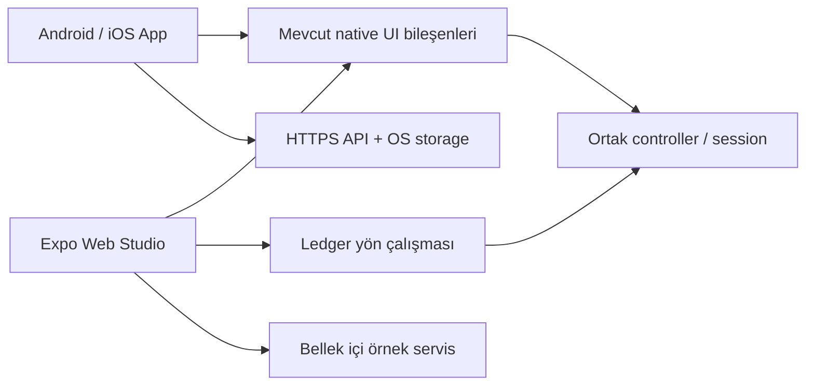
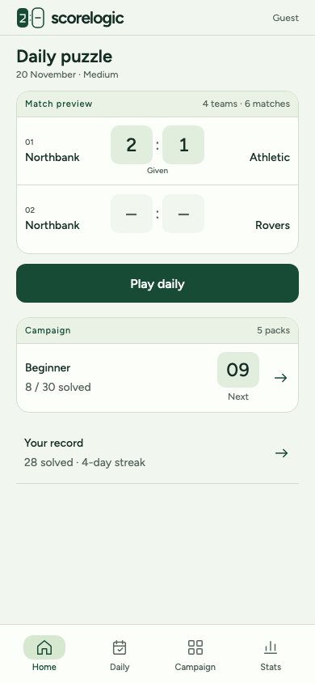
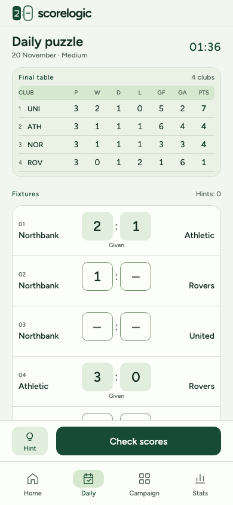
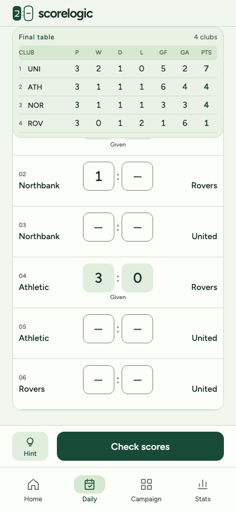
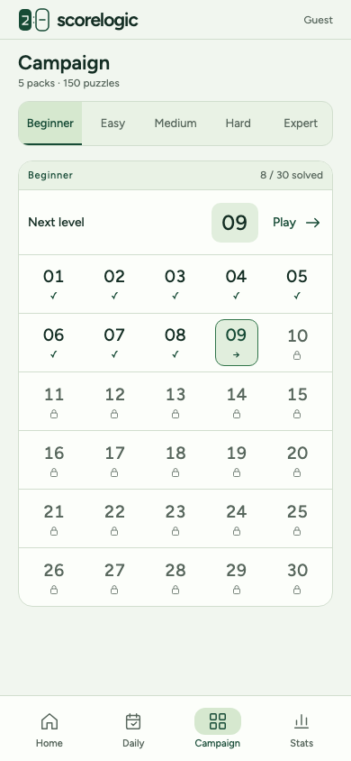
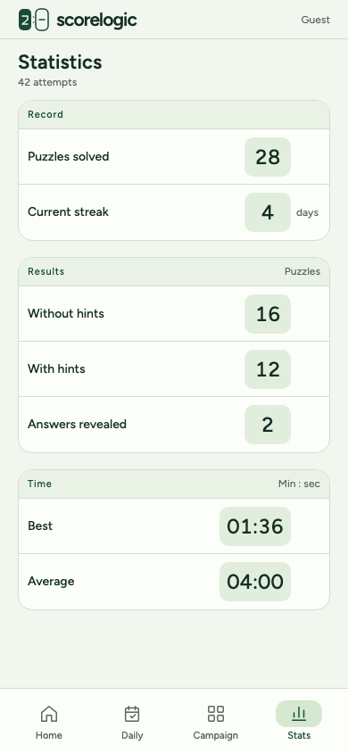
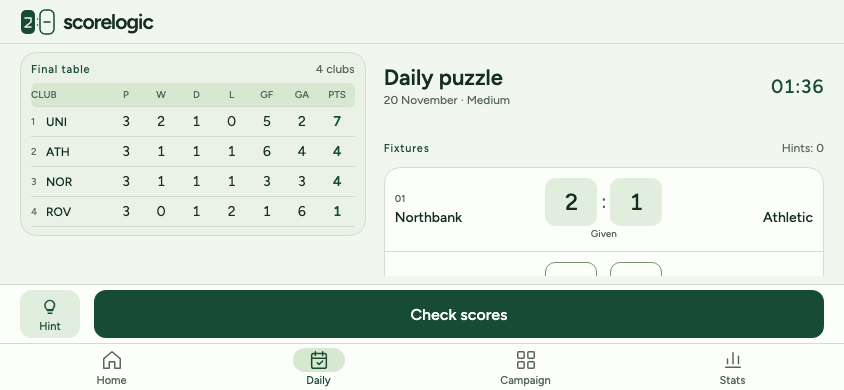
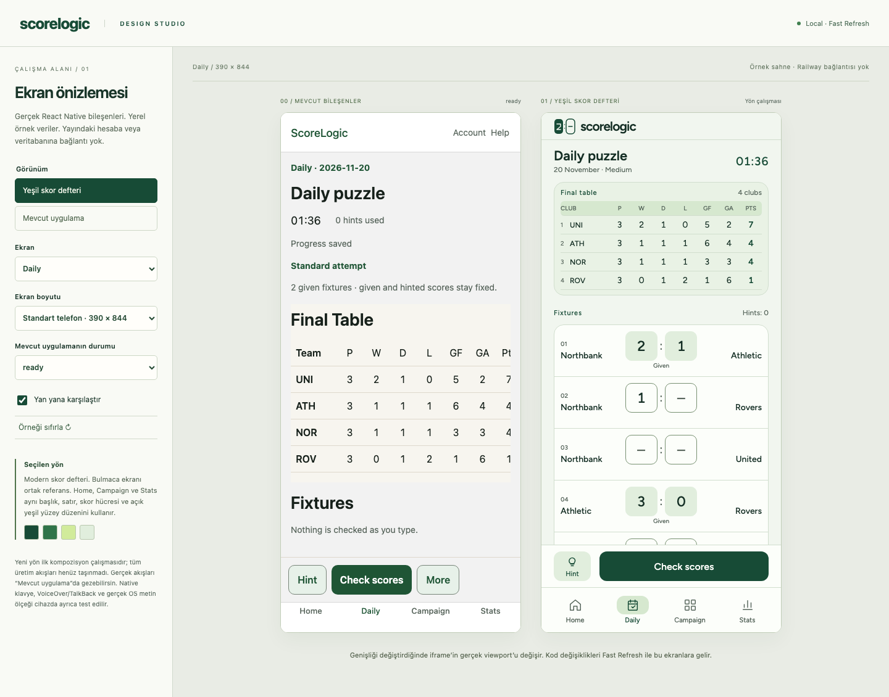

# ScoreLogic UI/UX — Yeşil skor defteri

> 20 Kasım 2026. Kullanıcı “modern skor defteri” çerçevesini, yeşil ve tonlarıyla seçti. İlk kompozisyonun ardından fontların değişmesi, sadeliği koruyan daha belirgin bir düzen, slogansız kısa metinler ve kaydırmada sabit kalan Final Table istendi. Figtree ve sabit tablo revizyonunun ardından kullanıcı yönü olumlu buldu; biraz daha yuvarlatılmış, sakin ve yeşil tonları daha fazla olan bir oyun görünümü istedi. Ardından görsel incelemede genel amaçlı kartlar, dekoratif saha ve tekrar eden kutular fazla bulundu. Kullanıcının isteğiyle güncel kompozisyon maç föyü etrafında yeniden düzenlendi; uygulama sonrası dar/yatay ekranlar yeniden görüntülenerek düzeltildi. Kullanıcı bulmaca çözme ekranını en beğendiği ekran olarak seçti; Home/Campaign/Stats aynı çizelge diline taşındı. Ortak geliştirme ortamı hazırdır; diğer ekranların nihai görsel kabulü henüz verilmedi. Kurulu Android test APK'sına yeni ekranların tamamı henüz taşınmadı.

## Seçilen ürün karakteri

ScoreLogic, maç sonuçlarını tablodan çıkarma oyunudur. Görsel kimlik bir spor yayınının netliğini ve skor defterinin düzenini taşımalı: koyu orman yeşili, yeşile dönük açık zemin, güçlü başlıklar, hizalı rakamlar, ince ayırıcılar. Kullanıcı uygulamayı açtığında bir sonraki puzzle'ı ve neye basacağını hemen görmeli.

Başlangıç kararları:

- Açık tema; mevcut İngilizce ürün dili korunur. Stüdyonun araçları Türkçedir.
- Yeşil ana kimliktir. Koyu yeşil eylem/kimlik, saha yeşili odak/vurgu, açık yeşil sınırlı destek yüzeyidir. Açık yeşiller tablo ve çizelge satırlarını ayırır; koyu yeşil ana eylem ve seçili durumlarda tutulur.
- Günlük puzzle Home'un tek ana eylemidir. Aynı daily için ikinci bir Continue kartı oluşturulmaz; yüklü aktif daily draft varsa ana düğme Continue daily olur. Başka kayıtlı oyuna devam etme satırı production taşımasında yalnız ilgili veri varsa eklenir.
- Son tablo çalışma referansı; skorlar esas etkileşim alanıdır. Final Table telefon ekranında kaydırma sırasında üstte kalır; geniş iki panelli düzende solda sabittir. Dekorasyon bu ikisinin önüne geçmez.
- Dikkat; yerleşim, yazı ağırlığı ve yeşil kontrastla sağlanır. Büyük slogan, iddialı pazarlama cümlesi ve işlevi tekrar anlatan açıklamalar kullanılmaz. “Daily puzzle”, “Play”, “Use 1 hint” gibi kısa ve somut etiketler tercih edilir.
- Gradyan, cam efekti, rastgele emoji/ödül rozeti, dekoratif sayaç ve bütün ekranlarda tekrarlanan büyük kartlar kullanılmaz. İkonlar aynı çizgi ağırlığında, bir işlevi anlatmak için kullanılır.
- Mevcut oyun kuralları, paketlerin yardım politikaları, official/first/best ayrımı ve verinin kaybolmama davranışları tasarım sırasında korunur.

## Mevcut arayüzde tespit edilen sorunlar

| Bulgu | Kullanıcı etkisi | Yeni sistemin kararı |
|---|---|---|
| Farklı önem düzeyindeki başlıklar aynı tip/boyda | Nereye bakılacağı belirsiz | Display / ekran başlığı / bölüm / gövde / metadata hiyerarşisi |
| Home'da çok sayıda benzer buton/kart | Başlama eylemi geri planda | Public puzzle verisinden tek günlük önizleme/CTA, Campaign için çizelge satırı, küçük kayıt özeti |
| Campaign'de beş büyük pack kartından sonra seviyeler | Gereksiz dikey yol, pack/level ilişkisi zayıf | Beş kompakt pack kontrolü + seçili pack özeti + satırlara ayrılmış seviye çizelgesi |
| Tablo kaydırıldığında referansın kaybolması | Her skor girişinde yukarı dönmek gerekiyor | Telefonda yapışkan tablo; geniş iki panelde ayrı sabit referans |
| Final Table'da sabit minimum kolon genişlikleri | Normal telefon boyunda son metriklerin taşması | 360 px viewport'ta sığan esnek kolonlar; büyük metin stratejisi ayrıca doğrulanacak |
| Fixture'larda takım adı, home/away ve büyük not butonları tekrarı | Skor alanına erişim uzuyor | Ortada karşılıklı skorlar; home solda, away sağda. Yalnız given/hint kaynağı görünür, entry etiketi tekrarlanmaz; ikincil not eylemi production taşımasında korunur |
| Hint/Check/More/Analyze eşit görsel ağırlıkta | Bir sonraki eylem belirsiz | Check ana eylem; Hint ikincil; More/Analyze mevcut politikaya göre ikincil yerleşim |
| Sadece yazıdan oluşan tab'lar ve genel başlıklar | Native uygulama hissi zayıf | Dört kalıcı tab, ikon + görünür kısa isim + seçili durum |
| Stats bütün metrikleri aynı sırada/ağırlıkta sunuyor | Özet ile ayrıntı ayrılamıyor | Önce temel kayıt, sonra gruplanmış bütün mevcut metrikler |
| Durumları görmek gerçek veri/hesap/ağ değişimi gerektiriyor | Tasarım incelemesi yavaş ve tekrarlanması zor | Ayrı bellek içi örnek servis, kontrollü sahneler ve reset |

## Ortak geliştirme ve test yöntemi

Proje kökünde:

```sh
npm run design:studio
# Mac üzerindeki Chrome/Safari: http://localhost:8082

npm run test:design:studio
```

Stüdyo Expo Web / React Native Web üzerinde çalışır. “Mevcut uygulama”, gerçek `AppShell`, `GameScreen`, player/account ekranlarını ve gerçek `PuzzleController` / `SessionClient` sınıflarını kullanır. Sunucu/vault/DB yerine yerel örnek veri portları bağlanır. Gerçek Railway verisine istek yapılmaz; örnek maçlar kurmaca ve skor tablosuyla tutarlıdır.

“Yeşil skor defteri”, `src/ui/ledger` altındaki platformdan bağımsız React Native bileşenleriyle ilk kompozisyon çalışmasıdır. Skor girişi mevcut **ScoreInput** bileşenini, yardım sheet'i mevcut **GameSheet** bileşenini ve işlemler gerçek controller'ı kullanır. Bu yön çalışması bütün üretim ekranlarının tamamlandığı anlamına gelmez.



### Stüdyo araçları

| Araç | Kapsam |
|---|---|
| Mevcut / yeni yön seçimi | Aynı içerikle hiyerarşi ve yerleşim inceleme |
| Yan yana karşılaştırma | Bağımsız iki iframe / iki örnek session |
| 360×780, 390×844, 430×932 | Kompakt, standart ve geniş telefon |
| 768×1024, 844×390 | Tablet ve yatay telefon incelemesi |
| Home / Daily / Campaign / Stats | Kontrolden doğrudan ekran açma; mevcut uygulamada diğer ekranlar header/navigation üzerinden açılır |
| ready / solved / loading / empty / error / offline | Mevcut bileşenler üzerinde tekrarlanabilir durumlar; yeni yön ilk hazır kompozisyonu gösterir |
| Örneği sıfırla | Yeni bellek içi session/draft; gerçek hesaba etkisi yok |
| Fast Refresh | Kaynak/CSS değişince önizlemeyi güncelleme |

İframe gerçek viewport oluşturur. Sadece 390 px genişliğinde bir div kullanılsaydı `useWindowDimensions` masaüstü genişliğini okuyabilir ve telefonun yanlış düzeni çizilebilirdi.

Tarayıcıda input, navigation, modal, scroll, görünürlük ve birçok odak akışı birlikte test edilir. Android/iOS native klavyesi, OS safe area/gesture, gerçek font scale, VoiceOver/TalkBack ve performans ölçümü için fiziksel cihaz gerekir. Web görüntüsünün native piksel eşitliği iddia edilmez. Yön çalışmasının timer'ı görsel inceleme için sabittir; gerçek timer mevcut uygulama görünümünde çalışır.

Normal native export yalnız iOS/Android hedefler. Web hedefi `MOBILE_DESIGN_STUDIO=true` ile eklenir. `App.web.tsx` native bootstrap'tan ayrıdır; native export denetimi `src/design` örneklerinin native bundle'a girmesini reddeder.

## Maç föyü revizyonu ve iç inceleme

Bu revizyonun amacı marka dilini oyunun kendi verisinden üretmektir. Yeşil palet, Figtree ve yumuşak köşeler korunur; her öğe bağımsız kart yapılmaz.

| Alan | Uygulanan karar |
|---|---|
| Marka işareti | Grafik çubukları yerine biri verilen, diğeri boş iki skor hücresi ve skor ayıracı. Home önizlemesi ve oyunla ortak motif. |
| Home | Dekoratif saha/sabit 2–1 kaldırıldı. Public puzzle'ın ilk iki fixture'ı, takım isimleri ve yalnız başlangıçta verilmiş skorları aynı takım/skor/takım düzeninde kullanılır. Gizli çözüm önizlemeye aktarılmaz. Açık yüzeyli Match preview, tek Forest Play daily / Continue daily; Campaign çizelge satırı ve Your record bağlantısı. |
| Oyun | Her maç için ayrı kart yerine tek maç çizelgesi; takım / karşılıklı skor / takım. Sabit tablo yaklaşık 184 px; önceki kompozisyonda 221 px idi. Oyun masthead'i 44 px. 390×844 görünümünde dört tam fixture satırı görünür. |
| Campaign | Sonraki seviye belirgin bir Play satırı. Otuz bağımsız kart yerine beşli çizelge satırları; tamamlananlarda işaret, sıradakinde skor hücresi gibi açık yeşil alan/yeşil sınır, kilitlilerde kilit. Play seçili catalog id'sini açar. |
| Stats | Büyük tek sayı kartı kaldırıldı. Record/Results/Time grupları, sabit değer ve birim sütunları, verilen skorlara benzeyen salt okunur sayı alanları; veri yerel servis üzerinden schema ile okunur. |

İlk iç incelemede Home fixture adlarının ayıracı eksikti, oyun takım isimleri farklı hizada duruyordu ve Stats'taki days birimi etiketi aşağı itiyordu. Ayraç, takım hizası ve metrik satırı düzeltildi. Given/Given tekrarı çiftin altında tek Given etiketine indirildi; tek hücrelik Hint etiketi hücresinde kalır.

Yatay telefonda tek sütunlu yapışkan tablo, maçlara yer bırakmıyordu. Yön çalışmasında genişlik en az 740 px ve font scale en çok 1,2 olduğunda tablo solda, bağımsız kayan fixture paneli sağda yer alır. Kısa ekranlarda eylem/navigation şeritleri daralır; skor ve ana düğmelerin 48 px dokunma alanı korunur. Home/Stats içeriği geniş ekranda 600 px ile sınırlanır. 360×780, 390×844, 768×1024 ve 844×390 görüntüleri incelendi; yatay sayfa taşması saptanmadı.

Kullanıcının bulmaca ekranını referans seçmesinin ardından diğer ekranlar da aynı ölçülere taşındı: bütün masthead'ler 44 px, ekran başlıkları 22/28, açık çizelgelerin köşeleri 16 px, skor/değer alanları 10 px. Koyu Home paneli, limon yeşili geniş CTA, ayrı koyu Next Level kartı ve büyük ekran başlıkları kaldırıldı. Home önizlemesi oyun satırlarını kullanır; Campaign'in pack seçimi tek bir kontrol şerididir ve Next level satırı seviyelerle aynı yüzeydedir. Stats'ta bağımsız büyük sayı vurguları yerine aynı satır ve hücre düzeni kullanılır. Yeşil başlık şeritleri bölüm adını/veriyi taşır; dekoratif grafiğe dönüştürülmez.

Bu son görsel revizyonun iç incelemesinde Stats sayı/birim hizaları ve alt kenarlardaki çift çizgiler düzeltildi. 360/390 telefon, tablet ve yatay görünümler yeniden görüntülendi. Bulmaca ekranının maç/table yerleşimi korunur; yeni bir oyun kuralı, ödül veya dekoratif içerik eklenmez.

Seçili tab durumu web'de de `aria-selected`, pack düğmeleri `aria-pressed` ile sunulur. Yerel campaign örneğinin ilk sekiz Beginner kaydı schema'ya uygun tamamlanmış progress ile eşlendi; artık sayılar ve Play hedefi yalnız görsel sabitler değildir. Bu örnekler gerçek oyuncu kaydı değildir ve Railway'e yazılmaz.

## Görsel sistem

Kaynak: [ledger/theme.ts](../../apps/mobile/src/ui/ledger/theme.ts). Bu aday tokenlar şu an eski global paleti değiştirmez; onaylanan ekranlarla birlikte taşınır.

| Rol | Değer | Kullanım |
|---|---|---|
| Paper | `#F1F6EF` | Ana zemin |
| Surface | `#FCFEFA` | Input, navigation ve gerekli ayrılmış yüzey |
| Ink | `#142E24` | Ana metin ve rakam |
| Forest | `#174B36` | Marka, ana eylem, seçili kontrol |
| Field | `#307449` | Odak ve sınırlı vurgu |
| Lime | `#D1EB9B` | Yedek vurgu tokenı; güncel ana CTA Forest, geniş Lime panel kullanılmaz |
| Muted | `#58675D` | İkincil metin; yeni açık yüzeylerin tamamında en az 4,5:1 |
| Line | `#D1DECE` | Dekoratif satır/bölüm ayırıcı |
| Control border | `#789172` | Etkileşimli alan sınırı; surface üzerinde en az 3:1 |
| Soft | `#E1EEDD` | Verilmiş skor gibi destek yüzeyi |
| Mint | `#E9F2E5` | Sabit tablo ve dönüşümlü çizelge satırları |
| Selected | `#D6E8CF` | Seçili tab, tablo başlığı, hint yüzeyi |
| Danger | `#9B382F` | Açık Check sonucu/hata; giriş sırasında otomatik hata işareti yok |

Metin/zemin seçili çiftleri en az 4,5:1; input sınırı en az 3:1 test edilir. Ink/Muted/Forest yazıları Paper/Surface/Soft/Mint/Selected yüzeylerinin tamamında kontrol edilir. Dekoratif ince çizgi, input sınırı yerine kullanılmaz. Given, hint, yanlış ve locked durumları yalnız renkle ifade edilmez; okunabilir metin ve erişilebilir etiket gerekir.

### Tipografi ve ölçü

- **Figtree SemiBold:** marka ve ekran başlığı. Bütün ekran başlıkları 22/28; sheet/modal başlığı 23/30; dar ve aşırı büyük display kullanılmaz.
- **Figtree Regular / Medium:** gövde, düğme, metadata ve sayılar. Gövde 16–17; düğme 16; tablo/metadata yoğunluğa göre 11–14.
- Tablo, timer ve skorlar hizalı rakamlarla gösterilir. Türkçe studio kontrolleri ve mevcut İngilizce ürün dili font kapsamındadır.
- Fontlar `assets/fonts` içinde yereldir; Figtree yazarının resmî deposundan OFL lisansıyla alındı. Çalışan önizleme Google font CDN'ine bağımlı değildir.
- 4 px aralık sistemi; telefonda başlangıç yatay padding 20, ana bölüm arası 24–28.
- Ana kontrol köşesi 12, skor/seviye/değer hücresi 10, bütün çizelgeler ve sabit tablo 16. Aynı ölçüler `ledger.radius` tokenlarından alınır. Bu hafif yuvarlatma ile açık yeşil katmanlar daha sakin ve oyun hissi taşıyan bir görünüm verir. Tablo satırları hizalı ve düz kalır; yüzeyler veri gruplarını ayırmak için kullanılır.
- Skorlar ve ana eylemler en az 48 yüksekliğinde, alt tablar portrede 64, kısa yatay ekranda 40 yüksekliğindedir; görünür keyboard focus. Metin ölçeği sabitlenmez. %200 ve büyük font yerleşimleri ayrı kabul kapısıdır.

## Ekran sistemi ve davranış sözleşmesi

| Ekran | Birincil iş | Yerleşim / korunacak davranış |
|---|---|---|
| Home | Günlüğe başla / kayıtlı oyuna dön | Public fixture önizlemesi, tarih/zorluk, tek Play daily; yüklü aktif draft varsa Continue daily; Campaign çizelge satırı ve küçük kayıt özeti |
| Daily / campaign oyun | Tabloya bakarak skor gir | Üstte kimlik/süre; kaydırmada sabit kompakt Final Table; numaralı 6 fixture tek çizelgede; karşılıklı skorlar ortada; altta Check + Hint |
| Campaign | Pack/seviye seç | Normal kompakt genişlikte beş pack görünür; sonraki seviye Play satırı ve tamamlandı/açık/kilitli çizelgesi; kilit nedeni erişilebilir; unlock davranışı değişmez |
| Stats | Özet kaydı ve ayrıntıyı gör | Önce solved/streak/time; sonra mevcut 15 canonical metrik ve son altı puzzle kaydı. Yön çalışmasındaki Record/Results/Time seçkisi bütün metriklerin yerine geçmez |
| Hint / not / More | İkincil işi tamamla | Bağlamı koruyan sheet; kısa neden, tek açık eylem; kapatmak işlem tüketmez; başarıda kapanma, pending iken aynı komutla recovery |
| Check / Analyze | Girdileri değerlendirme | Pack'e göre mevcut disclosure; skor yazarken otomatik değerlendirme yok; stale analysis ayrımı korunur |
| Sonuç / paylaşım / replay | Sonucu gör, davet et, tekrar oyna | Official/first/best ayrımı, süre/hint ve puzzle daveti; replay unlock/history'yi silmez; Reveal ayrı açık onay ister |
| Account / auth / help | Hesabı yönet / yardım al | Görünür alan etiketleri, açık hatalar; guest devam, merge, logout/silme bariyerleri ve privacy/support korunur |

Gerçek `GameScreen` içinde de bu turda sabitleme uygulandı: dar düzende doğrudan ScrollView çocuğu olan referans bloğu `stickyHeaderIndices` ile üstte kalır; geniş düzende tablo dışarıda, yalnız fixture paneli kayar. Tablo opak zeminlidir; alttan geçen satırlar tabloyu okunamaz kılmaz. Normal telefon boyutunda yön çalışmasının tablosu yatay gizlenmez. Büyük font veya çok dar alan için yatay scroll gerekiyorsa açık ipucu ve metric açıklamaları tasarlanır. Tablet/yatay final düzeninde tablo ile fixture paneli ancak gerçek kullanılabilir genişlikte ayrılır; mevcut breakpoint mantığı ve klavye etkisi cihazda kontrol edilir. Stüdyodaki tablet artboard'u tek başına tamamlanmış tablet tasarımı sayılmaz.

### Mevcut yön çalışmasının sınırı

Home, oyun, Campaign ve Stats için maç föyü kompozisyonu eklendi. Örnek skor girişi, Hint ve Check gerçek controller'ı çalıştırır. Üretime geçmeden More/Reveal/Replay/Analyze/not, bütün stat metrikleri, canonical sonuç/paylaşım, account/auth ve recovery durumlarının her biri yeni bileşen sistemine eksiksiz yerleştirilecek. Mevcut görünüm bu akışların çalışır referansıdır; mock servis bir backend solver/security doğrulaması değildir.

## Uygulama sırası

1. **Tamamlanan:** Ortak stüdyo, yerel örnek servis, yeşil yönün Figtree/kısa metin ve maç föyü revizyonu, viewport/durum seçimi ve browser kabulü. Final Table sabitlemesi gerçek oyun bileşenine de uygulandı.
2. **Temel UI kit:** Onaylanan renk/type/spacing, ikon, buton, yüzey, input ve navigation bileşenlerini production UI'a taşı. Native bootstrap'ta fontları yükle; yeni font/SVG modülleri için bir development binary üret.
3. **Oyun ekranı:** Compact table/fixture/keyboard, not, Hint, Check, More/Analyze, conflict ve sonuçları aynı controller üstünde tamamla. Mevcut işlevleri çıkarma.
4. **Home ve Campaign:** Gerçek daily/progress/catalog state'lerini yeni kompozisyona bağla; loading/empty/offline ve locked seviye durumlarını tamamla.
5. **Stats / account / auth / help:** Bütün veri ve eylemleri UI kit'e geçir; kısa özet ve ayrıntıyı ayır.
6. **Native kabul:** Tarayıcı görsel ve interaction kontrolleri sonrası Android development client'ta klavye, back, focus, landscape ve metin ölçeği; sonra iOS/iPad ve diğer matris. Fast Refresh için development client kullanılabilir; mevcut Metro'suz test APK'sı ayrı dağıtım olarak korunur.

Her ekran, durumlarıyla birlikte taşınır. Bir tema rengi değiştirip bütün ekranları aynı anda tamamlanmış saymak bu planın kabul ölçütü değildir.

## Doğrulama ve görsel kanıt

- **22 Playwright senaryosu**: Chromium + WebKit; telefonun iki görünümünde gerçek scroll sırasında sabit tablo ve hareket eden fixture doğrulaması; geniş gerçek oyun ekranında ayrı kayan panel; yatay yeni yönde eksiksiz referans ve bağımsız kayan fixture paneli; public givens/boş hücre önizlemesi; doğru campaign level id, kilitli seviye, seçili tab ve Home/Stats geçişi; iki görünümü açma, gerçek iframe viewport'u, 360 px tablo sınırı, beş pack'in görünürlüğü, ortak ScoreInput'ta 0 girişi, proposal ve mevcut Hint akışları, kapatmanın ücretsizliği ve modalın kapanması, empty/loading/error/offline/solved, dış API isteği olmaması.
- **95/95 core**: mevcut dayanıklılık suite'i + örnek tablonun skor/puan tutarlılığı, örnek transport'un gerçek network kullanmaması, Hint/Analyze/Reveal/Replay contract'ları ve yeni palet kontrastı.
- Ortak stil revizyonunda 22 browser senaryosu, 2 mevcut tasarım fixture/kontrast testi, native TypeScript ve değişen kaynakların lint kontrolü yeniden çalıştırıldı. 95 core önceki maç föyü revizyonunda geçmişti; bu tur controller/fixture davranışı değişmedi. Önceki oyun refaktöründe **49/49 native component** geçmişti; bu revizyon oyun/controller davranışını değiştirmez.
- Önceki native export denetiminde mapped iOS/Android export ve private/canary sınırı başarılı; tasarım örnekleri native bundle'da yok. Web çalışma alanı canlı APK veya Railway deployment'ı değildir.
- Gerçek tarayıcıdan Home/Daily/Campaign/Stats ve karşılaştırma görüntüleri alındı; capture'da page/console error yok. Yeni yerleşimlerin native cihaz kabulü henüz yapılmadı.
- Expo'nun çevrimiçi sürüm kontrolü, sabit SDK 58.0.25 seti için Expo/dev-client/SQLite/Jest Expo'nun daha yeni patch sürümlerini önerdi. Bu çalışma sırasında SDK/binary yükseltmesi yapılmadı; eklenen web/font/SVG paketleri SDK'nın yerel uyumluluk haritasındaki sürümlere sabitlendi. Mevcut native/browser test ve export sonuçları bu kilitli set içindir.









Teknik kaynaklar: [Expo Web](https://docs.expo.dev/workflow/web/), [Figtree kaynak ve OFL lisansı](https://github.com/erikdkennedy/figtree). Font lisanslarının kopyaları proje assets klasöründedir.
