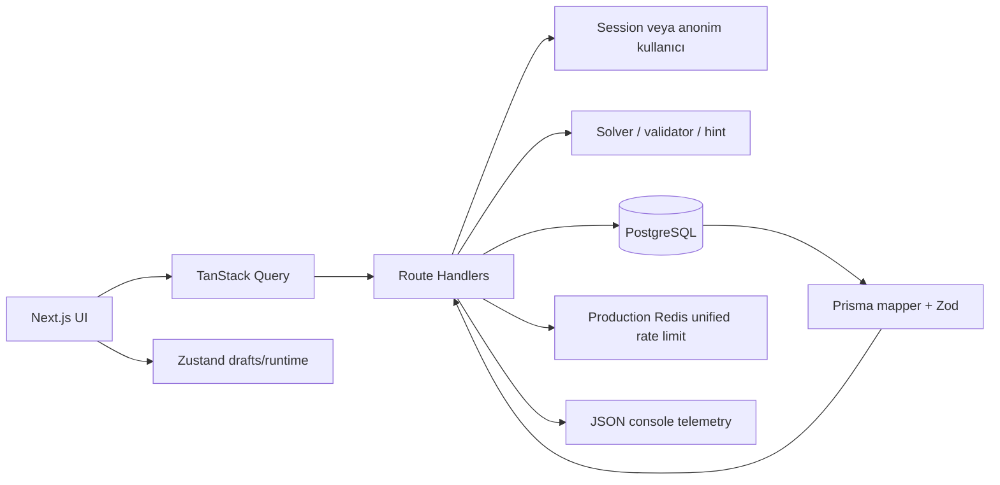
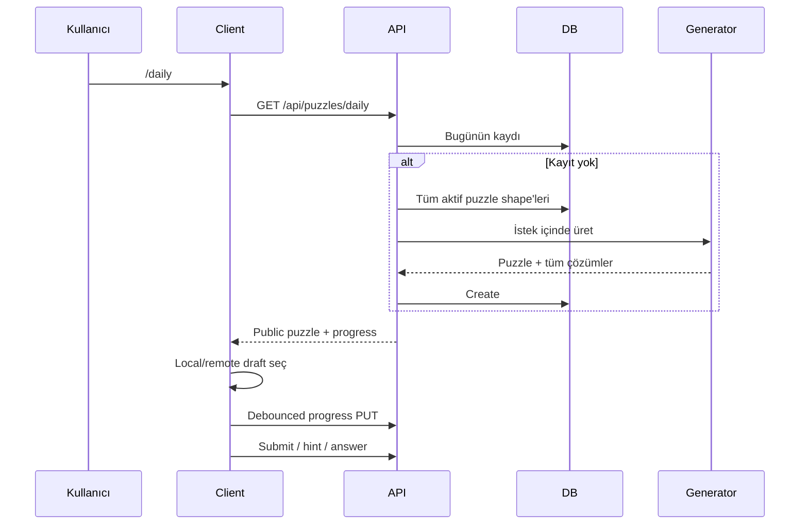
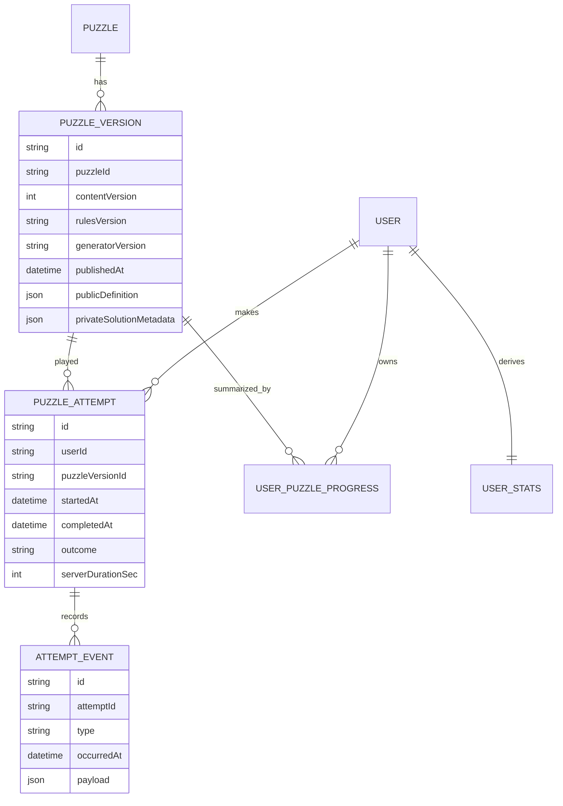
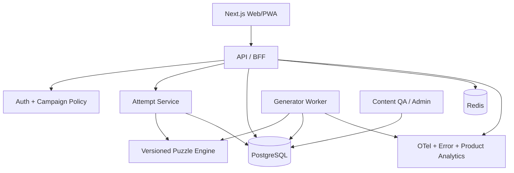

# ScoreLogic Uçtan Uca Analiz ve İyileştirme Raporu

> İnceleme tarihi: 29 Temmuz 2026  
> İncelenen sürüm: `fa31fdd` (`main`)  
> Kapsam: ürün akışları, oyun motoru, algoritmalar, veri modeli, API, istemci state'i, kimlik doğrulama, güvenlik, performans, test, erişilebilirlik, gözlemlenebilirlik ve operasyon
>
> Uygulama durumu: 4 Ağustos 2026 itibarıyla Faz 0, Faz 1 / Dalga 1–3,
> Faz 2 / Dalga 4–8, Faz 3 / Dalga 9–15 ve Faz 4 / Dalga 16–22 tamamlandı.
> Production environment fail-fast, merkezi business date/timezone, gerçek PostgreSQL
> integration + CI, solve-any hint/submit doğrulaması, Beginner scoreline akışı ve
> server-side campaign gate; submit idempotency/unique completion, immutable content
> publication, home DB hata izolasyonu, kalıcı attempt/event yaşam döngüsü,
> server-authoritative süre/hint/reveal, first/best/current progress ayrımı ve canonical
> stats/streak reconciliation, kayıpsız anonymous-account merge ve fail-closed
> JSON/domain publish doğrulaması ile mantıksal puzzle kimliği, immutable revision,
> staged promotion ve rollback akışı; finite solver budget profilleri, `fixedCells`,
> `SAT/UNSAT/UNKNOWN`, çözüm sızdırmayan solver telemetry ve explicit Analyze Board
> üzerinden server-authoritative global partial satisfiability; tablo, presentation ve
> effective katmanlarını ayıran mode-aware zorluk modeli uygulandı.
> Sürümlü otomatik content QA; çözüm politikası, skor gerçekçiliği, hint güvenliği,
> playthrough ve havuz benzerliği kapılarıyla publisher'a bağlandı.
> Daily üretim request path'inden çıkarıldı; bugün + 14 gün varsayılan QA-onaylı buffer,
> concurrency-safe scheduled worker ve gap denetimi uygulandı.
> Otomatik QA'dan ayrı insan editorial review kapısı, aktörlü append-only karar geçmişi,
> manuel/zamanlanmış aktivasyon işçisi ve audit izli rollback uygulandı.
> Standart attempt ledger'ından completion/reveal/abandon/hint/submit/süre sinyallerini
> aggregate eden, güven eşikli ve revision-bazlı observed difficulty kalibrasyonu eklendi.
> Aşağıdaki bulgular ilk inceleme kanıtını korur;
> çözülen maddeler ayrıca işaretlenmiştir.

## 1. Yönetici özeti

ScoreLogic, iyi ayrıştırılmış bir oyun motoruna, public/private DTO sınırına, runtime şema doğrulamasına, anonim-first kullanım modeline ve çalışır bir günlük/kampanya arayüzüne sahip güçlü bir MVP temelidir. Güncel doğrulamada TypeScript, lint, 50 dosyada 241 birim testi, 15 gerçek PostgreSQL integration testi ve 8 Playwright senaryosu başarılıdır.

Bununla birlikte uygulama bugün “production-ready standart uygulama” seviyesinde değildir. En kritik sorunlar yalnız çevresel veya kozmetik değil, doğrudan oyunun doğruluğunu ve ilerleme bütünlüğünü etkiler:

1. **Dalga 2'de giderildi:** Hint, mevcut kısmi hücrelerle uyumlu `allSolutions` alt kümesini kullanır; dolu hücreyi değiştirmez ve yalnız ortak güvenli değeri açar.
2. **Dalga 2'de giderildi:** Beginner yalnız scoreline gönderir; bütün pack'ler aynı exact solve-any hakemine bağlıdır.
3. **Dalga 2'de giderildi:** Campaign read/progress/submit/hint/answer endpoint'leri ortak server-side erişim politikasını uygular.
4. **Dalga 3–4'te giderildi:** Idempotency receipt, kullanıcı–puzzle transaction lock'u
   ve mantıksal `(userId, contentKey)` unique completion ledger çift stats etkisini
   revision'lar arasında da engeller; `PuzzleAttempt` ve sıralı
   `AttemptEvent` kayıtları replay dahil bütün attempt geçmişini kalıcılaştırır.
5. **Dalga 1'de giderildi:** Günlük bulmaca lookup, seed, DTO ve streak akışları ortak IANA timezone tabanlı business date kullanır.
6. **Dalga 3'te giderildi:** Deploy yalnız migration uygular; explicit publisher checksum doğrular ve veritabanı yayınlanmış içerik güncellemesini reddeder.
7. **Dalga 1'de giderildi:** Production build/start eksik veya zayıf environment yapılandırmasında fail-fast durur.
8. **Dalga 1'de giderildi:** CI verify ve E2E işleri PostgreSQL service ile migration/test verisini hazırlar; integration komutu boş test setinde başarılı olamaz.
9. **Dalga 5'te giderildi:** `UserStats` ve `DailyStreak`, attempt/completion kayıtlarından
   saf hesaplayıcıyla yeniden üretilebilir; dry-run/repair reconciliation drift'i
   raporlar ve kullanıcı bazlı advisory lock ile idempotent düzeltir.
10. **Dalga 6'da giderildi:** Anonymous merge attempt/submission geçmişini kaybetmeden
    taşır; completion/progress çakışmalarını deterministik çözer, stats/streak'i canonical
    rebuild eder ve kalıcı receipt ile concurrency/retry güvenliği sağlar.
11. **Dalga 7'de giderildi:** Publisher ve request-time daily create sınırı, JSON/domain
    validator geçmeden yazmaz; bozuk round-robin, standings, çözüm kümesi, metadata,
    difficulty veya prefill `isTested` olamaz ve aktif sorgularda görünmez.
12. **Dalga 8'de giderildi:** Mantıksal `contentKey` fiziksel revision kimliğinden
    ayrıdır; yeni revision staged yayınlanır, aktif attempt varken promotion engellenir,
    aktivasyon/rollback atomiktir ve completion/unlock/stats revision'lar arasında
    mantıksal olarak tekilleştirilir.
13. **Dalga 9'da giderildi:** Solver node, süre ve çözüm limitli profiller kullanır;
    tam veya tek-taraflı fixed score hücreleri arama constraint'idir; budget dolması
    `UNSAT` yerine `UNKNOWN` üretir ve publication tam çözüm kümesini kanıtlayamazsa durur.
14. **Dalga 10'da giderildi:** Analyze Board tam ve tek taraflı bütün girilmiş skor
    hücrelerini server-side global solver'a bağlar; local overflow, global dead-end,
    incomplete ve indeterminate durumlarını ayırır, çözüm içeriğini response'a taşımaz.
15. **Dalga 11'de giderildi:** Table complexity ile prefill/feedback/analyze etkili
    presentation complexity ayrıdır; generation/publication iki bandı doğrular, UI ve
    unique-solve istatistikleri deterministik efektif sınıfı kullanır.
16. **Dalga 12'de giderildi:** Sürümlü automated content QA; çözüm sayısı/prefill
    oynanabilirliği, skor gerçekçiliği ve çeşitliliği, her çözüm için hint + partial/final
    playthrough ile tablo/havuz benzerliğini fail-closed publication kapısına bağlar;
    başarı kanıtı immutable revision metadata'sında saklanır.
17. **Dalga 13'te giderildi:** Günlük API salt-okumadır; bugün + 14 gün varsayılan future
    buffer worker tarafından önceden üretilir. Eşzamanlı koşular advisory lock ile
    tekilleşir; eksik/blocked gün structured rapor ve non-zero check sonucu üretir.
18. **Dalga 14'te giderildi:** Yeni revision ilk içerik dahil otomatik aktive edilmez;
    güncel QA kanıtından sonra ayrı insan onayı ister. Karar, planlama, aktivasyon,
    retirement ve rollback aktörlü append-only olaylardır; due worker planlanan içeriği
    atomik olarak açar.
19. **Dalga 15'te giderildi:** Observed difficulty, replay hariç standart attempt'lerden
    revision bazında hesaplanır; küçük/yarım kohortlar `INSUFFICIENT_DATA` kalır, güvenli
    predicted/observed sapma cron alarmı üretir ve published skor otomatik mutate edilmez.
20. **Dalga 16'da giderildi:** Production Redis fail-fast zorunludur; auth, oyun write,
    Analyze Board ve telemetry tek distributed limiter kullanır. Trusted proxy zinciri
    dışında forwarded IP kabul edilmez; anahtarlar hash'lenir, `429/503` retry sözleşmesi
    ve dependency-aware deployment readiness uygulanır.
21. **Dalga 17'de giderildi:** Middleware her request için CSP nonce üretir; production
    script policy nonce + `strict-dynamic` kullanır ve script kaynaklarından
    `unsafe-inline`/`unsafe-eval` kaldırılmıştır. Next framework/inline executable
    script'lerinin aynı nonce'u taşıdığı Chromium E2E ile doğrulanır.
22. **Dalga 3'te giderildi:** Daily preview kendi hata sınırında statik fallback render eder; ana sayfanın rehber ve pazarlama içeriği DB kesintisinde ayakta kalır.
23. **Dalga 20'de giderildi:** AES-256-GCM logical backup, checksum manifest, production
    hedefine restore'u reddeden güvenlik kapısı, veri invariant doğrulaması ve ölçümlü
    RPO/RTO restore drill'i uygulanıp runbook'a bağlandı.
24. **Dalga 21'de giderildi:** Public puzzle read path'i `solution/allSolutions` okumayan
    ayrı projection kullanır; intentional başlangıç skorları immutable ayrı kolondadır.
    Progress keyset cursor ile 20 varsayılan/50 maksimum sayfalanır; campaign ilerlemesi
    ayrı ve 150 kayıtla bounded sorgudur.
25. **Dalga 22'de giderildi:** Sürümlü engine/load bütçeleri, CI solver regression kapısı,
    salt-okuma endpoint'leri için bounded yerel/CI yük testi ve remote-target güvenlik
    kapısı uygulanmıştır.

### Genel olgunluk değerlendirmesi

| Alan | Durum | Kısa değerlendirme |
|---|---|---|
| Ürün çekirdeği | Orta | Oynanabilir; çoklu çözüm semantiği ve kampanya kuralları netleştirilmeli |
| Oyun motoru | İyi | Modüler ve testli; domain publish invariant'ları, solver budget, global partial satisfiability ve mode-aware zorluk uygulandı |
| Veri bütünlüğü | İyi | Submit/completion idempotent; attempt/event server-authoritative ve stats/streak canonical kayıtlardan yeniden üretilebilir |
| Güvenlik | Orta-İyi | Production secret/Redis fail-fast, trusted-proxy unified limiter, bounded telemetry ve nonce script CSP var; hesap recovery, retention/redaction ve signed anonymous token açık |
| Test güveni | Orta-İyi | Unit, gerçek PostgreSQL integration ve 8 temel E2E senaryosu çalışıyor; auth recovery/accessibility kapsamı hâlâ eksik |
| Performans | Orta-İyi | Public/private projection ayrık, progress/campaign bounded; engine ve endpoint load bütçeleri CI'da izleniyor |
| Erişilebilirlik | Orta | Etiketler ve reduced-motion CSS var; modal/focus/klavye semantiği eksik |
| Operasyon | İyi | Immutable publisher, worker'lar, APM/alert/synthetic, encrypted backup ve ölçümlü restore runbook'u var; provider/off-site aktivasyonu deployment sorumluluğudur |
| Dokümantasyon | Orta | Kapsamlı başlangıç dokümanları var; çalışan sistemle önemli ölçüde ayrışmış |

## 2. İnceleme yöntemi ve sınırlar

İncelemede şu kaynaklar kullanıldı:

- Uygulamadaki 122 TypeScript, 34 TSX ve 10 MJS dosyası
- Prisma şeması ve Dalga 15 sonu itibarıyla 15 migration
- 50 unit test dosyası, 15 gerçek PostgreSQL integration testi ve 8 Playwright senaryosu
- MVP, teknik doküman, Phase 0 kararları, tasarım sistemi ve deployment dokümanı
- `type-check`, `lint`, unit, integration, E2E, production build ve Prisma validate komutları
- Çekirdek üretici üzerinde deterministik örneklem ve Beginner sonuç uzayı taraması

Bu rapor:

- production veritabanını, gerçek trafik metriklerini veya Railway hesabını incelemez;
- bağımlılıklar üzerinde çevrimiçi CVE taraması veya penetration test içermez;
- zorluk modelini gerçek kullanıcı kohortuyla doğrulamaz;
- mevcut kod ve lokal çalışma kanıtlarına dayanır.

Dolayısıyla performans ve zorlukla ilgili sayısal sonuçlar bir “kalibrasyon başlangıcıdır”; production ölçümü yerine geçmez.

## 3. Mevcut sistem haritası

### 3.1 Teknoloji yığını

- Next.js 16 App Router, React 19.2, TypeScript
- PostgreSQL ve Prisma
- NextAuth v5 beta, credentials/JWT session
- Zustand local persistence
- TanStack Query
- Zod
- Production'da zorunlu Upstash Redis ve birleşik rate-limit katmanı
- Vitest ve Playwright
- Tailwind CSS ve Framer Motion

### 3.2 Çalışan ana modüller



### 3.3 Çekirdek oyun modeli

- Dört takım bulunur.
- Her takım diğer üç takımla bir kez oynar.
- Toplam altı maç vardır.
- Skorlar 0–6 aralığında üretilir.
- Final tablo W/D/L, GF/GA, averaj ve puanı içerir.
- Oyuncu bütün modlarda tam scoreline doldurur; Beginner daha fazla başlangıç verisi ve
  kademeli analiz desteği kullanır.
- Scoreline modunda sunucu, tek bir gizli çözüm yerine final tabloyu sağlayan herhangi bir tam skor setini kabul eder.

Bu son madde ürünün temel vaadini değiştirir: sistem artık “gizli tarihsel skorları bul” değil, “tabloyla uyumlu herhangi bir fikstür üret” oyunudur. Arayüz metni ve eski karar kayıtları bu değişimi açıkça anlatmamaktadır.

## 4. Güçlü yönler

İyileştirme çalışmasında korunması gereken iyi temeller şunlardır:

1. **Motor ayrımı:** `scoring`, `solver`, `validator`, `difficulty`, `generator` ve `hint` modülleri ayrıdır.
2. **Private/public DTO yaklaşımı:** Çözüm public puzzle DTO'sundan çıkarılır.
3. **Runtime validation:** Prisma JSON kolonları Zod ile parse edilir.
4. **Deterministik üretim:** Seed tabanlı random, tekrar üretilebilir içerik sağlar.
5. **Çoklu çözüm farkındalığı:** `allSolutions` ve en yakın çözüme göre geri bildirim desteği bulunur.
6. **Transactional solve:** Progress, stats ve streak aynı transaction içinde güncellenir.
7. **Local-first taslak:** Kullanıcının tahtası localStorage ve remote progress ile korunmaya çalışılır.
8. **Temel güvenlik:** Scrypt, timing-safe karşılaştırma, HttpOnly cookie, security header'ları ve rate limit vardır.
9. **Temel erişilebilirlik:** Form label'ları, score input aria-label'ları, skip link ve `prefers-reduced-motion` CSS'i vardır.
10. **Derlenebilirlik:** TypeScript, lint, unit test ve production build temizdir.

## 5. Kritik bulgular

### P0-01 — Çoklu çözüm ile ipucu motoru uyumsuz

**Durum: Dalga 2'de giderildi.** Hint motoru kısmi hücreleri filtreye dahil eder,
uyumlu çözümlerin ortak değer vermediği durumda bir çözüm dalını zorlamaz ve çelişkili
state'te yeni hücre açmaz.

**Kanıt**

- `lib/engine/hint.ts:44-76` içinde `standings` ve `userInputs` açıkça kullanılmaz.
- Hedef hücre yalnız daha önce açılmış hücrelere bakılarak rastgele seçilir.
- `app/api/puzzles/[id]/hint/route.ts:185-191` ipucunu daima `puzzle.solution` adlı kanonik çözümden üretir.
- Üretici çoklu çözümleri kabul eder; 60 deterministik örneklemde çözüm sayısı 1–38, ortalama 8,1'dir.

**Etkisi**

- Kullanıcı başka bir geçerli çözüme ilerlerken ipucu, o çözümle çelişen hücreyi kilitleyebilir.
- İpucu doldurulmuş fakat “revealed” olmayan bir hücreyi seçip üzerine yazabilir.
- “Yardım” eylemi geçerli bir tahtayı geçersiz hâle getirebilir.
- Kanonik çözüm seçimi, “her geçerli çözüm kabul edilir” kuralıyla çelişir.

**Öneri**

1. Kullanıcı girdileriyle uyumlu `allSolutions` alt kümesini çıkar.
2. Alt küme boşsa yeni hücre açma; mevcut çelişkiyi açıklayan yönlendirme ver.
3. Dolu hücreleri hedef adaylarından çıkar.
4. Önce bütün uyumlu çözümlerde aynı olan hücreyi aç.
5. Ortak hücre yoksa en yüksek bilgi kazancı sağlayan hücre için outcome/aralık ipucu ver veya kullanıcıdan çözüm dalı seçmesini iste.
6. Hint sonrası en az bir tamamlama kaldığını server tarafında assert et.

**Kabul ölçütü**

- İpucu hiçbir dolu veya daha önce açılmış hücreyi değiştirmez.
- Hint sonrası mevcut state en az bir geçerli çözüme tamamlanabilir.
- Property test, tüm çoklu çözüm fixture'larında bu iki invariant'ı doğrular.

### P0-02 — Beginner doğrulaması skor motorunda olmayan sonuçları kabul edebiliyor

**Durum: Dalga 2'de giderildi.** Eski outcome-only UI/submit/hint dalları kaldırıldı.
Beginner scoreline'ları diğer pack'lerle aynı `allSolutions` exact solve-any kontrolünden
geçer.

**Kanıt**

- `lib/puzzles/outcomes.ts:43-94` yalnız P/W/D/L/Pts alanlarını karşılaştırır; GF/GA veya `allSolutions` kontrol edilmez.
- `matchesAnyOutcomeSolution` fonksiyonu tanımlı olmasına rağmen submit akışında kullanılmaz.
- 60 deterministik bulmaca ve her biri için 729 olası sonuç dizilimi tarandığında 12 bulmacada toplam 15 “false accept” bulundu: sonuçlar W/D/L/Pts'yi sağlıyor, fakat hiçbir geçerli skor çözümünde bulunmuyor.

**Etkisi**

- “Her fikstür final tabloya uyar” başarı mesajı matematiksel olarak yanlış olabilir.
- Beginner ve scoreline modları farklı doğruluk tanımlarına sahip olur.

**Kesinleşen ürün kararı**

Beginner `OUTCOME_ONLY` modelinden çıkarıldı ve diğer pack'ler gibi scoreline girişi
kullanacaktır. Bütün seviyeler aynı solve-any doğrulamasına bağlanacaktır. Beginner'ın
kolaylığı farklı doğruluk tanımından değil; daha fazla prefill, açıklayıcı constraint geri
bildirimi, isteğe bağlı Analyze Board ve güvenli ipuçlarından gelecektir.

Beginner seviyelerinde 1–3 için 5, 4–15 için 4 ve 16–30 için 3 maçın skoru başlangıçta
verilecektir. Submit sonrası yanlış hücre geri bildirimi kullanılacaktır. Final Table statik
kalır; Analyze Board seviyeler 1–3'te rehberli, 4–15'te isteğe bağlıdır ve skor değişince
snapshot geçersiz olur.

### P0-03 — Kampanya ilerlemesi server tarafından korunmuyor

**Durum: Dalga 2'de giderildi.** Ortak campaign access policy bütün puzzle
endpoint'lerinde uygulanır. Katalog kilit durumunu server'dan alır ve kilitli puzzle
içeriğini taşımaz. Doğrudan atlama `403 FORBIDDEN` döndürür.

**Kanıt**

- Kilit hesabı yalnız `components/game/CampaignProgress.tsx:136-151` içindedir.
- `GET /api/puzzles/[id]`, submit, hint ve answer route'ları önceki seviyenin tamamlanmasını denetlemez.
- Puzzle ekranındaki Next bağlantısı `components/puzzle/DailyPuzzleExperience.tsx:74-92` tarafından tüm kampanya listesine göre oluşturulur ve kilit durumunu dikkate almaz.

**Etkisi**

- Kullanıcı doğrudan URL veya Next ile tüm seviyeleri açabilir.
- Kampanya sırası, ürün kuralı olmaktan çıkıp görsel öneriye dönüşür.
- Kilitli seviyeler stats ve progress'e yazılabilir.

**Öneri**

- Ortak `CampaignAccessPolicy` servisi oluştur.
- Read, save, hint, answer ve submit işlemlerinin tamamında aynı server-side kuralı uygula.
- API kilitli seviye için `403 FORBIDDEN` ve gerekli önceki seviye bilgisini dönsün.
- Next/Prev navigasyonu server'ın verdiği erişilebilir komşulara göre kurulsun.

### P0-04 — Kampanya tekrarları ve aggregate stats idempotent değil

**Durum: Dalga 3–4'te giderildi.** Submit için zorunlu `Idempotency-Key`,
payload hash'i ve response progress snapshot'ı tutan `PuzzleSubmission` receipt modeli
eklendi. Transaction kullanıcı–puzzle advisory lock'u ile sıralanır. Farklı key'lerle
gelen yarışlar da unique `(userId, puzzleId)` `PuzzleCompletion` kaydı sayesinde stats ve
streak'i yalnız bir kez etkiler. Dalga 4'te her standard/replay oturumu `PuzzleAttempt`,
eylemleri `(attemptId, sequence)` benzersiz `AttemptEvent` olarak kalıcılaştırılmıştır.
Progress current/first/best attempt referanslarını ayrı taşır.

**İlk inceleme kanıtı (artık giderildi)**

- Tek `UserPuzzleProgress` satırı hem en iyi sonucu hem aktif tahtayı taşır.
- Kampanya reset'i state'i `IN_PROGRESS` yapar (`store/puzzleStore.ts:1232-1280`).
- Progress route kampanya statüsünü daima `IN_PROGRESS` yazar (`app/api/puzzles/[id]/progress/route.ts:75-86`).
- Submit route yalnız daily tamamlanmış kayıtları replay dalına alır; tamamlanmış campaign yeniden stats artırabilir (`app/api/puzzles/[id]/submit/route.ts:123-204`).
- Eşzamanlı iki doğru submit için idempotency key veya “first completion” atomik koşulu yoktur.

**Etkisi**

- `totalSolved`, difficulty dağılımı ve ortalama süre bir kullanıcının aynı seviyeyi tekrar çözmesiyle şişer.
- Retry veya çift tıklama da çift sayım yaratabilir.
- “Solved puzzles” metriği gerçekte “başarılı submit sayısı”na dönüşür.
- Kampanya reset sırasında haritada yeniden tamamlanmamış görünebilir.

**Öneri**

- `PuzzleAttempt` tablosu ekle: attempt id, started/completed, duration, hints, reveal, result.
- `UserPuzzleProgress` yalnız aggregate/best/current özetini taşısın.
- İlk tamamlamayı benzersiz `(userId, puzzleId, completionKind)` kaydı veya atomik conditional update ile koru.
- Submit'e `attemptId` ve `Idempotency-Key` ekle.
- Stats'i event/attempt kayıtlarından yeniden hesaplanabilir kıl.

### P0-05 — Günlük bulmaca gün sınırı UTC'ye kayıyor

**Durum: Dalga 1'de giderildi.** `lib/time/businessDate.ts` lookup, seed, mapper ve
streak akışlarının ortak tarih sözleşmesidir. İstanbul gece yarısı, farklı IANA
timezone ve DST sınırları birim testleriyle kapsanır.

**Kanıt**

- `DEFAULT_DAILY_TIME_ZONE` ve `isoDateString` doğru bir timezone soyutlaması sağlar.
- Buna karşın `lib/db/queries/puzzles.ts:41-46` bir `Date` girdisini UTC takvim gününe çevirir.
- Daily endpoint varsayılan olarak `new Date()` yollar; factory timezone çözümüne gelmeden UTC tarih string'i üretilir.

**Örnek**

İstanbul'da 30 Temmuz 00:30, UTC'de 29 Temmuz 21:30'dur. Sistem bu aralıkta 29 Temmuz kaydını arayabilir/üretebilir.

**Öneri**

- `BusinessDateService` oluştur; tüm daily lookup, seed ve streak işlemi tek `YYYY-MM-DD` business date kullansın.
- DB katmanı `Date` değil açık tarih string'i kabul etsin.
- DST ve UTC+ bölgeleri için parametrik test ekle.
- Açık sekmede gece yarısı olduğunda daily query invalidation yap.

### P0-06 — Yayınlanmış puzzle içeriği deploy sırasında değişebilir

**Durum: Dalga 3 ve Dalga 8'de giderildi.** Production pre-deploy yalnız `db:deploy` çalıştırır.
Referans seed puzzle üretmez. Açık `db:publish` akışı içerik checksum'ını doğrular,
aynı kimlikte farklı içeriği reddeder ve yeni kayıtları version metadata ile oluşturur.
PostgreSQL trigger'ı yayınlanmış içerik alanlarının uygulama dışından da yerinde
değiştirilmesini engeller. Dalga 8'de aynı mantıksal `contentKey` altında immutable
revision zinciri, staged publish, tek aktif revision, promotion ve rollback eklenmiştir.

**Kanıt**

- Railway pre-deploy `db:setup` çağırır.
- `db:setup` her deploy'da migration ardından seed çalıştırır.
- Seed 150 kampanya puzzle'ını tekrar üretir ve aynı id'lerle `upsert update` yapar (`prisma/seed.ts:47-113`).
- Üretici veya zorluk algoritması değişirse deterministik seed aynı olsa bile içerik değişebilir.

**Etkisi**

- Tamamlanmış bir puzzle sonradan farklı puan tablosu/çözüme sahip olabilir.
- Kaydedilmiş currentState yeni puzzle ile uyuşmayabilir.
- Stats ve paylaşılan sonuçların yeniden üretilebilirliği kaybolur.
- Deploy süresi içerik üretim süresine bağlanır.

**Öneri**

- Seed'i yalnız referans/bootstrap veri için kullan.
- Yayınlanmış puzzle'ı immutable yap.
- `contentVersion`, `generatorVersion`, `rulesVersion`, `publishedAt` ekle.
- Yeni algoritmada yeni puzzle/version üret; eskisini güncelleme.
- İçerik üretimini cron/worker + QA + publish pipeline'a taşı.

### P0-07 — Production auth secret sessizce güvensiz değere düşüyor

**Durum: Dalga 1'de giderildi.** Merkezi server environment doğrulaması production
build ve start öncesinde çalışır; PostgreSQL URL'i, auth URL'i, secret uzunluğu/
placeholder kontrolü, boolean host ayarı ve IANA timezone doğrulanır. Geliştirme
fallback'ı production'da kullanılamaz.

**Kanıt**

- `lib/auth/env.ts:10-12`: secret yoksa `scorelogic-dev-secret`.
- Build veya startup guard secret'ın production'da zorunlu olduğunu enforce etmez.

**Etkisi**

Yanlış yapılandırılmış production deployment'ta JWT/session bütünlüğü bilinen bir secret'a dayanabilir.

**Öneri**

- Production'da eksik veya düşük entropili secret için uygulamayı startup'ta durdur.
- Dev fallback yalnız `NODE_ENV !== "production"` iken kullanılsın.
- Environment şemasını tek yerde Zod ile validate et.
- Secret rotation runbook'u ekle.

### P0-08 — CI/E2E yeşil güven sinyali üretmiyor

**Durum: Dalga 1'de giderildi.** GitHub Actions verify ve E2E işlerinde PostgreSQL
16 service/healthcheck bulunur. Migration, integration ve deterministik E2E seed
adımları çalışır; `--passWithNoTests` integration/E2E komutlarından kaldırılmıştır.
Paylaşılan E2E verisi nedeniyle Playwright tek worker ile deterministik çalışır.

**Kanıt**

- `npm run test:integration` altında test dosyası yoktur ve `--passWithNoTests` nedeniyle exit 0 verir.
- GitHub E2E job'ında PostgreSQL service, `DATABASE_URL`, migration veya seed adımı yoktur.
- Lokal gerçek E2E koşusunda DB hazır olmadığı için 5 testin 4'ü başarısız, 1'i başarılı oldu.
- Kampanya kabuğu testi API hatasına rağmen boş/eksik data ile başarı verebildi.

**Öneri**

- CI'a PostgreSQL service ve healthcheck ekle.
- Migration ve minimal deterministik seed çalıştır.
- Integration için `--passWithNoTests` kaldır.
- E2E API 5xx gördüğünde testi fail edecek network assertion/console guard ekle.
- E2E verisini her test worker için izole et.

## 6. Çekirdek algoritma incelemesi

### 6.1 Skorlama

`lib/engine/scoring.ts` skorları takım istatistiklerine uygular/geri alır ve branch pruning için fizibilite kontrolü yapar. Temel W/D/L/Pts/GF/GA matematiği doğrudur.

İyileştirmeler:

- `played === won + drawn + lost` invariant'ını açıkça denetle.
- Global toplam `sum(GF) === sum(GA)` kontrolü ekle.
- Girilen skor için integer, non-negative ve motor max-goal kontrolünü engine sınırında da yap.
- API/Zod/UI limitlerini bir sabitten üret. Şu an generator/solver 6, Zod 20, input 19 kullanıyor.
- Takım ve maç id'lerinin bilinen kümeye ait olduğunu doğrula.

### 6.2 Backtracking çözücü

**Durum: Dalga 9'da solver operasyon sınırı tamamlandı; ileri arama optimizasyonları açık.**

Çözücü altı maçı hedef tablo ağırlığına göre sıralar, mümkün skor sınırlarını daraltır ve istatistikleri mutate/revert ederek arama yapar.

Güçlü taraflar:

- İlk iki çözümde durarak uniqueness kontrolü yapılabilir.
- Skor sınırları GF/GA hedefleriyle daraltılır.
- Terminal state tüm tablo metriklerini karşılaştırır.

Dalga 9 ile uygulanan sözleşme:

```ts
solveWithBudget(standings, matches, {
  budget: { maxSolutions, maxNodes, maxDurationMs },
  fixedCells,
  signal
}): {
  status: "SAT" | "UNSAT" | "UNKNOWN"
  solutions: ScoreMap[]
  exhaustive: boolean
  capped: boolean
  terminationReason: "EXHAUSTED" | "MAX_SOLUTIONS" | "MAX_NODES" | "TIMEOUT" | "ABORTED"
  metrics: SolverMetrics
}
```

- Generation, publication, difficulty, legacy runtime ve gelecekte kullanılacak
  interactive/hint/analyze profilleri finite limit taşır.
- `fixedCells` tam scoreline veya yalnız bir skor tarafını aramanın içine uygular.
- Hiç çözüm bulunmadan limit dolması `UNKNOWN` olur; `UNSAT` yalnız exhaustive kanıttır.
- Publication complete solution set'i kanıtlayamazsa fail-closed durur; generator budget'a
  takılan adayı eler.
- Telemetry skor, takım, maç, standings veya solution gövdesi içermez.

Açık iyileştirmeler:

1. Arama sırası yalnız kaba tablo toplamına dayanır; minimum remaining values/forward
   checking daha etkili olabilir.
2. Çözücü bulunan ilk N çözümü bellekte tutar; yalnız count gerektiren işler için
   streaming/counted API henüz yoktur.
3. Budget profillerinin production latency ve içerik dağılımıyla kalibre edilmesi gerekir.

### 6.3 Partial validator

**Durum: Dalga 10'da giderildi.**

Ucuz takım bazlı validator tamamlanmış scoreline'ların tablo katkısını ve yerel taşmalarını
hesaplamaya devam eder. Explicit Analyze Board eylemi ise tek taraflı girişler dahil bütün
dolu hücreleri `fixedCells` olarak `ANALYZE` solver profiline gönderir. Böylece “yerel ihlâl
yok” ile “en az bir global completion var” artık aynı iddia değildir.

- `SAT`, bütün girilmiş hücreler korunurken en az bir tamamlama kanıtıdır.
- Exhaustive `UNSAT`, `GLOBAL_DEAD_END` üretir.
- Node/süre/iptal limiti `UNKNOWN` ve `ANALYSIS_INDETERMINATE` üretir; yanlış sayılmaz.
- Tamamlanmamış tahta `INCOMPLETE`, bilinmeyen fixture `UNKNOWN_MATCH`, takım bazlı gerekli
  koşul taşmaları `LOCAL_OVERFLOW` olarak ayrılır.
- Beginner 1–3 Guided, 4–15 Assisted uygunluğu ve campaign gate server-side uygulanır.
- API yalnız aggregate analiz sonucu döndürür; `solution`, `allSolutions` veya skor önerisi
  sızdırmaz ve attempt/progress state'ini değiştirmez.
- Skor değişikliği snapshot'ı geçersiz kılar; otomatik analiz yapılmaz ve Final Table statik
  kalır.

İleride kalibre edilecek noktalar:

- `ANALYZE` node/süre bütçesini production latency dağılımıyla ayarlamak.
- Kullanım hakkı ücretli pakete taşınırsa mevcut server-side uygunluk kapısına entitlement ve
  kullanım ledger'ı eklemek.
- Global analiz oracle'ının ürün zorluğuna etkisini gerçek kullanıcı verisiyle ölçmek.

### 6.4 Zorluk modeli

**Durum: Dalga 11'de mode-aware tahmini zorluk, Dalga 15'te observed calibration tamamlandı.**

Model artık matematiksel içeriği oyuncuya sunulan deneyimden ayırır:

- `tableDifficultyScore` ve geriye uyumlu `difficulty`, aday sayısı, çıkarım/branching,
  yakın tablo değerleri ve çözüm kümesi gibi salt matematiksel özellikleri temsil eder.
- `presentationDifficultyScore`, çözülmemiş maç sayısı, feedback bilgi düzeyi ve
  Guided/Assisted Analyze Board desteğini deterministik bir skora dönüştürür.
- `effectiveDifficultyScore = round((2 * table + presentation) / 3)` iki tahmini
  birleştirir; `effectiveDifficulty` aynı Easy/Medium/Hard eşikleriyle sınıflandırılır.
- Campaign generation ve publication hem eski tablo bandını hem mode-aware efektif bandı
  doğrular. Böylece içerik havuzu davranışı korunurken yardım politikası ölçüme katılır.
- UI, progress ve unique-completion difficulty istatistikleri efektif sınıfı kullanır;
  `difficulty` alanı mevcut content hash/revision uyumluluğu için tablo sınıfı olarak kalır.
- Türetilmiş skorlar mevcut immutable content hash'ine eklenmez; hashlenen tablo skoru ve
  mode metadata'sından publication sırasında yeniden hesaplanır ve DB trigger'ı sonradan
  değiştirilmelerini engeller.
- Legacy satırlar migrasyonda sınıf-temelli deterministik başlangıç profili alır;
  `legacy-unverified` içerik publisher ile doğrulanırken gerçek tablo analiziyle yükseltilir.

Dalga 15 observed katmanı:

- `scorelogic-observed-difficulty-v1`, yalnız `STANDARD` attempt'leri önceki 90 tam UTC
  günlük kapalı kohortta değerlendirir; replay kullanıcı uzmanlığı sonucu çarpıtmaz.
- Completion, reveal, abandonment, hint kullanımı, ortalama submit baskısı ve median çözüm
  süresi 1–100 observed skora dönüştürülür. PostgreSQL aynı snapshot'ta P50/P75 süreyi
  hesaplar.
- 24 saattir etkinlik görmeyen açık attempt analitik olarak stale abandonment sayılır;
  yakın açık attempt skor dışında kalıp terminal coverage/confidence değerini düşürür.
- En az 30 farklı kullanıcı, en az 30 terminal attempt ve `0,8` confidence olmadan sonuç
  yalnız `INSUFFICIENT_DATA` kanıtıdır. Güvenli örnekte `±6` skor farkı under/over-estimated
  drift üretir.
- Her algoritma/pencere/politika koşusu idempotent snapshot'tır. PII veya kullanıcı kimliği
  snapshot'a yazılmaz; published `effectiveDifficultyScore` değişmez.
- Weekly cron `--fail-on-drift` ile güvenli sapmayı operasyonel alarma dönüştürür. Yerel
  ilk ölçüm 177 revision ve 39 terminal attempt bulmuş, fakat revision başına 30 farklı
  kullanıcı eşiği oluşmadığı için 177 sonucu da doğru biçimde `INSUFFICIENT_DATA` tutmuştur.

Model araştırması olarak açık kalan konular:

1. Seçim gereken adımda algoritma gerçek çıkarım yapmadan kanonik çözümün skorunu state'e enjekte eder (`difficulty.ts:181-185`).
2. Birden çok geçerli çözüm varken hangi çözümün izleneceği skoru etkiler.
3. Presentation ağırlıkları ürün hipotezidir; gerçek kullanıcı verisiyle kalibre edilmemiştir.
4. İlk güvenli production kohortları oluştuğunda observed bias'a göre presentation
   ağırlıkları ve sınıf eşikleri yeniden değerlendirilmelidir; otomatik fit uygulanmaz.
5. Pack progression etiketi ile üçlü efektif sınıf bilinçli olarak ayrı kavramlardır;
   içerik dağılımı gerçek kullanım verisiyle yeniden dengelenmelidir.

### 6.5 Üretici ve içerik kalitesi

**Durum: Dalga 12 automated content QA, Dalga 13 daily scheduling ve Dalga 14 editorial lifecycle tamamlandı.**

Mevcut üretici bağımsız ağırlıklı gol örnekler, tabloyu çıkarır; difficulty bantları ile
content QA kapılarının tamamını geçen ilk adayı döndürür.

Dalga 12 ile publication sırası ölçülebilir ve fail-closed hale getirildi:

1. Domain invariant'ları ve exhaustive publication solver kapısı korunur.
2. Çözüm sayısı `1–128` aralığındadır; deterministik prefill sonrasında en az bir
   oynanabilir solve-any çözümü kalır.
3. Kanonik içerik; maç başına `1,3–3,7` gol, takım başına en çok `6`, maçta toplam en çok
   `9` gol, en az `3` scoreline ve `2` outcome türü, en çok iki `0-0` ve en çok `12`
   goals-for spread kurallarına uyar.
4. Prefill-uyumlu bütün çözüm yollarının her prefix'i partial validator'dan, final hali
   solve-any hakeminden geçirilir. Aynı durumlarda hint motoru çalıştırılır ve açılan
   hücrenin satisfiability'yi koruduğu doğrulanır.
5. Mode-aware tablo/efektif difficulty bandı domain kapısında yeniden doğrulanır.
6. Final tablo şekli kesin dedup'tur. Takım kimliği, fixture sunumu, scoreline/outcome
   histogramı, çözüm sayısı ve zorluk `0–1` benzerlik skoruna girer; `0,96+` reddedilir.
7. Başarılı `scorelogic-content-qa-v1` raporu revision üzerinde saklanır; ilk legacy
   yükseltmeden sonra DB trigger'ı rapor değişikliğini reddeder.
8. `npm run db:audit-content`, aktif/test edilmiş havuzu topluca yeniden tarar ve eksik/eski
   kanıtta ya da kalite ihlalinde başarısız çıkar.
9. Yeni revision `PENDING_REVIEW` ve pasif doğar. İnsan kararı QA kanıtından ayrı tutulur;
   onay, değişiklik talebi ve red aktör/zaman/not ile audit olayına yazılır.
10. Yalnız güncel QA kanıtlı `APPROVED` revision manuel veya gelecekteki bir ana planlanarak
    aktive edilebilir. Due worker, retirement/activation ve rollback'i content-key lock'u
    altında atomik uygular; bütün lifecycle olayları append-only'dir.

Deterministik 150 seviyelik campaign havuzunun tamamı kapıdan geçti; otomatik hint ve
playthrough boyunca 11.528 ara durum denetlendi. Havuzdaki en yüksek benzerlik `0,7439`
olduğu için `0,96` sınırında yeterli marj vardır.
Yerel aktif havuz audit'i historical ve future daily içeriklerle birlikte 177 puzzle ve
13.616 ara durumu hatasız doğruladı; audit en yüksek benzerliği `0,7439` ölçtü.

Dalga 15 sonrasında açık kalan işler:

- Daily hedef zorluk rotasyonu.
- CLI üstüne kurulacak role/permission kontrollü admin/editorial paneli.
- Benzerlik penceresini sonsuz aktif geçmiş yerine zaman/pack bazlı tutma politikası.
- İlk güvenli production kohortu sonrasında observed bias ile ağırlık/eşik araştırması.

### 6.6 Public/private mapper invariant'ları

**Durum: Dalga 7'de giderildi.**

Ortak runtime/publication validator aşağıdaki ilk inceleme açıklarını kapatır:

- team id ve position tekrarları;
- `played !== won + drawn + lost`;
- altı maçın dört takımlı tam round-robin olması;
- aynı takım çiftinin tekrarlanması;
- solution'daki home/away takım kimliklerinin aynı id'li public match ile eşleşmemesi;
- solution veya `allSolutions` üyelerinin final tabloyu gerçekten üretmemesi;
- `solutionCount !== allSolutions.length`;
- difficulty/inference/score alanlarının yeniden analizle uyuşmaması;
- `campaignOrder`, pack ve level tutarlılığı;
- `isTested` olmadan servis edilme.

Bu kontroller publication profilinde eksiksiz çözüm kümesi yeniden çözülerek, runtime
profilinde ise bounded matematik/topoloji kontrolüyle uygulanır. PostgreSQL CHECK
constraint'leri JSON boyutları, mode metadata ve yayın kapısı için son savunmadır.

## 7. Ana kullanıcı akışları

### 7.1 Günlük puzzle

Mevcut akış:



Eksikler:

- Gün rollover otomatik değildir; query `staleTime: Infinity`.
- İstek içi generation latency/failure kullanıcı isteğine yansır.
- Birden fazla ilk istek aynı ağır generation işini yapabilir.
- Home server component ve daily client aynı kaynağı ayrı ayrı okur.
- Eski daily puzzle'ı doğrudan çözmek streak tarihini geriye alabilir.
- Offline açılış yoktur; yalnız daha önce açılmış taslak localde bulunur.

### 7.2 Kampanya

Mevcut model beş pack × otuz seviyedir. Bütün pack'ler scoreline kullanır; Beginner 5→4→3
prefill ve ilk 15 seviyede Analyze Board desteğiyle başlar.

**Durum: Dalga 4'te temel attempt modeli giderildi.** Güncel sistemde:

- Aktif/son, ilk completion ve best completion ayrı attempt referanslarıdır.
- Answer reveal attempt'i `REVEALED` yapar; completion veya unlock üretmez.
- Her reset/replay yeni kalıcı attempt üretir; tamamlanmış progress korunur.
- Pack içi erişim ortak server policy ile korunur; her pack'in ilk seviyesi açıktır.

Hedef state:

```text
CampaignEnrollment
  └── PuzzleProgress (firstClearedAt, bestAttemptId, currentAttemptId)
        ├── Attempt #1 SOLVED
        ├── Attempt #2 REVEALED
        └── Attempt #3 IN_PROGRESS
```

### 7.3 Submit ve geri bildirim

İyi taraf:

- Scoreline submit final tablo matematiğine göre herhangi bir geçerli çözümü kabul eder.
- Yanlış cevap feedback'i `allSolutions` içinden en yakın çözümü seçer.
- Pack'e göre feedback detay seviyesi değişir.

Dalga 4'te giderilen bütünlük açıkları:

- Server resmi `elapsedTimeSec`, `hintsUsed`, `hintTypes`, reveal ve replay yaşam döngüsünü
  attempt kaydından türetir; istemci payload'ındaki uyumluluk alanları canonical değildir.
- Campaign perfect solve ve süre attempt'in sunucu başlangıç/zaman damgalarıyla hesaplanır.
- Hint/reveal/submit eylemleri append-only event geçmişi üretir.

Kalan eksikler:

- Progress payload'ındaki match id'ler puzzle match setine göre filtrelenmez.
- Check sayacı görünür error count'tur; gerçek submit attempt sayısıyla aynı değildir.
- Günlük hard feedback de `ERROR_COUNT` kullanırken diğer günlüklerde constraint feedback kullanılması ürün dokümanında net değildir.

Uygulanan server-authoritative model:

- Attempt başlatma zamanı server'da oluşturulur.
- Hint/reveal event'leri append-only kaydedilir.
- Submit yalnız cevapları ve attempt id'yi taşır.
- Süre, hint count, replay ve completion server state'ten türetilir.

### 7.4 Anonimden hesaba geçiş

**Durum: Dalga 6'da temel merge bütünlüğü giderildi.**

- İki tarafın attempt/event/submission geçmişi gerçek kullanıcıya taşınır.
- Aynı puzzle'da en erken completion, en iyi başarılı attempt ve en güncel aktif draft
  ayrı kurallarla seçilir.
- Stats ve streak toplanmak yerine birleşmiş canonical geçmişten yeniden hesaplanır.
- Kimlik bazlı advisory lock ve `AnonymousUserMerge` receipt'i aynı merge'in eşzamanlı
  retry'ını idempotent yapar; farklı hedef hesabı reddeder.
- Merge hatası sign-in'i durdurur; başarılı merge sonrası anonim cookie expire edilir.

Kalan sorunlar:

- Paralel ilk yazma istekleri cookie oluşmadan birden fazla anonim kullanıcı oluşturabilir.
- Her read isteğinde `lastActiveAt` update edilerek DB write amplification yaratılır.
- Anonim cookie ham user id taşır; imzalı opaque token/rotation yoktur.

Kalan öneriler:

- Anonymous identity token'ını imzala ve rotate et.
- `lastActiveAt` yazımını örneğin 15–60 dakikada bir throttle et.
- Orphan anonim kullanıcı retention/cleanup işi ekle.

## 8. Veri modeli ve veritabanı

### 8.1 Yapısal eksikler

1. Attempt geçmişi yoktur.
2. Puzzle schema/generator/rules version yoktur.
3. Puzzle `updatedAt`, `publishedAt`, `retiredAt` ve audit bilgisi yoktur.
4. **Dalga 7'de giderildi:** JSON puzzle alanlarının zorunlu tür/boyutları ve publication
   metrikleri DB CHECK constraint'leriyle korunur.
5. **Dalga 7'de giderildi:** Daily/campaign alanlarının birbirini dışlayan metadata
   kombinasyonu DB CHECK constraint'iyle korunur.
6. `DailyStreak.lastPlayedDate` tarih yerine string'dir.
7. **Dalga 5'te giderildi:** `UserStats` ve `DailyStreak` artık
   `PuzzleAttempt`/`PuzzleCompletion` üzerinden yeniden üretilebilir aggregate'lerdir.
8. `UserStats` için `updatedAt` yoktur.
9. `getUserProgressSummary` pagination olmadan bütün geçmişi döndürür.
10. `(userId, updatedAt)` indeksi yoktur.
11. Anonymous cleanup için `lastActiveAt` indeksi yoktur.

### 8.2 Redundant veya problemli yapı

- `dailyDate` ve `campaignOrder` unique index'leri zaten index sağlarken ayrıca normal index tanımlanmıştır.
- `Team.code` unique iken ayrıca normal index vardır.
- `Team` tablosu seed edilir fakat puzzle runtime'ı embedded `teamsConfig` kullanır; canonical mı snapshot mı olduğu belirsizdir.
- Pool'larda `POR` hem Portugal hem Porto'dur. Seed `code` ile upsert ettiği için ikinci kayıt birincinin adını günceller; id farklı kalır.
- JWT session kullanıldığı hâlde `Session` tablosu fiilen kullanılmayabilir.

### 8.3 Önerilen model



## 9. Güvenlik analizi

### 9.1 Mevcut kontroller

- HttpOnly, SameSite=Lax ve production Secure anonim cookie
- Scrypt + random salt + timing-safe password check
- CSP, frame denial, nosniff, referrer ve permissions policy
- Zod request validation
- Auth, attempt, puzzle write/analyze ve telemetry için birleşik rate limit
- İstek başına nonce tabanlı production script CSP
- Public/private DTO ayrımı

### 9.2 Yüksek öncelikli güvenlik iyileştirmeleri

| Bulgu | Risk | Öneri |
|---|---|---|
| Production secret fallback | Session/JWT sahteciliği | Fail-fast env validation |
| Client-authoritative stats alanları | Leaderboard/stats manipülasyonu | Attempt event'lerini server üretmeli |
| **Dalga 16 tamamlandı:** trusted proxy zinciri dışında forwarded IP güvenilmez | Header spoof ile limit bypass | Topoloji değişirse hop sayısını deployment config ile birlikte güncelle |
| **Dalga 16 tamamlandı:** Redis production'da zorunlu; memory yalnız local/test ve periyodik temizlenir | Multi-instance bypass/bellek büyümesi | Redis availability alarmını Dalga 19'da dashboard'a bağla |
| **Dalga 16 tamamlandı:** auth ve route limiter tek politika/modülde | Politika drift'i | Limitleri gerçek trafikle kalibre et |
| **Dalga 16 tamamlandı:** telemetry limitli, 16 KiB body ve bounded string kullanır | Log amplification/PII | Sampling/redaction/retention Dalga 18 ile tamamlanmalı |
| **Dalga 17 tamamlandı:** production script CSP nonce + strict-dynamic; unsafe script izinleri kaldırıldı | XSS etkisi | Kalan inline style ihtiyacını UI refactor ile daralt |
| Password max uzunluğu yok | Scrypt CPU/memory abuse | 8–128 karakter ve request body limiti |
| Email doğrulaması yok | Başkasının email'ini rezerve etme | Verification + resend/cooldown |
| Account recovery yok | Kalıcı hesap kaybı | Tek kullanımlık, süreli reset token |
| Anonymous id ham cookie | Token paylaşımı/hijack | İmzalı opaque token ve rotation |

Ek ihtiyaçlar:

- dependency/SCA ve secret scanning;
- CodeQL/SAST;
- audit log;
- privacy policy, terms, account delete/export;
- veri retention ve log redaction politikası;
- backup şifreleme ve restore testi.

## 10. Performans ve ölçeklenebilirlik

### 10.1 Public liste sorgusu gereksiz private veri işler

`listCampaignPuzzles` 150 kayıt için:

- `solution` ve `allSolutions` kolonlarını da seçer;
- her kaydı private DTO'ya map eder;
- bütün çözüm setlerini parse/invariant kontrolünden geçirir;
- sonra private alanları siler.

Aynı işlem kampanya ekranında yalnız metadata ve komşu navigasyonu için yapılır.

**Çözüm**

- `campaignCatalogSelect` yalnız id/order/pack/level/difficulty ve özet alanları dönsün.
- Puzzle detail public mapper private çözüm kolonlarını hiç seçmesin.
- Private mapper yalnız submit/hint/answer'da çalışsın.
- Catalog response cache/ETag ile sunulsun.

### 10.2 Günlük üretimin request path'inden ayrılması

**Durum: Dalga 13'te giderildi.**

Daily API artık yalnız aktif/test edilmiş kaydı okur; eksik içerikte üretici veya DB write
çalıştırmadan retry edilebilir `503` döner. Ayrı worker:

1. İstanbul business date'inden bugün + 14 gün dahil pencereyi ölçer.
2. Yalnız tamamen eksik günleri deterministik üretir; yeni revision'ı insan review kuyruğuna
   staged eder. QA/review engelli kayıt `blocked`, onay veya aktivasyon bekleyen kayıt
   `REVIEW_REQUIRED` olur.
3. Content QA'yı publication anında tekrar uygular.
4. PostgreSQL advisory lock ile cron/manual concurrency'sini idempotent tek yayına indirger.
5. `--check` ile `READY/REVIEW_REQUIRED/GAP`, ayrıştırılmış tarih listeleri ve alarm için
   exit `0/2`; worker hatasında exit `1` üretir.

### 10.3 Diğer performans konuları

- User progress response pagination'sızdır.
- Stats ekranı yalnız altı kayıt gösterse de tüm progress'i indirir.
- Her read user `lastActiveAt` update eder.
- Tüm API'lara `no-store` uygulanır; public campaign catalog cache'lenemez.
- Solver telemetry'sinde visited node/elapsed/abort metriği yoktur.
- DB readiness sorgusunda timeout yoktur.
- **Dalga 3'te giderildi:** Home daily preview DB/auth sorgu hatasını kendi sınırında
  yakalar ve ana içeriği düşürmeden retry CTA içeren statik fallback render eder.
- Next bundle kabul edilebilir başlangıçta olsa da puzzle sayfası 173 kB first-load JS taşır; Framer Motion ve büyük store ayrıştırılabilir.

Önerilen performans bütçeleri:

| Ölçüm | Hedef |
|---|---|
| Public catalog p95 | < 200 ms |
| Daily read p95 | < 250 ms |
| Progress save p95 | < 300 ms |
| Submit p95 | < 500 ms |
| Generator offline candidate p95 | < 2 sn |
| LCP mobil p75 | < 2,5 sn |
| INP p75 | < 200 ms |
| CLS p75 | < 0,1 |

## 11. Frontend, UX ve erişilebilirlik

### 11.1 İyi noktalar

- Mobil/desktop responsive yapı
- Input aria-label'ları
- Native form label'ları
- Skip link
- Constraint feedback için live region/alert kullanımı
- Klavye ile score hücreleri arasında hareket
- Reduced motion CSS

### 11.2 Eksikler

1. Hint ve Victory modal'larında `role="dialog"`, `aria-modal`, accessible title, focus trap, Escape ve focus restore yoktur.
2. Intro modal role taşır fakat focus trap, Escape ve restore yoktur.
3. HelpPopover açıldığında içerik rolü, `aria-controls`, focus yönetimi ve kapanınca restore eksiktir.
4. Framer Motion animasyonları `useReducedMotion` ile kapatılmaz.
5. Revealed score input görsel olarak kilitli olsa da native `readOnly/disabled` değildir; kullanıcı yazabilir fakat state sessizce reddeder.
6. Error renklerine ek sembol/metin her yerde eşlik etmez.
7. Stats ve campaign query error state'leri yoktur; loading sonrası boş veri gerçek “0” gibi görünebilir.
8. Campaign progress bar accessible name/value taşımaz.
9. Form hata kutuları `role=alert`/`aria-live` taşımaz ve input ile `aria-describedby` ilişkisi kurulmaz.
10. Clipboard share hatası ele alınmaz.
11. Otomatik accessibility testi yoktur.
12. E2E yalnız Desktop Chrome kullanır; mobil, Firefox ve WebKit yoktur.

### 11.3 Ürün standardı eksikleri

- Şifre sıfırlama/değiştirme
- Email doğrulama
- Hesap profili ve hesap silme
- Veri dışa aktarma
- Privacy/Terms
- Session/device yönetimi
- Bildirim tercihleri
- Hata/maintenance sayfası
- Global `error.tsx` ve route `loading.tsx`
- Offline/PWA stratejisi
- Daily archive veya timezone açıklaması
- Çoklu çözümün kullanıcıya açık anlatımı
- Content report/feedback kanalı
- Admin/editorial puzzle yönetimi
- Paylaşım linki ve attribution

### 11.4 Share akışı sorunları

- Eski Beginner outcome-only paylaşım sorunu scoreline dönüşümüyle giderildi.
- Tek hücre hint'i tüm maçı mavi gösterir.
- Campaign “given” skorları ayrı işaretlenmez.
- Match sırası object key sırasına ve string sort'a bağlıdır; `m10` gibi id'lerde bozulur.

Share üreticisi puzzle.matches sırasını, mode'u ve hücre bazlı durumları girdi olarak almalıdır.

## 12. Gözlemlenebilirlik ve operasyon

### 12.1 Mevcut durum

- Web vital ve client error endpoint'leri vardır.
- Server event'leri JSON olarak stdout'a yazılır.
- Liveness ve DB/Redis readiness endpoint'leri ayrıdır.

Bu bir telemetry başlangıcıdır; gerçek observability platformu değildir.

### 12.2 Eksikler

- Trace/span ve DB query latency
- Request id'nin route loglarına taşınması
- Kullanıcı/attempt correlation
- Structured error taxonomy
- Sentry/PostHog/OpenTelemetry entegrasyonu
- Dashboard ve alert
- Log sampling/redaction/retention
- Generator kalite ve failure metrikleri
- Daily publish freshness alarmı
- Backup/PITR ve restore drill
- Incident runbook
- Migration rollback/forward-fix planı
- Capacity ve cost dashboard
- Synthetic daily solve

**Dalga 16 ile giderildi:** Railway promotion healthcheck'i dependency-aware `/api/health`
kullanır; PostgreSQL veya production Redis `up` değilse deployment `503` ile bekletilir.
`/api/healthz` salt liveness ve teşhis amacıyla korunur.

### 12.3 Önerilen SLI/SLO'lar

| SLI | Başlangıç SLO |
|---|---|
| Aylık uygulama erişilebilirliği | %99,9 |
| Daily puzzle hazır olma | Yerel gece yarısından 15 dk önce %99,99 |
| Submit başarı oranı | %99,9, kullanıcı doğrulama hataları hariç |
| Progress save başarı oranı | %99,5 |
| Puzzle content invalid oranı | %0 |
| Hint sonrası solvable state | %100 |
| Duplicate stats increment | %0 |
| RPO / RTO | ≤ 24 saat / ≤ 30 dk |

## 13. Test stratejisi değerlendirmesi

### 13.1 Mevcut sonuçlar

| Kontrol | Sonuç |
|---|---|
| `npm run type-check` | Başarılı |
| `npm run lint` | Başarılı; Next.js 16 flat-config üzerinde ESLint CLI kullanılıyor |
| `npm run test:unit` | 50 dosya, 241 test başarılı |
| `npm run test:integration` | Ayrılmış `_test` PostgreSQL veritabanında 15 test başarılı |
| `npx prisma validate` | Başarılı |
| `npm run build` | Başarılı |
| `npm run test:e2e` | Migration + seed uygulanmış gerçek PostgreSQL ile 8/8 başarılı |

### 13.2 Test kapsamı boşlukları

- Migration from previous schema testi
- Streak future ve düzensiz tarih sırası
- Replay ve best attempt
- Solver fuzz/property/exhaustive doğrulama
- Publisher CLI'ın değişmiş aynı kimliği reddettiği uçtan uca negatif senaryo
- Redis'in gerçek ağ kesintisi ve çok-instance limiter load testi
- Auth verification/reset/recovery E2E
- Offline/reconnect/multi-tab
- Accessibility/axe
- Mobile/WebKit/Firefox
- API 5xx ve degraded dependency
- Uzun süreli soak ve gerçek production trafik profili
- Provider/off-site backup otomasyonunun platform tatbikatı

### 13.3 Önerilen test piramidi

1. **Property tests:** Motor invariant'ları ve permütasyon bağımsızlığı
2. **Unit:** Saf domain servisleri
3. **DB integration:** Testcontainers/PostgreSQL service
4. **API contract:** Gerçek route + gerçek DB
5. **E2E:** Daily solve, hint, reveal, replay, campaign gate, auth merge
6. **Accessibility:** axe + klavye senaryoları
7. **Load:** catalog, daily, save ve submit
8. **Synthetic production smoke:** Hazır daily'yi çözmeden okuyup content checksum doğrulama

CI'da “test yoksa fail” temel kural olmalıdır.

## 14. Dokümantasyon ve karar kayıtlarındaki ayrışmalar

İnceleme sırasında bulunan ilk beş ayrışma 29 Temmuz 2026 dokümantasyon güncellemesinde
giderildi:

1. Solve-any kanonik ürün kuralı olarak sabitlendi.
2. Mevcut hint kontratı yalnız `reveal` olacak şekilde düzeltildi.
3. Scoreline reveal davranışı tek hücre olarak düzeltildi.
4. Deployment seed sayısı 5×30=150 olarak düzeltildi.
5. Kullanılmayan OAuth/Resend environment yönergeleri kaldırıldı.

Takip edilmesi gereken ayrışmalar:

6. MVP offline ve cron stratejileri çalışan sistemde bulunmaz.
7. **Dalga 7'de giderildi, Dalga 12'de genişletildi:** `isTested` önce otomatik domain
   validation, ardından sürümlü automated content QA kapısı olarak tanımlandı ve normal
   puzzle query'leri `isActive && isTested` koşulunu uygular.
8. Teknik doküman ve gerçek tasarım sistemi farklı görsel yönler tarif eder.

Öneri:

- `docs/architecture/current-state.md`
- `docs/architecture/target-state.md`
- Kanonik ürün kurallarını `docs/product-rules.md` içinde güncel tutma
- OpenAPI veya koddan türetilen API sözleşmesi
- Her dokümana owner, status, last-reviewed ve replaces alanı

## 15. Hedef mimari



Ana prensipler:

- Published content immutable ve versioned
- Attempt state server-authoritative
- Engine saf, bütçeli ve property-testli
- Campaign access tek policy servisinde
- Public catalog ile private solution query'leri ayrı
- Generation request path'i dışında
- Aggregate stats yeniden hesaplanabilir
- Daily business date tek soyutlamadan
- Dependency failure'ları route/component sınırında izole

## 16. Önceliklendirilmiş yol haritası

### Faz 0 — Kararları sabitleme (2–3 gün)

1. **Tamamlandı:** Solve-any kesin ürün kuralı olarak sabitlendi.
2. **Tamamlandı:** Beginner scoreline modeline geçirilecek; seviyeler 5→4→3 prefill ve
   submit-sonrası yanlış hücre geri bildirimiyle ilerleyecek.
3. **Tamamlandı:** Her pack'in ilk seviyesi açık; pack içi akış sıralı; answer reveal unlock
   üretmez; replay ayrı attempt'tir.
4. **Tamamlandı:** Ana solved metriği unique puzzle'dır; attempt metrikleri ayrı tutulur ve
   aggregate değerler yeniden hesaplanabilir.
5. **Tamamlandı:** ADR yerine `docs/product-rules.md` kanonik kaynak yapıldı; eski
   sözleşmelerdeki açık çelişkiler güncellendi.

### Faz 1 — P0 bütünlük ve güvenlik (1–2 hafta)

1. **Dalga 1 tamamlandı:** Production env fail-fast ve secret kontrolü
2. **Dalga 2 tamamlandı:** Hint'i mevcut state + allSolutions uyumlu yapma
3. **Dalga 2 tamamlandı:** Beginner false accept düzeltmesi ve outcome-only kalıntılarını kaldırma
4. **Dalga 2 tamamlandı:** Server-side campaign gate
5. **Dalga 3 tamamlandı:** Submit idempotency ve first-completion koruması
6. **Dalga 1 tamamlandı:** Daily business date düzeltmesi ve timezone testleri
7. **Dalga 3 tamamlandı:** Published puzzle immutability; seed'den generation'ı çıkarma
8. **Dalga 1 tamamlandı:** CI PostgreSQL/migration/seed ve integration fail-on-empty
9. **Dalga 3 tamamlandı:** Home DB hata izolasyonu

### Faz 2 — Attempt ve veri modeli (2–4 hafta)

1. **Dalga 4 tamamlandı:** `PuzzleAttempt` ve `AttemptEvent`
2. **Dalga 4 tamamlandı:** Server-authoritative timer/hint/reveal
3. **Dalga 4 tamamlandı:** Best/first/current progress ayrımı
4. **Dalga 5 tamamlandı:** Stats/streak rebuild job ve reconciliation
5. **Dalga 6 tamamlandı:** Anonymous merge yeniden tasarımı
6. **Dalga 7 tamamlandı:** JSON/domain publish validator
7. **Dalga 8 tamamlandı:** Puzzle/content versioning migration

### Faz 3 — Motor ve içerik kalitesi (2–4 hafta)

1. **Dalga 9 tamamlandı:** Solver budget/telemetry/fixed-cells
2. **Dalga 10 tamamlandı:** Global partial satisfiability
3. **Dalga 11 tamamlandı:** Mode-aware zorluk
4. **Dalga 12 tamamlandı:** Automated content QA
5. **Dalga 13 tamamlandı:** Daily future buffer worker
6. **Dalga 14 tamamlandı:** Editorial review/publish/rollback
7. **Dalga 15 tamamlandı:** Gerçek kullanıcı verisiyle difficulty calibration

### Faz 4 — Production hardening (2–3 hafta)

1. **Dalga 16 tamamlandı:** Redis production zorunluluğu, trusted proxy ve unified limiter
2. **Dalga 17 tamamlandı:** İstek başına nonce tabanlı CSP/script hardening
3. **Dalga 18 tamamlandı:** OTel/Sentry/product analytics; request→Prisma→engine trace,
   PII redaction ve server-proxy allowlist funnel
4. **Dalga 19 tamamlandı:** Sürümlü dashboard/alert sözleşmesi, CI validator, incident
   runbook ve yetkili salt-okuma synthetic smoke
5. **Dalga 20 tamamlandı:** Şifreli backup, restore runbook ve ölçümlü RPO/RTO drill
6. **Dalga 21 tamamlandı:** Public/private query projection ve cursor pagination
7. **Dalga 22 tamamlandı:** Engine bütçesi ile bounded application load/performance testi

### Faz 5 — Standart ürün yetkinlikleri (paralel)

1. Email verification/reset/change password
2. Account export/delete ve legal sayfalar
3. Modal/focus/a11y düzeltmeleri
4. Offline/PWA ve reconnect UX
5. Mobile/WebKit/Firefox kalite matrisi
6. Share deneyimi ve content feedback
7. Admin/editorial panel

## 17. Uygulanabilir backlog

| ID | Öncelik | İş | Başarı ölçütü |
|---|---|---|---|
| CORE-01 | P0 | Multi-solution aware hint | Hint sonrası en az bir completion, overwrite yok |
| CORE-02 | P0 | Beginner validation kararı ve düzeltmesi | False accept 0 |
| FLOW-01 | P0 | Server campaign gate | Doğrudan URL/API bypass 403 |
| DATA-01 | P0 | Submit idempotency | Aynı key/attempt stats'i bir kez artırır |
| TIME-01 | P0 | Business date service | Istanbul midnight testleri geçer |
| CONTENT-01 | P0 | Immutable published version | Deploy content checksum değiştirmez |
| SEC-01 | P0 | Production env fail-fast | Secret yoksa startup başarısız |
| CI-01 | P0 | PostgreSQL E2E setup | CI'da 8/8 ve yeni kritik akışlar geçer |
| REL-01 | P0 | Home dependency isolation | DB down iken home temel içeriği 200 |
| DATA-02 | P1 | **Dalga 4 tamamlandı:** Attempt modeli | Replay ve best result ayrı saklanır |
| DATA-03 | P1 | **Dalga 5 tamamlandı:** Stats reconciliation | Drift dry-run ile görünür, repair idempotent ve canonical |
| CORE-03 | P1 | **Dalga 10 tamamlandı:** Global partial solve check | Explicit Analyze Board dead-end state'i submit öncesi bulur; UNKNOWN yanlış sayılmaz |
| CORE-04 | P1 | **Dalga 9 tamamlandı:** Solver budgets/fixed-cells/telemetry | Budget belirsizliği UNSAT sayılmaz; çözüm içeriği loglanmaz |
| CORE-05 | P1 | **Dalga 7 tamamlandı:** Domain invariant validator | Bozuk round-robin publish edilemez |
| CORE-06 | P1 | **Dalga 15 tamamlandı:** Observed difficulty calibration | Düşük örnek güvenli sayılmaz; güvenli ±6 sapma snapshot ve alarm üretir |
| CONTENT-04 | P1 | **Dalga 8 tamamlandı:** Immutable revision/promotion/rollback | Geçmiş bozulmadan tek aktif revision değiştirilebilir |
| CONTENT-02 | P1 | **Dalga 14 tamamlandı:** Generator/editorial QA pipeline | Domain gate'ten ayrı review durumu yalnız QA sonrası onaylanır; aktivasyon/rollback auditlidir |
| CONTENT-03 | P1 | **Dalga 13 tamamlandı:** Daily pre-generation | Varsayılan bugün + 14 gün hazır; request-time generation yok; gap check non-zero |
| AUTH-01 | P1 | **Dalga 6 tamamlandı:** Anonymous merge reconciliation | Çift stats/kayıp progress yok |
| AUTH-02 | P1 | Verification/reset | Uçtan uca auth recovery testi |
| API-01 | P1 | **Dalga 4 tamamlandı:** Server canonical progress | İstemci hint/time/reveal spoof edemez |
| API-02 | P1 | Optimistic concurrency version | Future clock progress'i kilitlemez |
| PERF-01 | P1 | **Dalga 21 tamamlandı:** Public/catalog projection | Private çözüm kolonları public read path'inde okunmaz |
| PERF-02 | P1 | **Dalga 21 tamamlandı:** Progress pagination | Cursor tabanlı bounded response; campaign query ayrı ve bounded |
| OBS-01 | P1 | **Dalga 18 tamamlandı:** Error/APM/tracing | Request→DB→engine trace, request id ve release korelasyonu; ham PII/çözüm yok |
| OPS-01 | P1 | **Dalga 17/19 tamamlandı:** Readiness + synthetic monitoring | DB/Redis readiness ve günlük domain/engine zinciri ayrı kontrollerle görünür |
| OPS-02 | P1 | **Dalga 20 tamamlandı:** Backup restore drill | RPO/RTO ölçülmüş, checksum ve veri invariant doğrulamalı restore başarılı |
| SEC-02 | P1 | **Dalga 16 tamamlandı:** Rate-limit hardening | Trusted proxy + Redis + Retry-After |
| SEC-03 | P1 | **Dalga 16/18 tamamlandı:** Telemetry abuse controls | Max payload/rate limit + allowlist/redaction + retention sözleşmesi |
| SEC-04 | P1 | **Tamamlandı:** Next.js major güvenlik yükseltmesi | Next 16.3.0, React 19.2 ve flat ESLint config'e kontrollü geçildi; production `npm audit --omit=dev` bulgusu sıfırlandı. Auth.js beta.32/core 0.41.3 korunuyor. |
| A11Y-01 | P1 | Accessible dialogs | Focus trap/Escape/restore + axe temiz |
| TEST-01 | P1 | Property tests | Solver/hint invariant suite |
| TEST-02 | P1 | Concurrent integration tests | Duplicate submit/merge yarışları kapsanır |
| DOC-01 | P1 | Current/target docs + ADR | Çalışan kodla sözleşme uyumlu |
| UX-01 | P2 | Query error/retry states | Stats/campaign 5xx'i “0” göstermez |
| UX-02 | P2 | Share model fix | Beginner/hücre/given durumları doğru |
| PWA-01 | P2 | Offline/reconnect | Açılmış puzzle offline oynanır/senkron olur |
| DATA-03 | P2 | Team identity cleanup | Pool-scoped unique code veya canonical id |
| SEO-01 | P2 | SEO/legal metadata | Canonical, OG image, noindex özel sayfalar |

## 18. Definition of Done

ScoreLogic'in production-ready çekirdeği için aşağıdakilerin tamamı sağlanmalıdır:

- [x] Ürün çözüm semantiği kanonik ürün kurallarıyla sabit
- [x] Her kabul edilen cevap tanımlı puzzle kuralına matematiksel olarak uyuyor
- [x] Hint mevcut geçerli state'i bozamıyor
- [x] Kilitli kampanya içeriği server'dan açılamıyor
- [x] Submit retry/concurrency stats'i çoğaltmıyor
- [x] Daily timezone sınır testleri geçiyor
- [x] Published puzzle deploy ile değişmiyor
- [x] Client stats/time/hint durumunu sahteleyemiyor
- [x] Integration test gerçekten PostgreSQL kullanıyor
- [x] E2E işi CI'da PostgreSQL/migration/seed hazırlıyor; aynı akış lokalde 8/8 geçiyor
- [x] DB kesintisi ana sayfayı tamamen düşürmüyor
- [x] Production secret/env doğrulaması fail-fast
- [x] Production Redis zorunlu, limiter çok-instance ortak ve dependency kesintisinde fail-closed
- [x] Trusted proxy sınırı spoof edilemeyen istemci anahtarı üretiyor
- [x] Production script CSP istek başına nonce kullanıyor; unsafe script izinleri kapalı
- [x] Backup restore gerçek PostgreSQL üzerinde denenmiş; ölçülen RPO/RTO ve invariant raporu başarılı
- [ ] P0/P1 accessibility testleri geçiyor
- [x] Observability dashboard/alarm sözleşmesi ve synthetic monitor implementasyonu hazır;
      provider import/aktivasyon deployment ortamında `ops/observability/*` ile yapılır
- [x] Faz 0/API/teknik/operasyon dokümanlarındaki değiştirilen sözleşmeler çalışan kodla uyumlu

## 19. Sonuç

ScoreLogic'in temel fikri ve kod organizasyonu değerlidir; proje yeniden yazılmayı gerektirmez. En doğru yaklaşım, mevcut modüler motoru koruyup güven sınırlarını ve domain kararlarını sertleştirmektir.

İlk yatırım UI genişletmekten önce şu üç eksende yapılmalıdır:

1. **Matematiksel bütünlük:** Çoklu çözüm, hint ve Beginner aynı doğruluk tanımına bağlanmalı.
2. **Durum bütünlüğü:** Attempt, replay, completion ve stats server-authoritative/idempotent olmalı.
3. **İçerik/operasyon bütünlüğü:** Published puzzle immutable olmalı; daily request sırasında değil kontrollü pipeline'da üretilmeli.

Bu üç eksen tamamlandığında mevcut Next.js/Prisma/Zustand mimarisi, ürünün sonraki özelliklerini güvenle taşıyabilecek sağlam bir platforma dönüşür.
